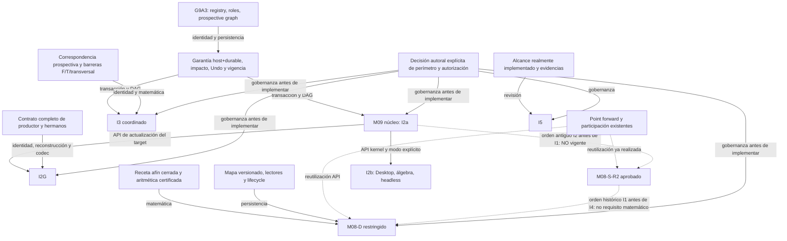

> **Sucesión autoral de 2026-11-02; candidato de continuación 2026-11-03.** La recomendación previa de cerrar exclusivamente M08-S-R2 queda sucedida como estrategia por la nueva dirección: conservar M08-S-R2 aprobado y estudiar como única ampliación funcional candidata la creación desde clic o Q. M08-D queda diferido por decisión autoral; M09/I2a/I2b, I2G e I3 se difieren por sus precondiciones ya documentadas. El arrastre general sigue como deuda separada. No se ha aprobado todavía el alcance reducido ni CU7 global. La integración clic bajo R6/R2/H1 existentes se implementa como candidato; una nueva admisión individual sin C1 requiere decisión normativa. Véanse el [informe sucesor](../validation/pre_g9b_cu7_general_creation_candidate_report.md), [diseño](pre_g9b_cu7_general_creation_design.md) y [texto normativo candidato](pre_g9b_cu7_general_creation_normative_candidate.md). Lo que sigue conserva el estudio anterior como historia y evidencia, sin reabrir su investigación M09.

# PRE-G9B-CU7 — Reassessment integrado de viabilidad y estrategia

Fecha: 2026-11-02, Europe/Madrid. Estado: **ESTUDIO COMPLETO COMO CANDIDATO PARA REVISIÓN; SIN IMPLEMENTACIÓN PRODUCTIVA**. `selfApproved=false`. Las recomendaciones no modifican la autoridad vigente ni cierran CU7.

## 1. Dictamen y decisión única propuesta

**Recomiendo la estrategia D, con separación técnica C de las deudas: consolidar el perímetro ya aprobado M08-S-R2 y proponer al autor un cierre de alcance expresamente reducido. No recomiendo reanudar ahora M09, I2G o I3, ni fabricar una ampliación pequeña para denominarla implementación de CU7. M08-D afín restringido es viable como proyecto independiente, pero no ofrece hoy una extensión de bajo impacto ya certificada y persistible.**

El paquete recomendado es **CU7-RS: disposición de alcance, trazabilidad de capacidades diferidas y preparación de revisión independiente**, sin nuevo comportamiento de producto. El perímetro reducido de CU7 sería exclusivamente **I1 — M08-S-R2**; otras capacidades mantienen sus aprobaciones propias, sin incorporarse tácitamente a este cierre. Una sola autorización puede adoptar ese perímetro, sus exclusiones y las modificaciones documentales enumeradas en §8. El [prompt ejecutor candidato](../../.github/prompts/tasks/pre-g9b-cu7-reduced-scope-disposition.prompt.md) está preparado, **no ejecutado**. Si el autor no aprueba explícitamente la reducción, CU7 global permanece abierto; no se sustituye su objetivo por una etiqueta de completitud.

Razones decisivas:

1. Las sondas históricas de M09/A0 descartan dos atajos concretos: setter+cascada no publica conjuntamente selector, claim y estado; XML por sí solo no restaura todo S0 ni Undo. No demuestran imposibilidad general. Demuestran que «singleton» no basta para justificar bajo impacto.
2. G9A3 ofrece piezas útiles y grupos completos, pero no un adaptador demostrado para separar una salida de un productor heredado. I3 añade correspondencia y barreras que una transacción común no resuelve.
3. M08-D tiene un camino matemático cerrado independiente de M09. Su coste real está en probar la receta y la aritmética, mantener su identidad y soportar persistencia/lectores; el certificado afín `double[]` actual no satisface automáticamente ese contrato.
4. CU3 y los puntos forward ya permiten construcciones explícitas útiles. Conservan valor sin atribuirles una proyección dinámica universal ni reabrir M08-S-R2.

Esta es una recomendación de inversión y alcance, no una conclusión de imposibilidad ni una decisión autoral. Cambiarla por una prioridad autoral concreta para M08-D restringido es técnicamente razonable, pero constituiría otro paquete y no se inicia por este estudio.

## 2. Encargo, base y método

Se retomó el encargo original del chat **«Analizar estrategia integrada de CU7»**, ID `01a19de3-5ab6-7fe1-aea3-4e5b0c349a0a`, y el [traspaso](../validation/pre_g9b_cu7_integrated_reassessment_handoff.md). El encargo solicita un estudio profundo de I2a/I2b, I2G, I3, I4 e I5, un paquete cerrado y un prompt para autorización posterior. Autoriza investigación, documentos y sondas aisladas; prohíbe implementar producto, adoptar normativa, publicar o modificar el libro. La instrucción actual reanuda el estudio pausado.

| Identidad inspeccionada | Valor |
| --- | --- |
| Base local y `origin/main` | `eea7f57b8a7e8be9f5fe9356a9f7f989dd7fdf17` |
| Árbol base | `d62179e72dd2bb37226cba5956198809467cb7c1` |
| `git ls-remote origin refs/heads/main`, revalidado al continuar | mismo commit; exit 0 |
| Rama del estudio, ya existente | `research/pre-g9b-cu7-integrated-reassessment` |
| Worktree del estudio | `C:/Users/usuario/Documents/ChatGPT/Geometría Descriptiva y CeDG/cu7-integrated-study` |
| Upstream fijado | `9b93256b7df401ff056c37b502d82df4d72b1522`, GeoGebra |

Clasificación: **planificación/diseño con auditoría de viabilidad y mantenimiento documental autorizado**. Capa afectada por el delta: documentación de arquitectura/validación y prompt candidato. Fuente de verdad: código, contratos y disposiciones aprobadas de la base. Informes y planes son derivados; no sustituyen contratos. Conjunto editable: los documentos nuevos de este estudio y su prompt. Validación mínima significativa: `STATIC` canónico y comprobación de formato/enlaces del conjunto guardado; no hay motivo para ejecutar suites de producto o modificar infraestructura.

Se separan cuatro tipos de afirmación: **hecho estático** leído en código/contrato; **evidencia histórica** ligada a su cohorte; **derivación** matemática o arquitectónica; **propuesta/estimación** aún no implementada. Las pruebas Java citadas se inspeccionaron, no se ejecutaron en esta continuación. No se repitieron las sondas negativas porque no cambió su hipótesis decisiva. Los anexos aportan las anclas y limitaciones:

- [M09, I2G y transacción](../validation/pre_g9b_cu7_integrated_m09_evidence.md).
- [I3, M08-D y alternativas](../validation/pre_g9b_cu7_integrated_i3_m08d_evidence.md).
- [Gobernanza y verificación integrada](../validation/pre_g9b_cu7_integrated_governance_verification.md).

`.github/copilot-instructions.md` no existe en esta base. El traspaso se conserva intacto. `CLAUDE.md` se mantiene intacto. No hay cambios en código, contratos aprobados, modelos, guías, infraestructura o `geocedg_book`.

## 3. Autoridad vigente y contratos preservados

La sucesión efectiva es: CU7-D aprobado el 2026-10-29; cambio operativo del 2026-10-30 que no reanuda M09/A0; cierre M08-S-R2 del 2026-11-02 que mantiene M09 bloqueado y CU7 abierto. La enmienda final de ADR0041 y el registro canónico de M08-S-R2 prevalecen sobre los encabezados históricos. La fila inicial del roadmap conserva un estado M08-S anterior; se registra como incoherencia documental, sin corregirla dentro del estudio.

El cierre M08-S-R2 corresponde al candidato `86438edabaed06a6509c1be37cf06278941e0e46`, árbol `96e90172201440739bfe8afb503059379c70ff70`. Su dictamen y smoke favorables son históricos y exclusivos de ese perímetro. No acreditan las operaciones pendientes ni una ejecución nueva en el árbol del estudio.

Se preservan explícitamente:

- Las tres identidades separadas: objeto P, definición/productor/roles/padres de P y solución/token propiedad de R. DA-5 permite mover P sin coincidencia; no transporta identidad entre raíces.
- DAG ordinario y grafo durable coherentes, cierre explícito, P3-R1 mínimo determinista y roles de productor completos. El frontier durable no es el impacto ordinario total.
- Versiones 1/2 de dependencia durable, migración solo en eventos aprobados, límites de ordinary refresh §10 y late participation §14. No se amplían a fuentes públicas.
- ADR0017/0039/0040: selector/procedencia, F/T/transversal, cuarentena/latencia/recuperación, integridad y política documental. Ni coordenadas iguales ni residuo pequeño prueban continuidad o STRICT.
- Locus semántico separado de muestras/render; coordenadas world, tolerancias y presupuestos explícitos. Ningún viewport, zoom, DPI, etiqueta o orden de creación decide identidad o métrica.
- Persistencia normal-form, copia con cierre y remapeo completo, Undo/Redo y lectores bajo sus contratos reales. No hay migración, rebind ni degradación automática nueva.
- M08-S conserva Q transitorio y punto forward durable. No se vuelve dinámico añadiendo una dependencia ficticia a Q.

## 4. Matriz de capacidades y destino

Las categorías en mayúsculas son recomendaciones del estudio. «Bloqueada» describe una precondición técnica, sin cambiar por sí sola el estado autoral. Costes relativos estimados por superficie y garantías pendientes, no por calendario.

| Capacidad | Estado y viabilidad | Dependencia decisiva / invasividad | Categoría recomendada |
| --- | --- | --- | --- |
| I1, M08-S-R2 | Implementado y AUTHOR APPROVED; fuera del trabajo pendiente | Reutilizar su protocolo dentro de su perímetro; ninguna reapertura | Preservar, sin nuevo incremento |
| I2a, evaluación/transacción M09 singleton | Diseño prospectivo aprobado; transacción segura no demostrada | Snapshot previo a parser/enrollment incluso sin ID; impacto ordinary+durable; escritores, Undo, claims y vigencia. Alta | **MANTENER BLOQUEADA HASTA RESOLVER UNA PRECONDICIÓN** |
| I2b, Desktop/álgebra/headless M09 | Comparte semántica con I2a; no constituye una solución solo de UI | Una evaluación kernel común y recuperación tipada; depende de I2a completa. Media adicional, alta acumulada | **MANTENER BLOQUEADA HASTA RESOLVER UNA PRECONDICIÓN** |
| I2G, salida seleccionada de productor multisalida | Grupos completos G9A3 existentes; separación de salida no demostrada | Productor/roles/grupo, slots internos, hermanos anónimos y consumidores, reconstrucción/codec. Muy alta para generalizar | **DIFERIR A FASE POSTERIOR** |
| I3, cambio coordinado soporte/conductor/fuente | Algunas rutas actuales admitidas; nueva operación coordinada sin contrato completo | Cierre prospectivo + correspondencia propia + barreras F/T/transversal verificadas. Alta/muy alta | **MANTENER BLOQUEADA HASTA RESOLVER UNA PRECONDICIÓN** |
| I4, M08-D afín cerrado certificado | Matemáticamente viable, independiente de M09; proveedor/receta/lectores pendientes | Certificado fuerte, aritmética, identidad mapa/dominio/componente y lifecycle. Media-alta | **DIFERIR A FASE POSTERIOR** |
| M08-D general, mínimos múltiples/singularidad/seams | Fuera de una primera clase cerrada; no hay regla de selección aprobada general | Contrato matemático y correspondencia, no continuación por historia. Muy alta | **MANTENER BLOQUEADA HASTA RESOLVER UNA PRECONDICIÓN** |
| Wrapper «D» que solo recalcula nearest o duplica una fórmula sin certificar L | No satisface el contrato D; no justifica un comando nuevo | CU3 o composición forward ya expresan los casos con procedencia/parámetro conocidos | **DESCARTAR LA PROPUESTA CONCRETA POR EXISTIR UNA ALTERNATIVA MEJOR** |
| I5, disposición/revisión de perímetro reducido | Ejecutable documentalmente; no implementa M09/D | Decisión autoral explícita de reducción + revisión independiente + candidato exacto | **IMPLEMENTAR EN CU7 SOLO CON PERÍMETRO RESTRINGIDO** |

No se recomienda ninguna nueva capacidad productiva en la categoría IMPLEMENTAR EN CU7 sin restricciones. Esto es resultado del análisis de costes/garantías, no de parar el estudio al primer bloqueo.

## 5. Arquitectura transversal y límite de reutilización

### 5.1 ¿Existe un subconjunto transaccional mínimo y cerrado útil para varias partes?

**Existen piezas comunes; no está demostrado en la base un subconjunto cerrado suficiente para M09 singleton, I2G e I3.** La respuesta positiva solo es válida para el alcance ya cubierto por G9A3: preparar un grafo durable/runtime, validarlo y publicarlo con sus contratos de roles. No equivale a una transacción general sobre la construcción GeoGebra ni a la garantía más fuerte de M09/A0.

Un núcleo candidato necesario para M09 e I3 tendría que abarcar: contexto anterior a construcción/enrollment; overlay sellado de padres e IDs prospectivos; validación simultánea host+durable y P3-R1; impacto ordinary+durable completo; vigencia por eventos; publicación de definición/registros/claims; frontera de observadores y escritores; restauración de S0 y Undo. Enumerarlo no demuestra su cierre. Las fronteras de callbacks, factories, setters, scripts, loader y Undo impiden afirmar que basta añadir un booleano o envolver XML.

| Pieza reutilizable | Utilidad concreta | Garantía que no aporta automáticamente |
| --- | --- | --- |
| `SpatialLifecycleTransaction` y prospective graph/runtime switch | Preparación y publicación de registros/runtime; compartirlo evita otro sistema durable | Snapshot host previo al parser, mementos de todo escritor, aislamiento de todo callback o restauración de Undo |
| `SpatialRedefineContext/Assessment/Transaction` y modos explícitos | Identidad, contratos, epochs, evaluación kernel y decisión de modo | Contexto M09 sin ID; freshness ABA universal; todos los nuevos puntos de escritura |
| `DurableDependencyProjection` | Regla única por versión y overlay prospectivo | Impacto ordinario completo, recetas de reconstrucción o correspondencia semántica |
| P3-R1 de A3 | `clamp(oldSlot, predecessorBound, dependentBound)` y orden no afectado | Cualquier topological sort, productor incompleto o testigos encontrados tras mutar |
| Claims/ledger y `AlgoLocusIntersectionPointV2` | Admisibilidad y lifecycle de puntos token | Commit M09 por setter; conservación de raíces entre definiciones incompatibles |
| Leases/callback scopes y rollback actuales | Cercas y rollback de las rutas ya admitidas | Cobertura del nuevo protocolo solo por invocarlos; la sonda A0 no se ejecutó como una nueva transacción M09 completa |
| M08-S-R2 | Dirección explícita, single-use, revisión y participación bajo su contrato | Redefinición de target, definición dinámica D o atomicidad de productores heredados |
| CU3 structural correspondence | Relación por procedencia y mismo soporte admitido | Inversión de Q arbitrario ni barrera automática para todo cambio coordinado |

M09 e I3 comparten requisitos transaccionales, pero I3 necesita además su contrato de correspondencia. I2G añade propiedad del productor/grupo. M08-D de **creación** puede usar participación normal y DAG forward; no exige reconstruir un target viejo. Por ello no se agrupan las cuatro capacidades en un framework común.

### 5.2 M09 e I2G: costuras mínimas y comparación upstream

Los detalles y casos P01–P11 constan en el anexo M09. P02 es una costura mecánica útil, no un commit de contrato. P07 observa prefijos; P08 entra en loader y cambia instancias/epochs; P09 no restaura Undo tras su almacenamiento. Un exit JUnit 0 que verifica estos resultados negativos no supera las puertas A0.

El proveedor de construcción ordinario es singleton neutral. G9A3 preserva grupos completos de igual conjunto de roles/cardinalidad; no permite arrancar una salida arbitraria. `AlgoIntersectLineConic` conserva estado conjunto y escribe sus dos salidas. Un proxy o slot interno nuevo necesita definir propiedad, reconstrucción y persistencia; no basta conservar las coordenadas del hermano. No se encontró un adaptador pequeño y completo demostrado para el perímetro requerido. Esto no descarta un adaptador futuro **por productor** con tabla cerrada y pruebas de todos los hermanos.

Inspección local contra el commit upstream fijado, mediante `git diff --numstat <baseline> HEAD -- <archivos>`:

| Archivo upstream bajo `source/shared/common/src/main/java/org/geogebra/common/` | Adiciones / eliminaciones acumuladas en la base |
| --- | --- |
| `kernel/Construction.java` | 1363 / 42 |
| `kernel/commands/AlgebraProcessor.java` | 348 / 37 |
| `kernel/Kernel.java` | 181 / 92 |
| `main/undo/UndoManager.java` | 5 / 0 |
| `kernel/algos/AlgoElement.java` | 6 / 2 |
| `kernel/algos/AlgoIntersectLineConic.java` | 48 / 0 |

Son deltas **preexistentes**, no cambios de este estudio ni estimaciones de implementación. Se inspeccionaron las costuras actuales y el diff pertinente. `UndoManager` solo añade ahí la ruta de almacenamiento para geos participantes; ese delta no es una API general de rollback de historial. Los cambios de `AlgoElement` comparados son de presentación de comandos, no detach. El upstream fijado sigue siendo el límite de comparación, sin actualizar dependencias ni asumir que una API nueva de upstream resolvería estas garantías.

El reparto sostenible sería kernel compartido para definición, DAG, identidad, claims y codec; cambios upstream solo en costuras demostradas de entrada/publicación/Undo; Desktop para presentar decisiones; herramientas externas para pruebas y análisis. No poner la transacción en Swing, el exportador o un script.

### 5.3 I3: correspondencia y barreras independientes

K01–K05 no quedan cubiertas por «el DAG se reconstruyó». Se distinguen cambio geométrico en sitio del mismo soporte, cambio de soporte de N, cambio de fuente/conductor bajo constructor compatible y cambio de lineage/familia. La firma del descriptor, el contrato de continuación y el selector efectivo no son el mismo dato. No se deduce la barrera K03 solo porque un descriptor contenga un nuevo support ID: hay que comprobar qué compara realmente la ruta de reutilización y la capa exterior de material/lineage.

La operación futura debe sellar una correspondencia total de participantes y evaluar F, T y transversales por separado. Debe conservar recuperación del mismo selector cuando corresponda; debe invalidar claims incompatibles aunque L o P retengan ID. La evidencia C/K5 histórica diferencia sin/cierre nuevo ya participado y conserva casos de mismatch registro/DAG. No demuestra el cambio coordinado completo, persistencia o todas las barreras. Este estudio no etiqueta esas observaciones como una regresión de las operaciones actualmente aprobadas.

### 5.4 M08-D: primera clase viable y alternativas

Para una componente elegida con dominio finito cerrado `[a,b]`, receta verificable `F(u)=B+A u` y `A≠0`:

```text
u0 = dot(A, Q-B) / dot(A,A)
u* = clamp(u0,a,b)
P  = B + A u*
```

La segunda derivada de la distancia al cuadrado es `2 dot(A,A)>0`: existe un mínimo único en ese intervalo. La unicidad es relativa a la componente declarada, no a otras ramas de L. El extremo abierto puede tener solo ínfimo; A=0, varias componentes, no finitos, pliegues y seams no se admiten por extensión implícita. La receta del mapa debe retener L, Q, componente/dominio y la procedencia de A/B, no el último u.

Oráculo analítico de ejemplo, sin atribuirlo a un objeto actual: `A=(2,3)`, `B=(1,-2)`, `[a,b]=[0,1]`, `Q=(3,0)` dan `u*=10/13` y `P=(33/13,4/13)`. Para `Q=B-A` el mínimo está en B; para `Q=B+2A`, en B+A. Son derivaciones exactas útiles para D01, no una prueba ejecutada del proveedor o de su reconocimiento constructivo.

**Implementación futura restringida posible:** reconocer una receta afín cerrada, demostrar vínculo con L y no colapso, registrar sus padres reales, usar prueba exacta o intervalos con redondeo exterior para el cociente/clamp y una cota de error world explícita. Si no puede decidir dominio/no colapso/precisión dentro del presupuesto, devolver causa tipada y coordenadas indefinidas. Tolerancia y residual no promueven STRICT. La identidad del mapa depende de la receta y correspondencia; los certificados se recalculan por revisión. Diseñar versión/lectores/copia/Undo antes de UI. Esto es una propuesta, no una API o un codec existente.

La interfaz actual `CertifiedAffineLocus2D` contiene coeficientes flotantes y firma; sus implementaciones admitidas no son un recognizer general de `B+A u`. No basta renombrar ese certificado o ajustar dos muestras. Incluso la clase pequeña exige decidir qué gramática/procedencia exacta reconoce y qué grado documental puede acreditar.

Alternativas actuales:

- **CU3 `Point(L,D)`** cuando D tiene procedencia y mismo soporte admitidos. Aporta correspondencia dinámica real, sin invertir Q arbitrario.
- **Construcción `Q → u → Point(L,branch,u)`** cuando el autor ya declara A/B/dominio coherentes con L. El parámetro dependiente participa en el DAG. La fórmula con Min/Max no recibe STRICT automáticamente: la tabla constructiva la clasifica como selección condicionada. No prueba la receta de un L arbitrario, ni D01–D08/U04 completos.
- Una perpendicular/intersección existente solo sustituye el caso cuya procedencia, unicidad y pertenencia a la componente se pueden justificar. No se declara equivalente para cualquier locus.

El proveedor D certificado sí añadiría valor: vínculo verificable L↔receta, clamp y estados tipados, cotas/validez y persistencia propias. Se difiere por coste medio-alto y alcance funcional inicial estrecho frente a estas composiciones; no porque dependa de M09 ni porque sea matemáticamente inviable. Se reconsidera con un caso autoral que requiera esas garantías, la gramática cerrada y la matriz de lectores fijadas. Un D general continúa bloqueado por políticas independientes.

## 6. Grafo real, caminos críticos y agrupación

Leyenda: flecha continua = requisito obligatorio para la nueva capacidad, indicando su tipo; punteada = reutilización conveniente u orden histórico, sin autoridad de ejecución. Los nodos «garantía» pueden ser obligaciones aún no demostradas.



| Dependencia | Tipo / fuerza | Consecuencia para el plan |
| --- | --- | --- |
| Host/registro/DAG/claims/Undo coherentes → M09, I3 | Transacción obligatoria | Compartir pruebas de la envolvente; no asumir que una implementación singleton la demuestra para I3 |
| Producer/group adapter → I2G | Identidad/reconstrucción obligatoria | I2G no es un checkbox de singleton; un productor admitido debe tener cierre completo |
| Correspondencia + barreras → I3 | Matemática/identidad obligatoria | No se elimina con un XML rebuild ni con retención de L |
| Receta afín + precisión + mapa/lectores → I4 | Matemática/persistencia obligatoria | Puede desarrollarse separado de M09 y sin nueva UI hasta superar estas puertas |
| Forward/participación → I4 | API necesaria; implementación actual reutilizable | No reutilizar nearest M08-S como autoridad dinámica |
| M08-S → I4, M09 → M08-S | Orden histórico, no dependencia de capacidad | No reabrir M08-S ni bloquearlo por M09 |
| Kernel válido → UI | API obligatoria; presentación al final | No desarrollar diálogos para una operación aún no demostrada |
| Autorización por perímetro → implementación/cierre | Gobernanza obligatoria | Una flecha técnica nunca autoriza el siguiente incremento |

Caminos críticos: para A/B, demostrar primero la envolvente M09; para I2G, además la propiedad completa del productor; para I3, además correspondencia/barreras; para D restringido, prueba afín/aritmética y codec/lectores. Para el paquete recomendado CU7-RS, el camino crítico es decisión de reducción → conciliación documental → revisión independiente → decisión de cierre. No hay camino crítico de reconstrucción de GeoGebra para ese paquete.

Si se autorizaran extensiones futuras, agrupar I2a/I2b y las pruebas comunes de M09/I3 en cohortes significativas. Mantener I2G y D con puertas de entrada específicas; no duplicar campañas completas por cada UI o ajuste incidental. No iniciar un framework general para obtener reutilización hipotética.

## 7. Comparación de estrategias A–D

Estimaciones relativas, no mediciones. El coste incluye cumplir garantías, no solo obtener coordenadas visibles.

| Estrategia | Valor funcional/científico y cobertura original | Upstream / contratos o formatos | Complejidad y acoplamiento |
| --- | --- | --- | --- |
| A — CU7 completo | Máximo: redefine singleton y grupos, soporte coordinado y D certificado. Cobertura completa solo después de todas las puertas | Alta/muy alta: costuras host, Undo/escritores, productor(es), contratos I3 y mapa D versionado | Muy alta; común transacción y varias garantías independientes. No viable como ampliación acotada inmediata |
| B — CU7 acotado con singleton | Alto valor de edición P; cobertura parcial, M09 sigue parcial sin I2G | Alta aunque no cambie el elemento XML: contrato nuevo y envolvente no demostrada | Alta; excluir grupos no elimina callbacks/Undo/impacto. No se acepta la premisa «singleton seguro» sin prueba |
| C — separación por viabilidad | Mantiene M08-S; D afín puede aportar garantía nueva y CU3/composiciones cubren casos. Cobertura parcial explícita | Baja si solo reutiliza capacidades; media-alta para nuevo certificado/codec D, sin reconstrucción M09 | Menor acoplamiento. D tiene una puerta científica y de lectores propia; no es automáticamente una extensión barata |
| D — disposición conservadora | Conserva todo el valor aprobado; no incorpora las funcionalidades pendientes. Permite cierre reducido solo por autor | Ningún cambio productivo; conciliación documental, deudas y decisión de perímetro | Baja para ejecutar la disposición, alta deuda funcional explícita. Preferida por relación entre valor adicional inmediato y riesgo |

| Estrategia | Identidad/DAG/persistencia y documentos existentes | Reutilización y verificación/smoke | Riesgo residual, diferimiento y reversibilidad |
| --- | --- | --- | --- |
| A | Riesgo máximo de cambio transversal; debe preservar carga no editada y probar nuevas recetas/lectores | G9A3, CU3, R6 y M08-S más R/K/D/U; productores focales y una campaña compuesta final autorizada; smoke de todas las superficies | Fracaso temprano puede exigir reconstrucción general. Diferir componentes rompe su promesa de cobertura total; reversión difícil tras publicar nuevos formatos |
| B | Persistir comandos actuales reduce formato nuevo, pero no prueba transacción ni backward-read semántico | Misma envolvente G9A3 más R/U y regresiones; smoke punto distante/Undo/rechazos. No atajo a validación | Deuda I2G/I3/D visible; M09 parcial. Reversible antes de publicar; no se vuelve B segura retirando solo hermanos |
| C | D puede aislar formato y lector; composiciones actuales conservan contratos sin atribuir certificado nuevo | Forward y CU3 reutilizables; D requiere D/U y pruebas matemáticas antes de UI; regresiones comunes una vez | Riesgo aritmético/receta de D permanece independiente. Diferimiento seguro sin nuevos registros; reversión simple antes de autoría de documentos nuevos |
| D | No cambia identidad, DAG o formato; documentos existentes siguen bajo los mismos contratos | Evidencia técnica aprobada se conserva por su cohorte; STATIC documental nuevo y revisión. Sin smoke productivo nuevo que inventar | Se pierde edición M09/cambio coordinado/D universal. Alta reversibilidad del plan; deuda de producto no desaparece. Riesgo principal: confundir cierre reducido con completitud, mitigado por denominación y exclusiones |

No se eligió A porque su alcance supera un desarrollo de CU7 acotado sin demostrar el núcleo. No se eligió B porque la precondición que la vuelve atractiva falló en sus atajos y sigue sin probarse. C es la buena separación arquitectónica para un futuro D priorizado; D es la decisión recomendada ahora. La garantía de D restringido no se sustituye por una demostración algebraica manual sin codec.

## 8. Paquete cerrado recomendado: CU7-RS

### Objetivo, resultado y límites

Resultado propuesto: documentar y, **solo después de autorización expresa**, adoptar que el perímetro reducido cerrable de CU7 es exclusivamente I1 — M08-S-R2. Otras capacidades conservan sus aprobaciones propias y no se incorporan a este cierre. M09/I2G/I3/M08-D quedan fuera como obligaciones identificadas, sin declararlas implementadas ni alterar sus contratos prospectivos. El producto no cambia.

La decisión única propuesta para el autor es: «Apruebo el perímetro reducido y autorizo CU7-RS con las exclusiones y deudas de este estudio, sin implementación productiva ni publicación; entregar candidato para revisión independiente». La decisión no aprobaría automáticamente las conclusiones técnicas del candidato ejecutado ni su promoción.

### Archivos y pasos internos propuestos, no realizados

1. Fijar commit/árbol de este estudio revisado y la decisión autoral que adopta la reducción. Verificar base `eea7f57...` o un descendiente expresamente seleccionado y su delta. Si no hay tal decisión, conservar CU7 abierto y parar la ejecución del prompt.
2. Crear `docs/validation/pre_g9b_cu7_reduced_scope_candidate.md`, inventario de implementado/diferido y mapa R/K/D/U. Crear `docs/validation/pre_g9b_cu7_deferred_capabilities_register.md` con §10, sin presentar IDs propuestos como deudas adoptadas antes de la decisión.
3. Añadir una disposición fechada de **alcance y estado**, sin reescribir historia, en `docs/architecture/pre_g9b_cu7_i_increment_proposal.md` y ADR0041; conciliar la fila inicial y el hito CU7 pertinente en `docs/roadmap/geocedg_roadmap.md`. Preservar contratos geométricos y el carácter prospectivo de M09/D. Si se necesitara cambiar una regla matemática/serializada, detener, no ampliar el paquete.
4. Registrar que el candidato es documental, `PRODUCT_PHASE_EFFECT=NONE`, `selfApproved=false`. Congelar un commit local limpio y guardar su SHA/árbol; ejecutar STATIC en su worktree y preservar comando, salida, informe y hashes externamente. Comprobar `git diff --check <sha-del-estudio-revisado> HEAD`, enlaces, consistencia de alcance y diff sin cambios productivos. No registrar una fase M09 ni ejecutar campañas de producto.
5. Entregar a revisión independiente de autoridad, trazabilidad, exclusiones y evidencia. Un hallazgo se corrige dentro del perímetro documental; una demanda de nueva capacidad se devuelve como cambio de alcance, sin implementación automática.
6. El registro de cierre autoral posterior, si se recibe decisión sobre SHA exacto y evidencia, se guarda en documento separado. Este paquete termina en candidato; no registra por anticipado `PASS — AUTHOR APPROVED`.

Conjunto editable exacto del futuro paquete: los dos documentos nuevos indicados, increment proposal, ADR0041 y los dos lugares CU7 del roadmap. No guías, specs M08/M09, registro de verificación, `source/`, modelos, libro, packaging, `CLAUDE.md` ni artefactos históricos. Un cambio de ruta necesario para una causa real requiere exponerla, no absorberla como limpieza.

### Puertas internas y contingencias

| Puerta | Condición de salida | Si falla |
| --- | --- | --- |
| RS0 — autoridad/base | Decisión expresa de reducción y SHA/árbol; contexto y delta compatibles | No ejecutar la disposición; CU7 global abierto |
| RS1 — exactitud de inventario | Cada capacidad y deuda tiene estado y evidencia; ningún «pendiente» se convierte en implementado | Corregir texto dentro del paquete; no tocar producto |
| RS2 — aislamiento documental | Solo rutas autorizadas; ninguna regla geométrica/codec/policy cambia | Detener y delimitar conflicto; no ampliar a M09 o D |
| RS3 — validación | STATIC completo y confiable, formato y enlaces guardados; diagnósticos separados | Clasificar entorno/permiso/check real. Conservar fallo; usar escalación gestionada si corresponde, sin parche de producto |
| RS4 — revisión/cierre | Revisión independiente y posterior decisión autoral del candidato exacto | Seguir como candidato sin aprobación; sin push/merge/etiquetas |

No se añade un mecanismo nuevo de rechazo de operaciones. La documentación debe distinguir los rechazos/no disponibilidad actuales de los códigos tipados propuestos por M09. Excluir I3 no prohíbe las redefiniciones de fuente ya admitidas. No se llama «corregido» a un diagnóstico silencioso solo porque se haya documentado.

## 9. Plan integrado de pruebas y aceptación

La matriz completa común/específica y las regresiones figuran en el anexo de gobernanza. Los IDs se conservan como obligaciones; no se marcan PASS por lectura ni por diferimiento.

| Cohorte futura | Casos y oráculos | Uso de la evidencia |
| --- | --- | --- |
| Envolvente común M09/I3 y cualquier grupo autorizado | R08/R10/R11/R13–R15; U01–U03/U05; snapshot previo a parser, target sin ID, ciclos mixtos, ABA intermedio, IDs/high-water, callbacks/reentrada, fallo en cada frontera y Undo | Pruebas focales antes de UI; mismo núcleo se reutiliza, ampliando escritores por capacidad. Igual XML no es todo S0 |
| Semántica M09 singleton | R01–R07/R12/R16: P distante, VALUE↔token, dueño exacto, admissibilidad, roles, downstream degenerado y rechazo de nueva I3 | No retener por clase o coordenadas; no fallback automático; R09 debe rechazar antes de mutar |
| I2G | R09/R10–R15 y U01–U04/U06 para cada productor y todos sus hermanos, incluidos anónimos | Admisión solo con adaptador total, recipe y roles aprobados; sin soporte genérico inferido |
| I3 | K01–K05 + R11/R13–R16 + U01–U06; F/T/transversal por separado; cambio en sitio/soporte/source/lineage y vuelta | Retención de objeto separada de raíz; comparación de selector efectivo, claims, split/merge y barreras, no solo descriptor |
| D restringido | D01–D08 + U01–U06: referencia analítica, dominio abierto/cerrado, colapso, no finitos, ambigüedad, pérdida/recuperación, historia/caché, política, lector previo y corrupto | Prueba matemática + aritmética + recipe/lectores antes de UI; sin mínima distancia por muestreo como autoridad |
| Regresión compartida | G9A3/A3/R3, CU3 F/T y estructurales, R6, M08-S-R2; corpus/Classic/spline/transformaciones/DXF/LaTeX según U06 y delta real | Guardar cohortes e inventario del registro; no convertir smoke o prueba histórica en ejecución actual |
| CU7-RS recomendado | Estado M08-S y bloqueos; exclusiones/deudas; enlaces, diferencias, STATIC; revisión de autoridad y del prompt | Evidencia documental solamente; no exige un smoke de capacidades no implementadas |

Durante un futuro desarrollo: selecciones focales registradas y pruebas adversarias tras cada cambio significativo; no una campaña completa por ajuste pequeño. Antes de aceptación: congelar cohorte completa, resolver planes y obtener autorización del nivel requerido. En esta base INTEGRATION y FINAL PlanOnly resuelven 46/68 nodos; los nodos comunes son idénticos y no faltan nodos INTEGRATION en FINAL. Los logs conservados son planificación, no acceptance.

No existe una fase M09/CU7-integrada registrada; debe registrarse con su autorización antes de invocarla. `DEV` y `OPERATIONAL` están incompletos; no se usan como sustituto ni se repara infraestructura para este estudio. Una futura selección integrada puede evitar duplicación de PHASE/INTEGRATION/FINAL **solo tras verificar contención real después del registro**, sin omitir smoke específico o dominio semántico. El nivel final lo gobiernan autoridad activa y autorización, no la sección archivada de verificación.

Si se autoriza FINAL: una campaña sobre candidato inmutable, cada productor requerido una vez, informe confiable/completo y receipt ligado a commit/árbol/plan/checkers/entorno/inputs; no atribuirle pasos de smoke no ejecutados. Si la autorización requiere nivel menor, registrar ese alcance y no llamarlo FINAL. Diagnósticos documentales/gobernanza/duración no cambian aceptación. Closeout solo inspecciona identidades, no repite aceptación ni modifica Git.

Smoke técnico futuro, solo de lo realmente incluido: Desktop/álgebra/headless con P distante, selección explícita/cancelación, estados inválidos, Undo/Redo, copia y reapertura; hermanos si I2G se implementa; soporte/conductor F/T/transversal si I3 se implementa; Q dinámico y extremos/collapse si D se implementa. El smoke autoral es una decisión/evidencia separada. No se ejecutó ninguno de esos casos productivos en este estudio.

## 10. Diferimientos precisos y condiciones de reconsideración

Los identificadores `PROP-DEBT-*` siguientes son **propuestos**, no registros de deuda adoptados por este estudio. La ejecución autorizada de CU7-RS los registraría con propietario de fase, sin inventar persona o fecha límite.

| Obligación propuesta | Pérdida temporal y operación fuera de alcance | Contratos que se conservan | Evidencia que permite reconsiderar / efecto sobre cierre |
| --- | --- | --- | --- |
| `PROP-DEBT-CU7-M09-TRANSACTION` | No nueva redefinición pública P conservando identidad por el protocolo M09; tampoco UI que la simule | DA-5, predicado cerrado, modos explícitos, claims, P3-R1, snapshot/Undo y sin rebind; rutas actuales intactas | Envolvente completa con escritores inventariados, ordinary+durable, ABA, target sin ID y fallos; R01–R16/U. Bloquea cierre original, no un perímetro reducido aprobado |
| `PROP-DEBT-CU7-I2G-PRODUCER-ADAPTER` | No separar output de productor conservando hermanos por M09; singleton futuro seguiría M09 parcial | Roles completos/cardinalidad/procedencia; no detach o mapping por índice/etiqueta | Adaptador por productor, ownership de slots, receta/lectores y R09/U con hermanos anónimos y consumidores. Impide declarar M09 completo |
| `PROP-DEBT-CU7-I3-COORDINATED-CLOSURE` | No nueva operación coordinada N/L/soporte; no supuesta continuidad por mismo dibujo | Ordinary refresh/late participation limitados; constructor/selector/lineage F/T/transversal y grados CU3 | Contrato de overlay/correspondencia y barreras efectivas K01–K05 + fallos/Undo/copia/lectores. Mantener admitidas las rutas actuales; bloquea alcance original |
| `PROP-DEBT-CU7-M08D-AFFINE-MAP` | No P que siga Q mediante proyección afín certificada como operación M08-D nueva | M08-S estático, CU3 por procedencia, forward por parámetro, política y formatos existentes | Caso de valor autoral, gramática afín cerrada, prueba ideal y aritmética, mapa persistente y lectores; D01–D08/U. No necesita resolver M09 |
| `PROP-DEBT-CU7-M08D-GENERAL-CORRESPONDENCE` | No mínimo general/ramificación/monodromía resueltos por historia | Ambigüedad y undefined explícitos; no nearest como identidad | Política matemática por clase, correspondencia/receta y garantías independientes; sin ampliación automática del afín |
| Rechazos/recuperación tipados M09 | No se promete el vocabulario nuevo en todas las superficies actuales | Las causas y límites existentes; distinguir no disponibilidad de error tipado implementado | Se incorpora al mismo paquete productivo que la operación, no por arreglo documental |

El diferimiento seguro consiste en no crear registros/mapas nuevos y conservar las operaciones ya aprobadas. La futura revisión debe partir de fuentes/contratos y delta nuevo, no repetir las mismas sondas negativas esperando otro resultado. No se convierte una deuda transaccional en una dependencia de CU10 ni del libro.

Obligaciones separadas conservadas: `DEBT-CU7-GENERAL-LOCUS-V2-POINT-DRAG`, restricción configurable de ramas/componentes, `DEBT-CU3-EXACT-TANGENCY-GENERALIZATION`, CU10, `CU10-GUIDE-INTEGRATION-CHECK`, expediente E1 y trabajo editorial. Este estudio no registra su aprobación, ejecución o cierre, ni modifica su orden autoral.

## 11. Riesgos residuales y propuesta exacta de cierre

| Riesgo | Control o contingencia |
| --- | --- |
| Extrapolar sondas negativas a imposibilidad universal | Limitarlas al mecanismo/fixture/cohorte; alternativa futura puede demostrar otra envolvente sin contradecirlas |
| Confundir certificado afín flotante y prueba ideal/numerical | Gate de receta/aritmética/política, antes del codec y de UI; no adaptar el nombre para evitarlo |
| Confundir support ID del descriptor con barrera de continuación | Comparar selector efectivo, contrato y capas de lineage para cada familia; evidencia K separada |
| Llamar «bajo impacto» a excluir grupos | Coste transaccional/Undo/observadores sigue íntegro; detener B si no demuestra su precondición |
| Cierre reducido interpretado como implementación total | Nombre de perímetro y lista explícita de excluidos en decisión, roadmap, candidato y cierre; conservar puertas pendientes |
| Que conciliar estado reescriba historia o normativa científica | Enmiendas fechadas solo de estado/alcance, cambios mínimos y revisión independiente |
| PlanOnly o evidencia histórica confundidos con acceptance | Etiquetas/cohortes/identidades y logs separados; ningún PASS de producto nuevo en este estudio |

Cuatro resultados de cierre posibles, sin mezclarlos:

1. **CU7 completo:** solo con implementación y aceptación de todo su alcance, incluidos I2G/I3/D según contrato y decisión autoral. No disponible hoy.
2. **CU7 — alcance reducido M08-S-R2 — PASS — AUTHOR APPROVED:** posible solo tras decisión autoral expresa de reducción, candidato conciliado, revisión independiente y aprobación exacta. Debe acompañarse de «M09/I2G/I3/M08-D no implementados; diferidos/bloqueados». Es la ruta recomendada; no se adopta aquí.
3. **Cierre parcial M08-S-R2 y CU7 global abierto:** estado vigente, también resultado correcto si el autor no reduce el alcance. No exige reabrir M08-S.
4. **CU7 abierto por requisito indispensable:** si el autor mantiene M09/D u otra capacidad como indispensable, su bloqueo sí impide cerrar globalmente; no se declara universalmente indispensable por el mero orden antiguo.

I5 revisa evidencia y alcance; no crea funcionalidad, no elimina deuda y no origina aprobación. Una decisión futura de scope no cambia las aprobaciones técnicas históricas. Publicación, promoción, releases y libro siguen fuera.

## 12. Entrega, inventario y evidencia de validación

**Inspeccionado:** `AGENTS.md`; prompts canónicos y task template; ADR0017/0026/0029/0039/0040/0041; CU7-D/diseño/incrementos/gates/M08/M09; cierre M08-S-R2 y roadmap; G9A3/A3/P3-R1/durable frontier; código/tests y sondas referidos con anclas en los tres anexos; upstream fijado y sus costuras. El inventario por subsistema y los límites de lectura están en los anexos. No equivale a lectura exhaustiva ni ejecución de todas las suites.

**Archivos nuevos del estudio:** este informe; los tres anexos; el prompt candidato. Se incorpora además el traspaso preexistente sin cambiar sus bytes. No se cambian fuentes productivas ni archivos normativos existentes. Capa: documentación de investigación y operación candidata. Efecto semántico/compatibilidad: ninguno.

`CHANGE_ROUTE=ORDINARY`; `VERIFICATION_CLASS=DOCUMENTATION_STATUS_ONLY` como clasificación del delta documental, sin reactivar mecanismos archivados. `PRODUCT_PHASE_EFFECT=NONE`. `BOOTSTRAP IMPACT — NO CHANGE REQUIRED`: no cambian instalación, herramientas, runtimes, entorno ni supuestos consumidos por bootstrap. `VERIFICATION_INFRASTRUCTURE_IMPACT=NONE`. `GUIDE_IMPACT=NONE` para el estudio; las obligaciones pendientes de integración de guía/CU10/E1 permanecen.

La evidencia se guarda externamente al candidato para evitar auto-referencia y mutación posterior. Directorio previsto: `artifacts/pre-g9b-cu7-integrated-reassessment/continuation-20261102/` del repositorio principal; `plans/` conserva copias verificadas de PlanOnly y su procedencia. El resumen externo registra commit/árbol del candidato, hash de archivos, comandos, exits y rutas; el informe STATIC es autoridad de su ejecución. Comando de comprobación: `& tools/agent/verify.ps1 -Profile STATIC -LogDirectory <directorio-nuevo>`, desde el worktree del estudio tras congelar un commit local limpio. El resultado efectivo se comunica con la entrega y se preserva en `delivery.json`; este documento no preatribuye un resultado antes de ejecutarlo. STATIC no es una aceptación de funcionalidades CU7 nuevas y no genera un receipt FINAL.

Se omiten justificadamente: experimentos productivos nuevos, suites Java/runtime, PHASE, INTEGRATION, FINAL, packaging y smoke productivo, por delta exclusivamente documental y prohibición de implementar. Las resoluciones PlanOnly guardadas se distinguen de esa omisión. No hay aprobación autoral del estudio, reducción efectiva, implementación del prompt, push, merge, tag, release o promoción.

El estudio entrega los diez componentes del encargo: dictamen (§1), matriz (§4), grafo (§6), arquitectura (§5), paquete (§8), pruebas (§9/anexo), riesgos (§11), diferimientos (§10), cierre (§11) y prompt canónico candidato. Los desconocidos técnicos quedan delimitados como puertas de las capacidades futuras; no como análisis omitido ni supuestos de PASS.
