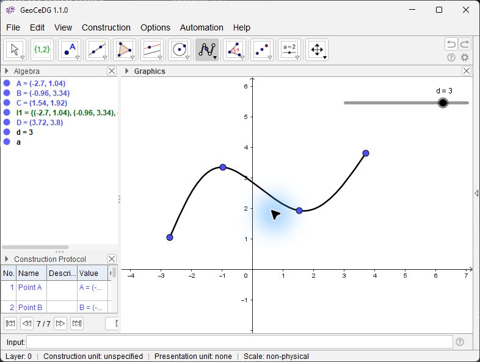
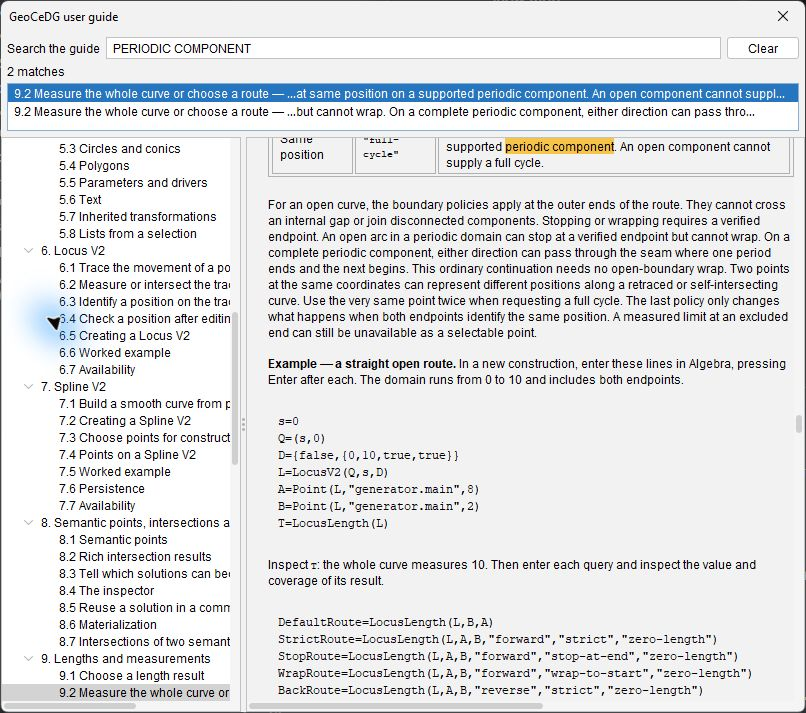
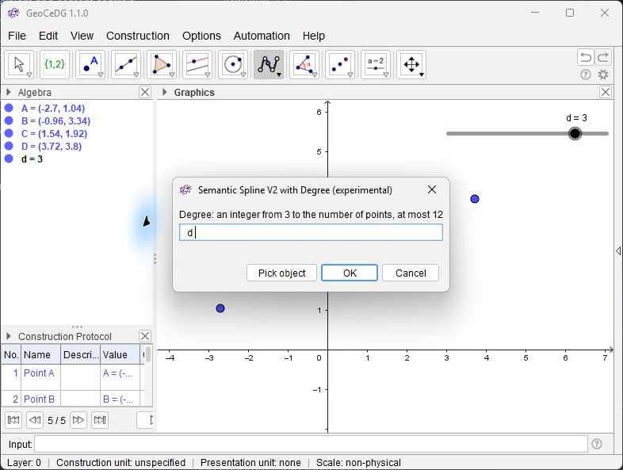
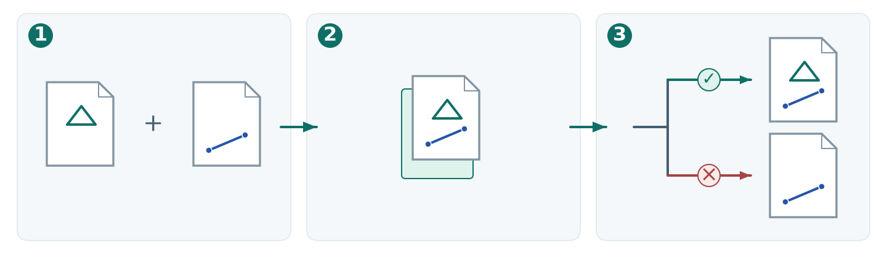
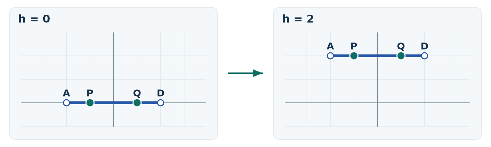
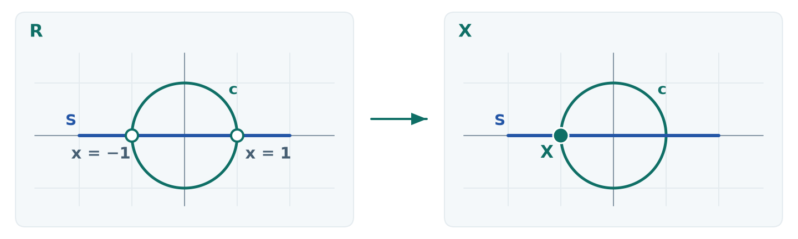
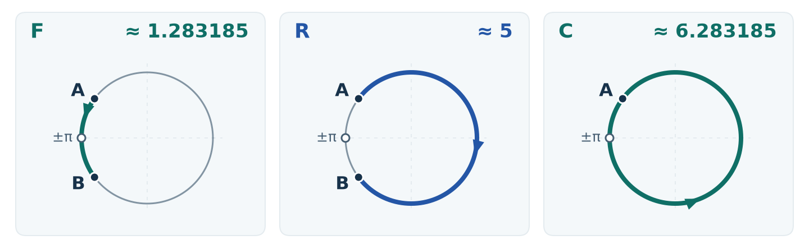
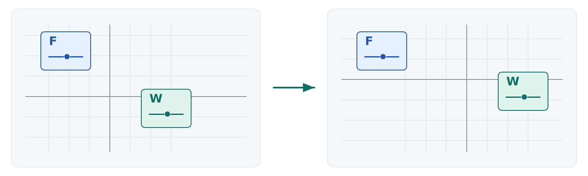
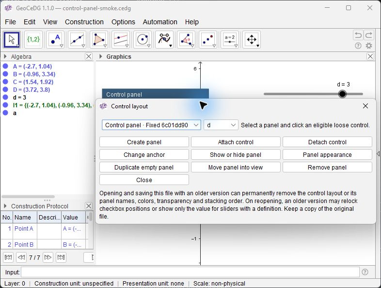

<!-- geocedg-guide-section: about-this-guide -->
# GeoCeDG user guide

GeoCeDG 1.1.0 · English edition

Start with [Your first construction](#getting-started/2.7), look up a tool
in the [reference](#command-and-workflow-reference), or press **Ctrl+F** to
[search the guide](#getting-started/2.8). For an unexpected result, see
[Troubleshooting and known limits](#known-limitations).

Feature marks used in both editions:

- **[N] New in GeoCeDG** — a capability introduced by the fork.
- **[A] Extended in GeoCeDG** — an addition to an inherited capability.
- **[G] Inherited from GeoGebra** — a capability already in the pinned baseline.
- **[!] Experimental or subject to significant limits** — check the linked scope before relying on it.

---

<!-- geocedg-guide-section: what-is-geocedg -->
## 1. What is GeoCeDG

GeoCeDG is a dynamic geometry platform for **Computer-Extended Descriptive
Geometry (CeDG)**. It complements CAD for reasoning about spatial problems
through explicit projections and constructions. Build with graphical tools or
type into Algebra Input. Changes to a starting object propagate to the objects
that depend on it.

### 1.1 Build with relationships

Create a segment between two points and move one of them. The segment and its
length change together. Use **Construction Protocol** to step through the
construction, and Algebra to check an object's definition. The same idea lets
you trace a curve from a point that depends on another point.

### 1.2 Work with projections alongside CAD

For example, you can study a spatial problem by constructing its projections
as related planar drawings and checking how they respond to a change in the
inputs. That is a use of descriptive geometry for 3D reasoning. The GeoCeDG
workspace documented here provides 2D tools and leaves the relationships
between projections to your construction. Automatic spatial reconstruction
and native 3D object associations are outside its current scope. You can
dimension the drawing and exchange supported 2D geometry with CAD through
[DXF export](#dxf-export). See [known limits](#known-limitations) for view and
compatibility boundaries.

### 1.3 Version and status

**Help → About GeoCeDG** shows version **1.1.0**, the version date
**2026-10-15** and the build identifier. It also shows the *distribution condition* and the notices for the copy you are running.
Installed copies may show **INTERNAL EVALUATION — NOT FOR REDISTRIBUTION**
or **NON-COMMERCIAL DISTRIBUTION — PROFILE NC**. A *development build* is
labelled separately. About points to the full terms, including EUPL-1.2
and CC BY 4.0 for the applicable GeoCeDG components.

### 1.4 What GeoCeDG adds to GeoGebra

This comparison covers the pinned **GeoGebra Classic 5.4.928.0** source
revision `9b93256b7df401ff056c37b502d82df4d72b1522`.

| Capability | Contribution | Tools or commands | Practical application | Guide link |
| --- | --- | --- | --- | --- |
| Basic dynamic geometry | **[G]** Points, lines, conics and polygons keep their construction dependencies. | Point, Segment, Circle, Polygon | Change a starting point and watch the construction update. | [Basic geometry](#basic-geometry) |
| Semantic curves | **[N] [!]** Locus V2 and Spline V2 give a curve a parameter you can use to locate a point and measure a path. | `LocusV2`, `SplineV2` | Trace a moving point or fit a smooth curve from a point list. | [Locus V2](#locus-v2/6.5) · [Spline V2](#spline-v2/7.2) |
| Points and intersections | **[A] [!]** `Point` and `Intersect` gain V2 forms. Intersections can return a result you inspect before creating points. | `Point`, `Intersect`, Inspect rich result | Choose a position on the curve or review the intersection solutions. | [Points on curves](#semantic-points-intersections-materialization/8.1) · [Intersection results](#semantic-points-intersections-materialization/8.2) |
| Tangencies and creating points | **[G]** Ordinary Tangents. **[A] [!]** V2 crossings can become points when admitted. Certain contacts have an explicit construction through the driver. | Tangents, Create selected intersection point, `Intersect(L,r,D)` | Keep a supported crossing or a proved contact as part of the construction. A tangency reported in an inspector does not by itself authorize point creation. | [Which solutions can become points](#semantic-points-intersections-materialization/8.3) · [Structural points](#semantic-points-intersections-materialization/8.6) |
| Length and traversal | **[A] [!]** `Length` can measure supported V2 curves. **[N] [!]** `LocusLength` adds evidence and lets you choose a traversal where supported. | `Length`, `LocusLength` | Measure a whole curve, an arc between two points, or a full circuit of a supported periodic branch. | [Traversal and length](#lengths-and-measurements/9.2) |
| Dynamic validity | **[G]** Objects update with their inputs. **[A] [!]** V2 positions and selected intersection points report when they lose validity after an edit. | Inspect definition…, Inspect rich result | Check whether a retained point is still usable after moving a driver. | [Check after editing](#locus-v2/6.4) · [Keep or recover a point](#semantic-points-intersections-materialization/8.6) |
| Construction steps, memory and orientation | **[A]** The inherited protocol adapts row height. Parallel and Perpendicular can each remember a reference during the session. Supported results can show a direction cue. | Construction protocol, Parallel Line, Perpendicular Line, Show orientation cue | Review a construction step or repeat a family of aligned lines. | [Construction protocol](#interface-and-workflow/3.8) · [Lines and reference memory](#basic-geometry/5.2) |
| Document units, dimensions and sheets | **[N]** Set a unit for the drawing, add engineering dimensions and define an ISO A border. | Document units…, `AlignedDimension`, `LinearDimension`, `IsoABorder` | Prepare a scaled sheet with readable dimensions. | [Units](#documents/4.6) · [Dimensions](#lengths-and-measurements/9.5) · [ISO A sheets](#documents/4.7) |
| Presentation and layers | **[A]** The inherited object styles and numeric layers gain presentation controls and a working layer. | Preferences, Working Layer, layer visibility | Group construction objects by layer and hide auxiliary work while checking the drawing. | [Presentation](#presentation-and-visualization) · [Working layer](#presentation-and-visualization/12.5) |
| Native documents and insertion | **[N]** Save as `.cedg`, insert supported constructions with checks, or review an expert trial before deciding. **[!]** Admissible sources depend on the route. | Save as…, Insert File…, Insert with expert review… | Bring an existing construction into a drawing and review the changes before confirming when expert review is available. | [Document formats](#documents/4.1) · [Insertion](#documents/4.2) |
| Controls and panels | **[G]** Sliders, buttons, check boxes and input boxes. **[N] [!]** Fixed or canvas-anchored panels for eligible controls in Graphics 1. | Slider, Button, Check Box, Input Box, Control layout | Keep controls together when you move around the drawing. | [Control panels](#presentation-and-visualization/12.6) |
| DXF exchange | **[N] [!]** Export supported 2D objects, with fidelity and approximation information. | Export 2D geometry as DXF (experimental)… | Hand off linework to CAD after checking what the export can represent. | [DXF export](#dxf-export) |
| User tools and Classic | **[G]** Custom tools can be stored in `.ggb` drawings. **[A]** GeoCeDG adds a tool manager, toolbar pins and an installed library. It also launches a separate Classic diagnostic session. | User tools, Open Classic diagnostic session | Reuse a tool or check an older construction within the compatibility limits. | [User tools](#user-tools-and-automation) · [Classic](#classic-compatibility-and-diagnostics) |


---

<!-- geocedg-guide-section: getting-started -->
## 2. Getting started

### 2.1 Starting GeoCeDG

Start GeoCeDG from its installed shortcut. The window title reads
`GeoCeDG 1.1.0`, or `GeoCeDG 1.1.0 — <file name>` once a document is open.

If you are working from a prepared source checkout instead of an installed
copy, the product profile is launched through the Gradle task
`:desktop:desktop:runGeoCeDG`. No additional argument is required to obtain the
capabilities described in this guide, except two that belong to an installed
copy only: the bundled GeoCeDG tool library (section 13.2) and a verified
distribution condition (section 1.3). A source checkout runs as a development
build without them.

### 2.2 The main window

GeoCeDG opens in the **CeDG Construction** workspace, which is the product
workspace. Its default layout provides:

- the **Graphics** view, with visible axes and no grid;
- the **Algebra** view;
- the **Construction Protocol**;
- the **Algebra Input** bar, with input help.

The **Spreadsheet**, **CAS** and **Object Properties** views are available
and initially closed. A saved document or preference can supply a different
layout. **View → Restore Construction layout → CeDG Construction** restores
the product layout.



*GeoCeDG Desktop in English. Algebra and the Construction Protocol are to the left of the drawing. Algebra Input is below it.*

### 2.3 Product language

GeoCeDG offers two product languages: **English** and **Spanish**. English is
the fallback when no other choice applies.

Choose the language under **Options → Product language…**.
The choice affects menus, dialogs and in-application help, including which
edition of this guide **Help → GeoCeDG user guide** opens.

### 2.4 Preferences

**Options → Preferences…** opens the global configuration. Opening it does not
select an object.

The **Layout & Presentation** tab holds the GeoCeDG presentation settings: the
presentation theme and the presentation sizes described below, the
**New document units** group (section 4.6), the **Dimension presentation**
group (section 9.5) and the **Orientation cue** option (section 5.2).

### 2.5 Presentation themes

A presentation theme selects the colours of known interface surfaces. There are
exactly three, chosen under **Preferences → Layout & Presentation → Theme**:

| Theme | Character |
|---|---|
| **Original** | The historical GeoCeDG appearance. This is the default and the fallback. |
| **Scientific Paper** | A warm, low-contrast palette suited to printed-paper work and screenshots for publication. |
| **Cool Geometry** | A cool, neutral palette with a slightly brighter canvas. |

A theme changes only presentation surfaces — frame, menu and toolbar surface,
panels, the Graphics canvas background and separators. It never changes object
colours, styles, visibility, axis or grid meaning, export output, or anything
stored in a document. The choice is a user preference: it survives restart and
is not affected by opening a document.

### 2.6 Presentation sizes

**Preferences → Layout & Presentation → Presentation sizes** offers six
independent controls:

| Control | What it governs | Default |
|---|---|---|
| General UI font size | Input bar, command help, ordinary dialogs | 12 pt |
| Menu font size | The menu bar and its items | 14 pt |
| Toolbar icon size | Toolbar buttons, including pinned user tools | 28 px |
| Algebra font size | The Algebra view and its editor | 12 pt |
| Construction Protocol font size | The protocol table and navigation | 12 pt |
| Graphics font size | Axes, coordinates and object labels in Graphics views | 12 pt |

These are independent: none is derived from another. The font of construction
**Text** objects is a separate setting (**Text font size**) and is not part of
this group, because a Text object belongs to the document.

All six are user preferences. They are never written into a construction and
never appear in a saved file.


### 2.7 Your first construction

Try a construction that changes as you work. In a new drawing, type
each line into **Algebra Input** and press **Enter** after each one.

```text
A=(0,0)
B=(3,4)
s=Segment(A,B)
d=Length(s)
```

Check that `d` is 5 in Algebra. Choose **Move**, drag `B` and watch the
segment and its length change. If the input bar is hidden, turn it on from
**Automation → Algebra Input**. The examples use English command names and a decimal point
within commands.

### 2.8 Search the guide

Open **Help → GeoCeDG user guide**. Use the tree on the left to open a
section. Press **Ctrl+F** or click the search field. Try `orientation` or
`LocusLength`. Each result shows its section and a short excerpt.
Activate a result with the mouse, or move down to the list and press
**Enter**. The document scrolls to the match and the tree marks its
section. Search ignores case and accents and lists up to 200 matches. Refine your
query if there are more. Press **Esc** or use the
clear button to return to normal browsing. After changing the product
language, reopen the guide to read the other edition.

Click a link to follow it. With the keyboard, press **Alt+Right** or
**Alt+Left** to move among links and **Enter** to follow the selected link.



*Guide window in English. The selected search result highlights the match in the text and selects its section in the tree.*

---

<!-- geocedg-guide-section: interface-and-workflow -->
## 3. Interface and construction workflow

### 3.1 Views

- **Graphics** is where you construct and where the current tool acts.
- **Algebra** lists the objects with their value, description or definition,
  depending on the display mode chosen under **Options → Algebra display**.
- **Construction Protocol** (**View → Construction inspection → Construction protocol**) shows the
  construction as an ordered sequence, which is the direct reading of its
  dependency structure. **View → Construction inspection → Show construction navigation bar** toggles the
  step control attached to the Graphics view; it creates no objects and no undo
  step.
- **Algebra Input** accepts commands and definitions.

### 3.2 Menus

Use the menu bar to find tools by task. The individual Construction tools are listed below. See the [reference](#command-and-workflow-reference) for inputs and shortcuts.

| Menu | What you can do |
|---|---|
| **File** | Direct entries include New file, Open…, Open recent…, Open Classic diagnostic session, Save, Save as…, Print preview…, Graphics View as Picture…, Export 2D geometry as DXF (experimental)…, PSTricks…, PGF/TikZ…, Asymptote…, Define export area…, Use Export_1 and Export_2, Show export area, Clear export area, Define ISO A export area…, Use selected ISO A border, Close. **Insert** opens a submenu with Insert File…, Insert with expert review…, Apply Styles…. Expert review is available by default (section 4.2). |
| **Edit** | Undo, Redo, Move, Move around Point, Working Layer, Select Objects, Attach / Detach Point, Delete. See [Menus, preferences and shortcuts](#command-and-workflow-reference/16.6). |
| **View** | **Views** toggles Algebra, Graphics2, Spreadsheet, CAS and Object Properties. **Visibility and style** — Show / Hide Object, Show / Hide Label, Copy Visual Style, Show orientation cue, Control layout. **Navigation** — Move Graphics View, Zoom to rectangle, Zoom In, Zoom Out, Zoom Factor In, Zoom Factor Out, Standard view, Show all objects. **Construction inspection** — Construction protocol, Show construction navigation bar, Inspect definition…. **Configure navigation zoom...** sets shortcuts and zoom factor. **Restore Construction layout** restores the CeDG Construction workspace. Dihedral procedures is unavailable. |
| **Construction** | Choose a tool by group in the next table. |
| **Options** | **Algebra display** (Value, Description, Definition), Sort by, Rounding, Labeling, Text font size. Direct entries: Preferences…, Axes, Grid, Product language…, Show solution markers, Auto-create eligible points for new explicit queries, Document units…, Save Settings. |
| **Automation** | Algebra Input, Legacy laboratory (separate session), Object properties and scripting…. Open **User tools** to manage tools in the document or use the [GeoCeDG library](#user-tools-and-automation/13.2). |
| **Help** | Input help, Current tool help, Command list, GeoCeDG user guide, Keyboard shortcuts, About GeoCeDG. |

| Construction submenu | Entries |
|---|---|
| Points | Point, Point on Object, Midpoint or Center |
| Lines and vectors | Line, Segment, Ray, Vector, Segment with Given Length, Vector from Point |
| Polygons | Polygon, Polyline, Regular Polygon, Rigid Polygon, Vector Polygon |
| List tools | Create List from Selection |
| Derived constructions | Parallel Line, Perpendicular Line, Perpendicular Bisector, Angle Bisector |
| Parameters and drivers | Slider, Angle with Given Size, Check Box, Button, Input Box, Animate selected object, Text |
| Relations and intersections | Intersect, Tangents, Relation, Polar or Diameter Line, Inspect rich result, Create selected intersection point, Create selected intersection points, Create all eligible intersection points |
| Circles and conics | Circle with Center through Point, Circle through 3 Points, Circle: Center & Radius, Circular Arc, Conic through 5 Points, Ellipse, Parabola, Compass, Semicircle, Circumcircular Arc, Circular Sector, Circumcircular Sector, Hyperbola |
| Semantic curves | Locus V2, Point on Locus V2 from reference, Point on semantic curve (explicit address), Spline V2, Spline V2 with degree, Closed Spline V2, Inspect semantic curve definition… |
| Metrics and validation | Angle, Distance or Length, Aligned Dimension, Linear Dimension, Total semantic locus length (experimental), Partial semantic locus length (experimental), Area, Slope |
| Similarity transformations | Reflect about Point, Reflect about Line, Translate by Vector, Rotate around Point, Dilate from Point |
| Annotations and media | Image, ISO A Border |
| Manual projection procedures | CeDG dihedral procedures (not authorized) |

### 3.3 Toolbar and flyouts

Open the arrow beside a tool to see the other tools in its group. This table describes the default toolbar from left to right.

| Group | Tools |
|---|---|
| Move | Move, Move around Point, Working Layer |
| List tools | Create List from Selection |
| Points and intersection | Point, Point on Object, Midpoint or Center, Attach / Detach Point, Intersect |
| Lines and vectors | Line, Segment, Ray, Vector, Segment with Given Length, Vector from Point |
| Polygons | Polygon, Polyline, Regular Polygon, Rigid Polygon, Vector Polygon |
| Derived constructions | Parallel Line, Perpendicular Line, Perpendicular Bisector, Angle Bisector, Angle with Given Size, Tangents |
| Circles and conics | Circle with Center through Point, Circle through 3 Points, Circle: Center & Radius, Circular Arc, Conic through 5 Points, Ellipse, Parabola |
| Semantic curves | Locus V2, Spline V2, Spline V2 with degree, Closed Spline V2, Point on semantic curve (explicit address), Point on Locus V2 from reference |
| Angles and lengths | Angle, Distance or Length, Aligned Dimension, Linear Dimension, Total semantic locus length (experimental), Partial semantic locus length (experimental) |
| Transformations | Reflect about Point, Reflect about Line, Translate by Vector, Rotate around Point, Dilate from Point |
| Parameters and drivers | Slider, Check Box, Button, Input Box, Text |
| Navigation | Move Graphics View, Zoom to rectangle, Zoom In, Zoom Out, Copy Visual Style |

The Semantic curves and Navigation flyouts show the last tool you chose in that group. An unavailable tool shows a reason when you hover over it.

### 3.4 Selecting, creating and editing

Select with the **Move** tool. Create by choosing a tool and clicking the
required inputs, or by typing a definition in Algebra Input.

Algebra Input shows a preview while you type. **Enter** commits one transaction;
**Escape** cancels; losing focus creates nothing. Nothing is created until you
press Enter.

To edit an ordinary numeric object you may double-click it, press **F2**, edit
its Algebra row directly, or type a compatible assignment such as `k=0.25` in
Algebra Input. All four routes keep the same object; the edit is explicit and is
one undo step.

**Undo** is `Ctrl+Z` and **Redo** is `Ctrl+Y`, also available under **Edit**.

### 3.5 Inspecting a definition

**Inspect definition…** (context menu, or **View → Construction inspection**)
shows how an object is defined, read-only. For semantic curves and their derived
objects, **Inspect semantic curve definition…** additionally shows the semantic
structure: branch, component, semantic address, address status (current and
admissible, or retained/dormant), source, provider, parameter and, for periodic
sources, the periodic lift and seam side.

Inspection never changes an object, never changes identity, and never changes
the global Algebra display mode.

Some objects show a **read-only definition**. That is not a defect: it means
that arbitrary direct redefinition of that object is not an approved operation.
Edit its defining inputs instead. Properties explains this when it applies.

### 3.6 Redefine an object

Edit a definition in Algebra, for example by pressing **F2**. GeoCeDG
updates its dependents. If a semantic construction depends on the
object and the edit changes its recorded inputs, review the choices
the dialog offers. **Keep identity** preserves the object and updates
its dependents when the edit allows it. **Replace** gives it a new
identity and lists the affected objects. **Cancel** leaves the drawing
as it was. An incompatible type or a circular definition is refused.

**Example.** Use a new drawing and enter these lines one by one.

```text
c=Circle((0,0),2)
C=Point(c)
f=Line(C,xAxis)
D=Intersect(f,yAxis)
E=Midpoint(D,C)
a=LocusV2(E,C)
```

Redefine `E` as `E=Midpoint(D,C+(1,0))`. Compare the locus before and
after, or use Undo to switch between them. Both definitions depend
on the same driver `C`. A point created from an intersection of
semantic curves stays usable while its own solution remains eligible.
If it becomes undefined, see [Materialization](#semantic-points-intersections-materialization/8.6)
and [Intersections of two curves](#semantic-points-intersections-materialization/8.7).

### 3.7 Find an object and read its help in Algebra

Use **Find by name** in the Algebra bar. Type part or all of an object's
name, including a subscript where applicable. Press **Enter** or use
the previous and next match arrows to select the row and scroll it into
view. Clear the text to finish. This searches the visible names of
objects in the list.

Hover over a row to read the **Value** or **Definition** that complements
the current display mode. A message appears when the object is undefined
or its definition is unavailable.

### 3.8 Read the Construction Protocol

Open **View → Construction inspection → Construction protocol**. Read the
steps in the table or show the construction navigation bar from the same
submenu. The protocol adjusts row height when a description wraps. To change
the font size, use **Preferences → Layout & Presentation**. To change a
result, return to the construction and edit its inputs.

### 3.9 Insert an existing number into a dialog

Use **Pick object** in the parameter field for a point by address on a
Locus V2, in the angle or factor field when rotating or dilating a Locus V2 or Spline V2, or
in the Spline V2 degree field. Select the number or angle's Algebra row.
Its name goes at the cursor or replaces the selected text. Finish the
expression and confirm. For example, if you already have `d=3`, choose
its row in the Spline V2 degree dialog. GeoCeDG checks the degree when
you confirm.



*GeoCeDG Desktop in English. The degree field contains the name d captured from Algebra.*

**Esc** disarms picking. Press it again to cancel the dialog. If clicking
a slider in Graphics 1 fails to supply a reference, use its Algebra row.
The button is available in these four fields.

---

<!-- geocedg-guide-section: documents -->
## 4. Documents

```text
.cedg = native GeoCeDG document
.ggb  = compatibility input
```

### 4.1 Native and compatibility formats

**[N]** `.cedg` is the native GeoCeDG document extension. Save your work as `.cedg`.

`.ggb` is accepted as compatibility input. GeoCeDG opens it without altering it
destructively. Opening a `.ggb` leaves that file in place. Use **Save as…** to save your
GeoCeDG work in a native `.cedg` file.

The extension is a product and input/output identity. It does not change
geometric meaning, object maturity, durable identity or command behaviour, and
renaming a file does not transform its contents. Internally both archives
currently keep the inherited `classic` application code and archive layout;
GeoCeDG does not introduce a new archive format.

### 4.2 Document commands

| Action | Where |
|---|---|
| New file | File |
| Open… | File |
| Open recent… | File |
| Insert File… | File → Insert |
| Apply Styles… | File → Insert |
| Save | File |
| Save as… | File |
| Print preview… | File |
| Close | File → Close |

**Save** writes to the current native path when there is one; otherwise it
behaves as **Save as…**. There is no silent downgrade from `.cedg` to `.ggb`
and no destructive conversion in either direction.

If a save fails its pre-validation, the previous file on disk is preserved and
your changes remain unsaved. Nothing is written half-way.

**Open…** offers one file type, GeoCeDG documents (`.cedg`, `.ggb`, `.ggt`,
`.html`, `.htm`). OFF files are not supported in GeoCeDG: opening one shows a
message and nothing changes.

**Insert File…** inserts the construction of a `.cedg` or `.ggb` document into
the current drawing, completely or not at all. Before anything changes, GeoCeDG
checks every object of the document and tries the insertion on a copy. Points,
lines, rays, segments, vectors, circles, ellipses, functions, polygons, angles
from three points, free angles with sliders, numbers, booleans, dependent and
static texts, lists and sequences are
supported, and so are Locus V2 and Spline V2 objects, Linear and Aligned
dimensions, ISO A sheets and objects built with tools. Documents with scripts,
3D objects or other object types are refused with a message naming them, and
nothing changes. Existing objects are never replaced: an inserted object whose
name is taken gets the next free indexed name (`A` becomes `A_1`). A tool the
inserted objects need is added once, or the drawing's own tool is used when it
is identical; a different tool with the same name refuses the insertion. A
document that needs both tools and Locus V2 or Spline V2 objects is refused.
Coordinates are never scaled and the units of the drawing never change; when the
inserted document has a different physical unit the status bar says so
(section 4.6). The insertion is one Undo step, keeps the identity of the drawing
and does not change what you copied; an ISO A sheet is inserted without the
export-area link of its document. After an insertion the selection is cleared
and the Move tool is active. If the insertion fails after it started, GeoCeDG
restores the drawing and its Undo history and says so. In the rare case that the
restoration cannot be verified, the drawing is isolated: it cannot be edited,
saved or exported, and you can only save the last verified version to a new
file, reopen the document from its file, or close it.

When inserting a free angle slider across different angular display modes,
GeoCeDG checks a temporary copy before offering to use the current drawing's
format. The confirmation shows examples of the format change. A text created
with `Text(theta)` can adopt the new format when `theta` is a verified angle
and no other construction step uses the text. The confirmation previews the
text before and after the change. Static text keeps its content and position.
The current drawing keeps its angular mode and precision. The usual paste
rules assign inserted objects to the active Graphics view. Membership in
other Graphics views can change. Cancel or close the confirmation to keep the
drawing as it is.

If the notice offers a retry with matching formats, open the source drawing,
match the current drawing's angular format, check the construction and its
presentation, and save a copy. You can then try inserting that copy. The usual
insertion checks still apply. Excluded objects, scripts and unresolved tool
compatibility have separate diagnostics.

**[N] [!]** **Insert with expert review…** is available in **File → Insert**. It accepts
passive 2D constructions that pass the integrity checks. It tries the
insertion on a copy of the current drawing, including unsaved work. Review
the objects, differences and uncertainties before confirming. Where available,
the preview shows the actual trial drawing. You can accept changes to layers,
views, presentation or valid geometry identified in the report. A
blocked review explains which condition prevents insertion. Cancel leaves the
drawing as it was. A successful insertion is one Undo step. Review the drawing
and choose **Save as…** to keep a separate copy. Both insertion routes reject
a source with control panels. Expert review also rejects a receiving
drawing with panels (section 12.6).



*Expert insertion diagram. 1. Choose a source. 2. Review the trial on a copy. 3. Confirm an available insertion or cancel.*

**Apply Styles…** copies colour, line style, line thickness, point style, point
size and fill opacity from the default styles of a `.cedg` or `.ggb` document (the
styles that document gives to new objects of each type, not the styles of its
existing objects) to the selected objects, or to all objects when nothing is
selected. Locus V2 and SplineV2 curves receive colour, line style and line
thickness from their own default types. Native dimensions, ISO A sheets and
other Locus V2 results keep their styles. Geometry,
names, layers, captions, visibility and units never change. One Undo restores
the previous styles; a document that cannot be read changes nothing.

In Preferences, set separate creation styles for Locus V2 and SplineV2 under
Defaults. Save Settings keeps your styles for later sessions. A saved drawing's
defaults take precedence for new objects in that drawing. Objects already in
the drawing keep their saved appearance. A slider's selected label mode, such
as Name + Value, is kept through saving, copying and Undo or Redo.

### 4.3 What a document preserves

A saved `.cedg` preserves the construction and its dependency structure,
including semantic curves, their explicit domains and parameters, semantic
points with their branch and canonical parameter, materialized intersection
points with their durable selectors, and the visual layout of the document.

For each object with a durable identity it also records the durable objects that
object depends on. A document saved by an earlier build keeps those records
exactly: opening and saving it never rewrites them. A record is updated to the
current format only when you redefine that object (section 3.6). A GeoCeDG build
that predates this format refuses a document containing an updated record
instead of misreading it.

It also records the document units when they are set (section 4.6).

It does not preserve application preferences. Language, theme, presentation
sizes, the new-document units and the installed user-tool library belong to the
GeoCeDG profile, not to the document.

### 4.4 Relation to Classic

The GeoCeDG Classic diagnostic session is a separate process with its own
isolated preferences. It reads ordinary documents, but it does not acquire
GeoCeDG semantic-curve creation. See section 14.

When you open a valid native `.cedg` in Classic, explicitly saved layers on
numbers are preserved in saves and history, including layer 0. Classic
supports layers 0 through 9. It clamps higher layers to 9 on open. Keep a
copy in GeoCeDG if your document uses higher layers.

### 4.5 Picture export and the export area

**File** offers **Graphics View as Picture…** (PNG, PDF,
SVG, EMF and EMF+), **Export 2D geometry as DXF (experimental)…** (section 11),
**PSTricks…**, **PGF/TikZ…** and **Asymptote…**; **Print preview…** (in File) prints the same picture. STL, Collada, HTML Collada, Dynamic Worksheet and
upload, Animated GIF and WebM are not offered.

**The export area.** A picture always shows one rectangle of Graphics 1 or
Graphics 2, its *export area*, chosen in this order:

1. the area you choose from **File**: **Define export area…**
   (four world bounds, starting from the current area, or the visible view) or
   **Use Export_1 and Export_2**, or an ISO A sheet or ISO A area (section 4.7);
2. otherwise the points `Export_1` and `Export_2` of the document, when both
   exist and span a rectangle;
3. otherwise the visible part of the view.

A selection rectangle drawn with the mouse is never an export area. The area
need not be visible: everything inside it is drawn completely — points, lines,
conics, polygons, functions, axes, grid, text and Locus V2 — also where it lies
outside the window. **Show export area** outlines it in Graphics 1; the outline
is never exported. **Clear export area** returns to rules 2 and 3. The area you
choose belongs to the session: it is not saved in the document, is not an undo
step and does not mark the document as modified, and New and Open clear it.

**Exact size.** Every format reproduces the export area exactly, with no added
margin and no cropping:

- PNG uses the nearest whole number of pixels for the chosen resolution and
  maps the four bounds of the area onto them.
- PDF uses a page of exactly the size of the area (within 0.001 pt), without
  page margins or fit-to-page.
- SVG declares the exact area as its `viewBox`; width and height keep its aspect
  ratio, and circles stay circles.
- EMF and EMF+ round the picture bounds to whole device units; the physical
  frame recorded in the file is the output size you chose, rounded to the
  nearest hundredth of a millimetre and never derived from the resolution.

**What a picture contains.** The preview in the Save dialog, the saved file,
printing and copying the Graphics view as an image (`Ctrl`+`Shift`+`C` or the
dialog's clipboard button) show the same area and omit hidden layers
(section 12.5). Objects at an absolute screen position keep that position on the
picture. Background images belong to the view background and are not hidden
with their layer, in the view and in the picture alike.

**Text in PDF.** For PDF the picture dialog offers **Export Text as Shapes**. It
is selected by default, and again each time you choose PDF: texts and labels are
then drawn as vector outlines. Clear it to keep them as text: the PDF then embeds
the fonts it uses as Type 1 fonts. Both forms were checked with Ghostscript,
Poppler and Xpdf.

**Physical size and drawing scale.** In a document with a construction unit
(section 4.6) the picture, print and LaTeX dialogs size the output from that
unit and the *drawing scale* `a:b` of the window: a length of the model is
drawn at `a/b` of its real size (`1:1` full size, `1:2` half size, `2:1` double
size). Choose a preset (`1:1`, `1:2`, `1:5`, `1:10`, `2:1`, `5:1`) or type
another pair of positive whole numbers; it is shown reduced (`2:4` becomes
`1:2`), and an invalid entry is refused and leaves the scale unchanged. The
drawing scale belongs to the window session: it is not saved, is not an undo
step and does not mark the document as modified; the status bar shows it as
**Scale: a:b**. New, Open and every
replacement of the whole document set it back to `1:1`; undo, redo, editing or
replacing a tool and similar actions keep it. Zoom, the window and the
resolution never change a physical size: the resolution only sets the number
of pixels, and the presentation unit only changes how lengths are expressed. In
a PDF picture of such a document the line widths and point markers are physical
too: a line of
thickness `t` is `0.4·t` pt wide and a point of size `s` spans `s` pt, at any
zoom, as in PGF/TikZ; texts, labels, angle arcs, hatching and axes keep sizes
that follow the zoom at export time (section 15). A
size that a format cannot represent, for example below one pixel, is refused
with a message instead of being clamped. In a document without a construction
unit the dialogs keep their device scales, labelled as non-physical, and no
engineering scale is offered; the short note "Non-physical: no construction
unit" shows the full explanation as its tooltip.

**The same area elsewhere.** `ExportImage`, the scripting functions
`writePNGtoFile`, `getPNGBase64`, `exportSVG` and `exportPDF`, and the command
line option `--export` produce the same area. Without a scale of their own they
use the physical size of a document with a construction unit; a scale or size
given to them explicitly stays a device setting and never changes the drawing
scale. `ExportImage` with the type `gif` or `webm` and the option
`--exportAnimation` are refused with an error, and the command line never
leaves an empty file behind.

**LaTeX.** PSTricks, PGF/TikZ and Asymptote start from the same export area,
and editing their bounds defines the export area (no selection rectangle is
drawn). They omit hidden layers and hidden objects, as the pictures do. With a
construction unit their x and y units are the physical scale of the drawing
scale and are shown but not editable; without one they stay non-physical
device settings. A Locus V2 or Spline V2 is written as one path per certified
valid component, approximated within the semantic-curve tolerance of the
dialog (default `0.001` model units); components are never joined across a
gap. Comments at the top of the code and at each curve, and the report in the
dialog, state whether the export is complete: a curve of which only some
components could be certified is written with those components and marked
incomplete, and when a curve changes during generation or the tolerance cannot
be met, no code is generated.

**Limits in this version.**

- A legacy `Locus` is drawn only from the samples it already has, which cover
  the window in which it was computed; outside that window it may look
  incomplete. Locus V2 has no such limit.
- The preview in the Save dialog appears only when the chosen file already
  exists and the file chooser is at least 600 pixels wide; for a new file name
  the preview area stays empty.
- PDF and SVG path coordinates are written with five significant digits; page,
  frame and `viewBox` sizes are exact.

### 4.6 Document units

**[N]** A document can record what one model unit means physically. The units are
document metadata: changing them reinterprets the model and never converts
coordinates, values, definitions, identities or the construction order, and no
construction command reads them.

| Setting | Values | Meaning |
|---|---|---|
| Construction unit | unspecified, `mm`, `cm`, `m`, `usm` | the physical length of one model unit; *unspecified* is the default and means the model has no physical scale |
| Presentation unit | same as construction unit, `mm`, `cm`, `m`, `usm` | the unit in which dimensional quantities are expressed; it needs a construction unit |
| Custom unit (`usm`) | factor, optional name, optional symbol | at most one per document, defined as 1 usm = k m |

**Document units.** **Options → Document units…** opens the
dialog. OK applies all its changes as one undo step and marks the document
modified; Cancel, or OK without a change, does nothing. Undo and redo restore
the previous units exactly. A unit change alone also makes an otherwise empty
document unsaved, so New and Close ask before discarding it.

**Custom unit.** Write the factor in metres with `.` as the decimal separator,
for example `0.0254` or `2.54E-5`; it must be finite and greater than zero. A
comma, grouping separators, `NaN` and `Infinity` are refused. The name and the
symbol are optional and take 1 to 64 characters, without control characters or
leading or trailing spaces. `usm` can be selected only once the custom unit is
defined, and the custom unit cannot be removed while a document unit uses it. A
refused entry shows a warning and leaves the document unchanged.

**Status bar.** Beside **Layer: n** the status bar shows
**Construction unit: …**, **Presentation unit: …** and **Scale: a:b**, the drawing
scale of the window (section 4.5); in a document without a construction unit it
shows **Scale: non-physical**. A custom unit is shown by
its symbol, or as `usm`; the tooltips explain each unit and give the custom-unit
factor. Clicking either unit opens Document units.

**New documents.** The **New document units** group under
**Options → Preferences… → Layout & Presentation** chooses the construction and
presentation units of new blank documents: at startup without a file, after
**New file** and in a new window. It is a preference of the GeoCeDG profile; it
never changes the current document, and a presentation default without a
construction default has no effect. Applying the defaults is not an undo step,
and an untouched new document stays saved.

**Unit on dimension values.** The Document units dialog also has **Show the
unit on dimension values**. It decides whether dimension texts (section 9.5) end
with the unit, as in `120 mm`, or show the number alone, `120`; it never changes
a number, the geometry or the units. Changing it is one undo step, and the
choice is saved with the document. New blank documents start with the choice of
the **Dimension presentation** group under Preferences, which is off unless you
turn it on; an opened document keeps its own choice, and a document saved
without one, such as a document from an earlier GeoCeDG version, keeps showing
the unit. A document that hides the unit is saved in a newer form of the unit
metadata, which earlier GeoCeDG versions refuse to open.

**Open and save.** An opened document always keeps its own units; the
preferences never apply to it. A document without unit metadata stays without
it: opening and saving it writes it exactly as before. A document whose unit
metadata is malformed, or written by a newer GeoCeDG version, is refused when
opened, with a message naming the problem, and the current document stays as it
was.

**Copy and paste.** Pasting copies numbers unchanged and never changes the units
of the target document. When the copied objects come from a document with a
different physical unit, the status bar says so for about ten seconds; the
notice is not an undo step and is not saved. In a narrow window the notice is
shortened to the space left in the status bar; its tooltip shows the whole text. Inserting a document
(**File → Insert → Insert File…**) shows the same notice; it never replaces what
you copied, so a later paste uses your own copy and its notice. No notice is shown when either
document has no physical unit.

**Exports.** With a construction unit, pictures, printing and LaTeX use the
physical size and drawing scale of section 4.5, and DXF records the unit in its
header (`mm`, `cm`, `m`) or, for a custom unit, in its mandatory sidecar
(section 11). Coordinates are never converted. Without a construction unit no
export claims a physical scale, and DXF stays unitless.

### 4.7 ISO A sheets

```text
IsoABorder( <Point>, <ISO A Index>, <Landscape>, <Scale Numerator>, <Scale Denominator>, <Model Units per Millimetre>, <Inner Frame> )
```

**[N]** An **ISO A sheet** draws the paper of an ISO 216 A-series sheet (A0 to A10)
at a drawing scale, with an optional inner frame and a label such as
`A3 — 1:50`. It is an ordinary construction that depends on the point at its
upper-left corner.

- Sizes are the nominal ISO 216 sizes in millimetres; A3 landscape is
  420 × 297 mm. Landscape puts the long side horizontally; nothing is rotated
  and the point stays the upper-left corner.
- The first output is the **paper boundary**: hidden by default (dotted when
  you show it), it is the sheet and the rectangle used as export area. The
  second is the **inner frame**, 20 mm from the left edge and 10 mm from the
  other edges, drawn solid; when the frame is off, or impossible (A10
  portrait), it still exists but is undefined. The third is the **label**, at
  the lower-right corner of the frame (inside the paper when there is no
  frame); hide it like any text. Corners are available as
  `Vertex(sheet, k)`.
- The size in model units is the paper size converted once:
  millimetres × denominator ÷ numerator × model units per millimetre. With
  construction unit `mm` at 1:50 an A3 landscape sheet measures
  21000 × 14850. The scale and the unit factor are inputs written when the
  sheet is created: changing the drawing scale or the document units later
  never changes the sheet.
- An ISO index that is not a whole number from 0 to 10, a scale term that is
  not a whole number from 1 to 10^9, a factor that is not positive, or a size
  the computer cannot represent makes the outputs undefined; correcting the
  input restores the same objects.

**Tool.** Construction → Annotations and media → **ISO A Border** (menu only;
there is no toolbar button). The document needs a physical construction unit
(section 4.6): without one the action is unavailable and its reason points to
**Document units…**; no unit is assumed. Click a point, or an empty position to
create a hidden corner point; a single selected point is used at once. The
dialog offers the size (A3 by default), the orientation (landscape by
default), the drawing scale (starting from the session scale, with presets or
a free `a:b`), **Inner frame** (on for A0–A4, off for A5–A10, unavailable for
A10 portrait) and **Show the sheet label**. OK creates the sheet in one undo
step; Cancel removes a point the click created. A custom unit whose factor
makes the millimetre conversion not representable is refused with its reason.
Move a sheet by dragging its frame (or its paper when shown); a sheet without
frame is moved by editing its point or by showing its paper.

**Export area.** A new sheet never replaces the export area. After creating
it GeoCeDG asks **Use this sheet as the export area?**; **File → Use selected ISO A border** links an existing sheet (select any of its
objects). A linked sheet is the export area of section 4.5: its paper
boundary, also while hidden, never the frame, and it follows the sheet when
it moves. The link belongs to the session: it is not saved, New and Open clear
it, and undo, redo, deleting or rebuilding the sheet releases it; the export
then uses the next rule of section 4.5, the status bar says that the link was
released, and the same action links the sheet again. **Define ISO A export
area…** sets an ISO-sized export area once, from an upper-left corner, a size
and an orientation, at the current drawing scale and unit, without creating
objects.

**Physical size and scale.** For a linked sheet the status bar shows the
sheet and the page size it would export at with the current unit and drawing
scale, and the picture, print and LaTeX dialogs show the same notice. Two
checks are independent: whether that page size is the nominal paper size, and
whether the session scale is the scale of the label. **Use sheet scale** (in
the notice, in the activation warning, or by clicking the status-bar segment)
sets the session drawing scale to the sheet's scale; it never changes
geometry. When the construction unit has changed since the sheet was created,
the scale alone cannot restore the nominal size and the message says so. When
the size cannot be determined reliably — no unit, an extreme custom unit, a
sheet very far from the origin — GeoCeDG says so instead of claiming a match.
Linking a sheet whose page size is not nominal shows this warning at once;
the scale never changes without your action.

**Export.** Pictures, printing, the clipboard and LaTeX draw the frame, the
label and the paper boundary when shown; a linked A3 1:50 sheet in `mm`
exports a 420 × 297 mm PDF page at session scale 1:50. DXF writes the paper
boundary and the frame as `LWPOLYLINE` entities whose last vertex repeats the
first, writes no label text, and reports `iso_a_border` as the export-area
producer.

**Classic and older versions.** The Classic diagnostic session of this
GeoCeDG version understands the command but offers no sheet tool, dialog or
export-area link. An older GeoCeDG version or upstream GeoGebra reports a load
error for each sheet; its outputs and the objects built on them are lost when
saving from such a version. The legacy macros `sheetISOAnLand` and
`sheetISOAnVert` of the historical template are unchanged and keep working;
no document is migrated.

---

<!-- geocedg-guide-section: basic-geometry -->
## 5. Basic geometry

GeoCeDG inherits the ordinary planar construction tools of the shared kernel.
This section covers what you need in order to work with the CeDG capabilities;
it is not a complete manual of every inherited tool.

### 5.1 Points

Create a free point with the **Point** tool or by typing a coordinate pair:

```text
A=(0,0)
```

**Point on object** constrains a point to an existing object. **Midpoint**
creates the midpoint of two points or of a segment.

A point placed on a *semantic* curve is a different, richer construction; it is
described in section 8.

### 5.2 Lines, segments, rays and vectors

```text
g=Line(A,B)
s=Segment(A,B)
r=Ray(A,B)
v=Vector(A,B)
```

The corresponding tools are under **Construction → Lines and vectors**.
**Segment with given length** and **Vector from point** take a numeric input.

**Orientation cue.** **View → Visibility and style → Show orientation cue** (also **Options →
Preferences… → Layout & Presentation → Orientation cue**) draws a small hollow
arrowhead with the direction the kernel uses for a line, segment or ray in
Graphics 1: `Line(A,B)` points from `A` to `B`, and parallels, perpendiculars,
perpendicular bisectors, reflections, rotations, translations and dilations
inherit the direction of what they are built from. Lines whose direction
depends only on how an equation was typed or on a configuration (for example
`y = 2x + 1`, a tangent to a conic or the bisector of three points) show no
cue. The option is off by default, is a user preference kept after a restart,
and never appears in a saved file, an export, a print or the clipboard.

**[A] Remembered reference.** In Graphics 1 on Windows, **Ctrl+click** **Parallel
Line** or **Perpendicular Line** on the toolbar or its flyout to toggle that
tool's memory. A plain toolbar click applies the session choice. The status
bar shows memory mode and whether the reference is available. Application
menus and scripts use the normal tool.

In memory mode, click a reference and then a point. The tool remembers the
reference when it builds the line. You can use the visible `xAxis` and `yAxis`,
as well as lines, segments, rays, polygon sides, vectors and linear functions.
With a reference available, click another point or empty space to build the
next line. To replace it, choose the new reference first and complete the
construction.

Each tool remembers its own reference. Changing tools or pressing Esc
cancels the unfinished gesture and keeps the memories. Hiding an axis
suspends its use until it is shown again. Ordinary references are also
suspended when they are outside the current step, undefined or on a hidden
layer. Undo/Redo, a rebuild, New and Open require a new selection. The file
saves the constructed lines. The memory belongs to the Graphics 1 session.

### 5.3 Circles and conics

```text
c=Circle((0,0),1)
k=Circle(A,B,C)
e=Ellipse(A,B,C)
```

**Construction → Circles and conics** additionally offers arcs, sectors,
semicircles, the compass, the conic through five points, the parabola and the
hyperbola.

### 5.4 Polygons

**Construction → Polygons** provides the ordinary polygon, polyline, regular
polygon, rigid polygon and vector polygon tools. They behave as in the shared
kernel.

### 5.5 Parameters and drivers

A parameter is an explicit, editable value that other constructions depend on.
Create one by typing an assignment or with the **Slider** tool:

```text
k=1
```

Sliders, check boxes, buttons, input boxes and the angle with a given size are
under **Construction → Parameters and drivers**. A parameter is the normal way
to drive a locus, a transformation or any relation you want to study
dynamically.

**Angle with given size** in Graphics 1 hides the angle it creates and keeps the
rotated point visible. The angle is an ordinary object: it is listed in the
Algebra View, where you can show it, and it is saved hidden or shown like any
other object. The `Angle(B, A, 40°)` command, scripts and the tool in Graphics 2
still show the angle.

### 5.6 Text

The **Text** tool creates a construction Text object. Text belongs to the
document; its logical font size is a document property (**Text font size**), and
in GeoCeDG a Text anchored to real coordinates scales visually with the zoom of
each Graphics view while its content, anchor and logical size stay unchanged.
A screen-positioned Text keeps the inherited fixed size.

### 5.7 Inherited transformations

**Construction → Similarity transformations** provides reflection about a point
or a line, translation by a vector, rotation by an angle and dilation from a
point. Applied to ordinary objects they behave as in the shared kernel; applied
to semantic curves they have the additional semantics described in section 10.

### 5.8 Lists from a selection

**Create List from Selection** (**Construction → List tools**, and its own
toolbar group just right of Move) builds an ordinary list from objects in the
exact order you select them. Select the objects one by one (points, segments,
numbers or any mix), then select the **first object again** to finish.
Selecting any other object again removes it from the selection, so no object is
added twice; a list that repeats an element is typed in Algebra Input, for
example `{A,B,A}`. **Escape** or another tool cancels and creates nothing.

The finished list is one undo step and an ordinary dependent list: it updates
when its elements change and follows the usual rules when an element is
redefined or deleted. A list of points can be given to Spline V2, for example
`SplineV2(l1)` or `SplineV2(l1,4)`.

---

<!-- geocedg-guide-section: locus-v2 -->
## 6. Locus V2

### 6.1 Trace the movement of a point

**[N] [!]** A Locus V2 traces the positions of one point as another value changes.
For example, you can trace the midpoint of a moving segment. The object
you vary is the **driver**. The **domain** tells GeoCeDG how far to vary it.

### 6.2 Measure or intersect the trace

You can measure a Locus V2, inspect its intersections or place points at
specific positions along it. Zooming in helps you see the curve while
the measurements and intersections stay the same. To create an ordinary GeoGebra locus, enter `Locus(P,Q)` with `Q`
constrained to a path and `P` a point that depends on it.

### 6.3 Identify a position on the trace

The **parameter** gives a position along the driver's journey. Its direction
tells you which way is forward. Each **branch** has a key, such as
`generator.main`. If the traced point becomes undefined during that
journey, GeoCeDG leaves a gap. Each uninterrupted part is a **component**.
Declare the endpoints of a numeric domain and whether each one is included.
The slider limits are independent of this domain.

### 6.4 Check a position after editing

**[A] [!]** When you edit an input, the curve and dependent results update. If a
previous position is temporarily unavailable, the definition inspector
shows it as retained but inactive. Restore the inputs to recover that position.
See [Points on curves](#semantic-points-intersections-materialization/8.1).

### 6.5 Creating a Locus V2

Through the interface, **Construction → Semantic curves → Locus V2** offers the
construction in two clicks. Select the dependent point first, then its
constrained driver point. Use Algebra Input to give a numeric domain.

Through Algebra Input, the command forms are:

```text
LocusV2( <Dependent Point>, <Constrained Point> )
LocusV2( <Dependent Point>, <Scalar State>, <Domain Descriptor> )
LocusV2( <Dependent Point>, <Scalar State>, <True Driver>, <Domain Descriptor> )
```

A domain descriptor is a list `{periodic, {start, end, startIncluded, endIncluded}}`.

### 6.6 Worked example

Enter each line once, pressing Enter after each:

```text
u=0
G=(u,0)
dom={false,{0,4,true,true}}
L=LocusV2(G,u,dom)
U=Point(L,"generator.main",1)
V=Point(L,"generator.main",3)
LL=Length(L)
LP=Length(L,U,V)
```

Expected results: **`LL` = 4** and **`LP` = 2**.

The locus here is the segment of the *x*-axis from `(0,0)` to `(4,0)`, because
you declared the driver domain `[0,4]` explicitly. Note that the domain came
from `dom`, not from any slider range and not from what is drawn.

### 6.7 Availability

Locus V2 creation is normal GeoCeDG behaviour and needs no launch argument. The
historical argument `--enableLocusV2=false` is retained as a diagnostic and
compatibility override that starts GeoCeDG *without* the V2 creation surface;
it changes exposure only, never durable identity, serialization or geometric
meaning.

The Classic diagnostic session never acquires V2 creation, whatever arguments
are used.

Locus V2 keeps the maturity `experimental` and is GeoCeDG-only. It supports the
documented generators, explicit domains and targets. It is **not** a generic
`Path`: operations that expect an arbitrary path object are not implied.

---

<!-- geocedg-guide-section: spline-v2 -->
## 7. Spline V2

### 7.1 Build a smooth curve from points

**[N] [!]** Use **Spline V2** to join an ordered set of points with a smooth curve,
then [build on it](#semantic-points-intersections-materialization/8.1) or
[measure it](#lengths-and-measurements/9.1). You can make an open curve or
a loop. For an ordinary GeoGebra spline, enter `Spline({A,B,C,D})` with
four existing points in the order you want to join them.

### 7.2 Creating a Spline V2

**Construction → Semantic curves** offers three tools. All of them work on
points that already exist:

| Tool | Result |
|---|---|
| **Spline V2** | an open Spline V2 of degree 3 |
| **Spline V2 with degree** | an open Spline V2 of the degree you enter |
| **Closed Spline V2** | the closed (periodic) Spline V2 through the points |

Select at least three points in the order the curve must follow, then select
the **first point again** to finish. While you select, a thin control polygon
shows the order; it is only a guide, never the curve. Selecting any other point
again deselects it, and nothing is created until you finish. **Escape** or
choosing another tool cancels and creates nothing. Each finished tool creates
one Spline V2 and one undo step.

- **Degree.** **Spline V2** always uses degree 3 and asks nothing. To choose
  the degree, use **Spline V2 with degree**: when you finish, it asks for the
  degree, an integer from 3 to the number of points, at most 12. Cancelling
  that question creates nothing.
- **Closed form.** Only **Closed Spline V2** creates a closed curve; it repeats
  the first point at the end for you. Selecting the first point again only
  finishes: it never closes a curve, and nearby or overlapping points are never
  taken as a closure.
- **Points.** The tools do not create points; create them first, for example
  with the **Point** tool.

Choosing a Spline V2 tool never opens or closes **Input Help**. When you open
Input Help yourself, or choose **Help → Current tool help**, while a Spline V2
tool is active, it shows the `SplineV2` command. Its forms can be typed in
Algebra Input:

```text
SplineV2( <List of Points> )
SplineV2( <List of Points>, <Degree> )
SplineV2( <List of Points>, <Degree>, <Weight Function> )
SplineV2( <Point>, <Point>, <Point>, ... )
```

`SplineV2({A,B,C,D},4)` sets an explicit degree, and `SplineV2(A,B,C,D,A)`
repeats the first point for the closed form. The forms fail differently: an
explicit degree outside 3 to the number of points is rejected with an error when
you press Enter, whereas a form without a degree accepts more points than the
bounded policy allows (more than 32) and gives an undefined spline.

Whether it comes from a tool or from Algebra Input, the command keeps its point
list and its degree as named objects of the construction (for example `l1` and
`a`), so that the document preserves them with their identities.

The default branch key of a Spline V2 is `spline-v2/main`.

### 7.3 Choose points for construction or measurement

The points you give to `SplineV2` define the curve. You can use them as
length endpoints when they identify a unique position in its point list.
For a new point that follows the curve, use the tool or command below.
Coordinates alone can match several positions on a curve.

### 7.4 Points on a Spline V2

There are two routes:

- **Interactive.** Choose the ordinary **Point** tool and click on the curve
  *stroke*. Clicking inside a closed curve does not select it. If the semantic
  preimage is unique, one point is created. If several preimages exist, you
  choose explicitly or cancel; nothing is chosen by proximity. Such a point can
  be dragged with Move and keeps its identity while the continuation is unique.
- **Explicit parameter.** Use the address form, which is exact and scriptable:

```text
P=Point(S,"spline-v2/main",0.25)
```

A point created with an explicit parameter is controlled by that parameter, not
by a drag that would silently replace it. The parameter may be a named number
so that you can edit it.

### 7.5 Worked example

In a new construction:

```text
h=0
A=(-2,h)
B=(-2/3,h)
C=(2/3,h)
D=(2,h)
S=SplineV2({A,B,C,D},3)
P=Point(S,"spline-v2/main",0.25)
Q=Point(S,"spline-v2/main",0.75)
M=Length(S)
MP=Length(S,P,Q)
```

Expected results: **`M` = 4** and **`MP` = 2**.

Editing `h` translates the spline without changing either length. That is the
dynamic dependency working as intended: the metric follows the semantic
definition, not the drawing.

### 7.6 Persistence

A Spline V2, its semantic points and their parameters are saved in the native
`.cedg` document and are reconstructed on reopening, with their durable
identities preserved.

### 7.7 Availability

Like Locus V2, Spline V2 creation is normal GeoCeDG behaviour with no launch
argument, keeps the maturity `experimental`, and is not available in the
Classic diagnostic session.

---

<!-- geocedg-guide-section: semantic-points-intersections-materialization -->
## 8. Semantic points, intersections and materialization

### 8.1 Semantic points

**[A] [!]** A **semantic point** identifies a position on a Locus V2 or Spline V2 by its
curve and position along the construction. At a crossing, two positions
along the curve can have the same coordinates. The point keeps the position
you chose and can be used to measure a route (§9.3).



*Diagram of the spline from section 7.5. Changing h moves the curve and its associated points together.*

**Place by clicking.** With **Point** or **Point on object**, click a supported
curve. If GeoCeDG can place the point directly, it creates it. If the panel
offers a position instead, select it and choose **Confirm**, even when there
is just one offer. If several objects are under the pointer, choose the curve
first. No helper point is needed. Panning or zooming within the same view
keeps a pending offer. Changing views or tools, editing the source or
changing the placement policy can invalidate it. Click again if the offer
expires.

**Place from a reference.** Choose **Construction → Semantic curves →
Point on Locus V2 from reference**. Select the curve, then select the existing
reference point `Q` in Graphics or Algebra. In the panel above the input bar,
choose the position and click **Confirm**. To start from the click itself,
activate **Click position** in that tool and click the curve. The panel is
available in a bottom row even with the input bar hidden. **Cancel**,
**Restart** or `Escape` lets you start again without creating a point.

- **r world** is the search radius in construction units, initially 0.1 for
  the reference tool. With **Click position** in that tool, it still uses the
  entered radius. With an ordinary click in **Point**, GeoCeDG captures a
  radius from the view and keeps it during confirmation.
- **Policy** displays the equal-distance and parameter tolerances, plus
  limits on evaluations (**Semantic misses**), subdivisions, refinement
  iterations and candidates. Enter positive numbers with a decimal point
  for the radius and tolerances and positive integers for the limits.
  **Apply** saves the settings for the next selection. Increasing the limits can
  help a search finish. It cannot make an unsupported curve eligible.
- A verified local offer may appear even when GeoCeDG cannot establish
  global uniqueness. An offer marked **Forward address; numerical proximity
  is uncertified** can place the point at a supported position, with no
  guarantee of exact projection or minimum distance. If no position is
  offered, read the diagnostic. A refused search may leave open whether a
  mathematical solution exists.

The new point follows the curve. Moving `Q` afterwards has no direct effect,
though it can affect the result if it already helps define the curve. If the
chosen position becomes unavailable, the point becomes undefined until its
position returns. The tool does not select a different branch for you.
When you know the position, use `Point(L,u)` with a numeric parameter on
the main branch or `Point(L,"generator.main",u)` to give the branch explicitly.
You can also choose **Point on semantic curve (explicit address)** in
**Construction → Semantic curves**, select the curve and enter the branch
key and parameter in the dialog. See §7.4 for the Spline V2 branch key.

**Allow dragging.** The panel initially enables dragging for new points on
supported objects. Clear it to create a locked point that still follows its
source. The panel remembers your reference and drag choices while you work
in the current document. To move an unlocked point, switch to **Move** and start a new gesture.
Supported Locus V2 and Spline V2 constructions keep the point on the same branch
and component as you drag, including across a periodic seam when the continuation is
established. The pointer can leave the stroke. At a gap, ambiguity or other
barrier the point stays at its last valid position. Release the button and
start a new drag to try again. A changed gesture adds one Undo step.
Availability depends on the curve and the document. For example, an
unsupported existing region point or undefined conic can prevent an operation
whose failure GeoCeDG cannot safely undo.

**Place an ordinary point using Q.** Right-click a supported native 2D
object and choose **Create point from reference Q**. Select `Q` in Graphics
or Algebra and **Confirm**. You can also enable **From reference Q** in the
**Point** or **Point on object** panel and select the object, then `Q`.
Supported objects include 2D lines, rays, segments, conics and supported conic
parts. Axes, 3D objects, dimensions, functions, implicit curves, polylines and
legacy loci are outside this reference mode. The native placement uses the
ordinary point-on-object rule and ignores the V2 search radius. Leave **From
reference Q** off for ordinary click placement.

**Example — start a point on a segment from Q.** Enter the two lines in a new
construction.

```text
source=Segment((0,0),(2,0))
ReferenceQ=(1,0.03)
```

Open the segment's context menu and follow the ordinary reference workflow.
After confirmation, a new point lies on the segment at `(1,0)`. Move
`ReferenceQ` and check that the point stays in place. Move a segment endpoint
and check that the new point still lies on the segment.

**Save and reopen.** Save native work as `.cedg`. GeoCeDG can preserve the
exact path position of eligible free points on complete 2D conics when
their defining objects can also be reconstructed faithfully. Other states use
the compatible representation, which can lose exact parameter information.
Classic and older readers can also lose that extra information on re-save.
Keep the original GeoCeDG file when opening a copy elsewhere.

### 8.2 Rich intersection results

**[A] [!]** `Intersect(...)` applied to a semantic curve does not return a list of points.
It returns a **rich intersection result**: an object that carries every root
that the solver found, together with its evidence — the branch and component on
each side, the semantic parameters, a residual, an admissibility verdict and a
durable **exact token** identifying that solution.

```text
c=Circle((0,0),1)
R=Intersect(S,c)
```

To try it, add the circle and the intersection above to the Spline V2
construction in section 7.5. Select `R` in Algebra and inspect the listed
solutions. The relevant command forms are:

```text
Intersect( <Locus V2>, <Supported Object> )
Intersect( <Locus V2>, <Locus V2> )
Intersect( <Rich Intersection Result>, <Solution Token> )
```

A rich result is a normal dependent object: it recomputes when its inputs
change.

### 8.3 Tell which solutions can become points

In the inspector, **Certified; eligible** means you can create a point from
this solution. **Rich result only** means you can inspect it. The inspector
also identifies solutions that already have a point and warns you if an
edit has made the displayed result out of date.

Check the completeness indicator when your work needs every solution.
You can use an eligible crossing even if the result cannot establish that
it found every crossing. A contact or an ambiguous solution can appear
in the list without offering point creation.

### 8.4 The inspector

Select the rich result in Algebra and choose **Inspect rich result**
(**Construction → Relations and intersections**, or the context menu). The
inspector lists the solutions with their evidence and lets you:

- **Create one** — materialize the highlighted solution;
- **Create one and close**;
- **Create selected** — materialize an explicitly selected group (`Ctrl` or
  `Shift` to select several);
- **Create all eligible** — materialize every currently admissible root;
- **Close**.

The inspector stays available so you can continue after creating a point.
Solutions already materialized are identified as such.



*Diagram of the example in section 8.2. Inspect both crossings, select the left solution and create a point to use it in the drawing.*

**Show solution markers** displays transient markers for the candidate
solutions. Markers are presentation only: they are not objects, they are not
saved, and they confer no admissibility.

### 8.5 Reuse a solution in a command

The inspector normally handles solution selection for you. In automation,
`Intersect(R,"<token>")` takes the exact solution identifier. Copy the
identifier from the result when needed. Each identifier refers to a
solution, independently of its displayed coordinates or row number.

### 8.6 Materialization

**[A] [!]** Creating a point from an eligible solution lets you use it as an input to
another construction. The point follows that solution as its inputs change.

Three rules govern the lifecycle:

- **Recomputation never creates points.** Changing an input recomputes the rich
  result; it does not silently add points to your construction.
- **Losing admissibility makes an existing point dormant**, not deleted. It
  becomes undefined while its solution is not currently admissible, and the
  definition inspector reports its address as *retained/dormant — not current*.
- **Only its own selector reactivates it.** When the same solution becomes
  admissible again under its exact selector, that same point is reactivated. No
  new point is invented, and no point is reassigned by proximity.

**Auto-create eligible points for new explicit queries** (under **Options**) is an explicit, visible opt-in that applies only to a newly submitted
query. The query and the points it creates form one compound undo step. It does
not run when you merely select, reopen or recompute a result.

#### Structural points: `Point(L, D)` and `Intersect(L, r, D)`

```text
Point( <Locus V2>, <Driver Point> )
Intersect( <Locus V2>, <Object>, <Driver Point> )
```

`Point(L, D)` is the point of the Locus V2 `L` at the driver position that
corresponds to the point `D`. `Intersect(L, r, D)` is the same point, created as
an intersection of `L` with `r`: it is defined only when that point is proved to
lie on `r`. The third argument is never a starting guess of a numerical search.

```text
c=Circle((0,0),2)
N=Point(c)
v=Line((0,0),(0,1))
g=Line((0,3),(1,3))
X=Intersect(Line(N,v),g)
L=LocusV2(X,N)
K=Point(c)
S=Point(L,K)
T=Intersect(L,g,K)
```

Drag `K` along the circle. Check in Algebra that `S` and `T` both
show `(x(K),3)` evaluated at the current position. This leaves `N` in
place.

**Preconditions and constructive authority.** Both forms need the document to
have adopted the constructive authority. In a document under the legacy policy
GeoCeDG offers that adoption; without it nothing is created and the policy is
kept (cause `CONSTRUCTIVE_AUTHORITY_REQUIRED`). `D` must be a point on the
driver support of `L` (the same object, not a copy), a defining point of that
support, or the output of an admitted intersection that has the support among
its inputs. The driver position must fall inside a certified component of `L`.

**Failures.** When a fact cannot be proved, the point is undefined and keeps a
typed cause instead of a guessed position, for example
`DRIVER_SUPPORT_MISMATCH`, `PROVENANCE_NOT_ESTABLISHED`,
`OUTSIDE_CERTIFIED_COMPONENTS`, `MEMBERSHIP_NOT_TRANSFERRED`, or, for
`Intersect`, `INCIDENCE_REFUTED_IN_CONSTRUCTIVE_CONFIGURATION` when `r` does not
pass through the point (in the example, `Intersect(L,Line((0,1),(1,1)),K)`).

**Dynamics and identity.** The point depends on `L`, `D` and, for `Intersect`,
on `r`; it is recomputed with them and becomes undefined, never moved to another
point, while a precondition fails. Its identity is its own durable identity with
those inputs; it contains no token, parameter, coordinate or index.

**Persistence.** The document stores only the command. The point is rebuilt from
its inputs after reopen, copy, Undo and Redo; no parameter or certificate is
stored. Readers older than this version reject the two forms.

### 8.7 Intersections of two semantic curves

A pair of semantic curves consumes the same rich-result machinery. Several
distinct roots may each be individually admissible. A root whose multiplicity or
identity is unresolved — a tangency, for instance — stays rich-only.

A root of two semantic curves can be materialized when **both** curves have a
**certified model**: an exact description of the curve that lets GeoCeDG prove
that the root exists, that it is the only root of its kind in its region, and
that the two curves cross there. These curves have a certified model:

- a Spline V2, as before, so **Spline V2 × Spline V2** pairs keep their
  behaviour;
- a Locus V2 traced by a point driven along a circle, a circular arc or a
  segment, when the traced point is obtained from the driver only through lines
  through two points, parallel and perpendicular lines, intersections of two
  lines, midpoints, and translations, rotations, reflections and dilations with
  fixed parameters — including a translation written as an expression of one
  point and one fixed vector, `P+v`, `v+P` or `P-v`, where `v` is a vector object
  such as `u=(1,0)` or a literal of two numbers such as `(1,0)`;
- a Locus V2 of a number whose traced point moves along a straight line at a
  constant rate as the number changes;
- similarity images of any of these.

Spline V2 × Locus V2, Locus V2 × Spline V2 and Locus V2 × Locus V2 pairs
therefore materialize exactly like spline pairs when both sides qualify. When a
side has no certified model — for example a locus traced through a line–circle
intersection, along another locus, or through any other expression, such as
`(x(C)/2,y(C))`, `C+2u`, `C+u+u` or `C+A` with a point `A` — the pair stays
rich-only, and the result's diagnostics say that a side lacks the model. A root
at the seam where a driving circle closes on itself stays unresolved.

Certification is local: each admissible root is proved on its own, while the
global completeness of the result normally stays `NOT_ESTABLISHED`
(section 8.3).

This section describes the workflow and the concepts you need. The full
mathematical treatment of intersection identity is not in scope for a user
guide.

---

<!-- geocedg-guide-section: lengths-and-measurements -->
## 9. Lengths and measurements

### 9.1 Choose a length result

**[N] [!]** Use `LocusLength` when you want to see the measured value,
the part of the route covered and any limitations of the calculation. It works
with Locus V2 and Spline V2. Lengths use construction units and are non-negative
in either direction. If you need an ordinary number for another calculation,
use `Length(L)` for the whole curve or `Length(L,A,B)` for the default route.
You can also use `Length(M)` on an existing `LocusLength` result `M`. In each
case GeoCeDG supplies a number only when the result qualifies for numeric use.

In **Construction → Metrics and validation**, choose **Total semantic locus
length (experimental)** and select the curve. For **Partial semantic locus
length (experimental)**, select the curve and two eligible points, choosing
the start point before the end point. Each tool opens the result inspector.
For a result you entered in Algebra, select its row and choose **Inspect rich
result** from its context menu or from **Construction → Relations and
intersections**. Check **Metric value**, **Computation status**, **Metric
coverage**, **Traversal outcome** and any diagnostics. The numeric guarantee
and error fields tell you how to interpret an estimate.

### 9.2 Measure the whole curve or choose a route

```text
LocusLength(L)
LocusLength(L,A,B)
LocusLength(L,A,B,"direction","boundary","same-position")
```

The first form measures the declared domain of `L`. If the construction
retraces part of the curve, the traversal counts each pass. The second form
measures from `A` to `B` using `"forward","strict","zero-length"`. Supply all
three policy arguments together to change the route. Type the lowercase words
in quotes in either language. You can also supply text objects containing
those words.

| Argument | Value | When to use it |
|---|---|---|
| Direction | `"forward"` | Follow the curve's defined orientation, usually the increasing driver parameter. |
| Direction | `"reverse"` | Follow the opposite orientation. The value is still a length. |
| Open boundary | `"strict"` | Require the route to reach the target. If it cannot, the result has no value. |
| Open boundary | `"stop-at-end"` | Measure only up to the end encountered in the chosen direction when the target lies behind that route. The result is incomplete and the target was not reached. |
| Open boundary | `"wrap-to-start"` | Continue from the opposite end of a supported open component. The measurement adds the two pieces and leaves out the jump between ends. |
| Same position | `"zero-length"` | Return zero when the two endpoints identify the same position along the curve. |
| Same position | `"full-cycle"` | Measure one complete turn from that same position on a supported periodic component. An open component cannot supply a full cycle. |

For an open curve, the boundary policies apply at the outer ends of the route.
They cannot cross an internal gap or join disconnected components. Stopping
or wrapping requires a verified endpoint. An open arc in a periodic
domain can stop at a verified endpoint but cannot wrap. On a complete
periodic component, either direction can pass through the seam where one period
ends and the next begins. This ordinary continuation needs no open-boundary
wrap. Two points at the same coordinates can represent different positions
along a retraced or self-intersecting curve. Use the very same point twice
when requesting a full cycle. The last policy only changes what happens
when both endpoints identify the same position. A measured limit at an
excluded end can still be unavailable as a selectable point.

**Example — a straight open route.** In a new construction, enter these
lines in Algebra, pressing Enter after each. The domain runs from 0 to 10
and includes both endpoints.

```text
s=0
Q=(s,0)
D={false,{0,10,true,true}}
L=LocusV2(Q,s,D)
A=Point(L,"generator.main",8)
B=Point(L,"generator.main",2)
T=LocusLength(L)
```

Inspect `T`: the whole curve measures 10. Then enter each query and inspect
the value and coverage of its result.

```text
DefaultRoute=LocusLength(L,B,A)
StrictRoute=LocusLength(L,A,B,"forward","strict","zero-length")
StopRoute=LocusLength(L,A,B,"forward","stop-at-end","zero-length")
WrapRoute=LocusLength(L,A,B,"forward","wrap-to-start","zero-length")
BackRoute=LocusLength(L,A,B,"reverse","strict","zero-length")
```

- `DefaultRoute` is 6, from 2 to 8.
- `StrictRoute` has no value. Travelling forward from 8 cannot reach 2
  before the open end at 10.
- `StopRoute` is 2, from 8 to 10, with incomplete coverage.
- `WrapRoute` is 4, from 8 to 10 plus 0 to 2.
- `BackRoute` is 6, from 8 directly back to 2.

**Example — a periodic route and a full cycle.** In a new construction, use a
point on a unit circle as the driver. The period runs from `-pi` up to `pi`,
with those angles identifying the same seam. Enter each line separately.

```text
periodicCircle=Circle((0,0),1)
periodicDriver=Point(periodicCircle)
Q=periodicDriver+(0,0)
L=LocusV2(Q,periodicDriver)
A=Point(L,"generator.main",2.5)
B=Point(L,"generator.main",-2.5)
F=LocusLength(L,A,B,"forward","strict","zero-length")
R=LocusLength(L,A,B,"reverse","strict","zero-length")
Z=LocusLength(L,A,A,"forward","strict","zero-length")
C=LocusLength(L,A,A,"forward","strict","full-cycle")
```

Inspect the results. `F` is about 1.283185 and crosses the seam, while `R`
is about 5. `Z` is 0, and `C` is about 6.283185. The display may round these
values. Direction follows the construction and there is no shortest-route
option. The command has no separate branch or tolerance argument. Use the
point definitions to identify the intended positions.



*Diagram of the periodic example. F crosses the seam at ±π, R follows the other arc, and C makes one turn back to A.*

### 9.3 Choose valid endpoints and diagnose a missing value

For a partial length, each point must identify a position on the measured
curve by how it was constructed. Use any of these:

- A point created on that curve, including a point placed by its parameter.
- A point used exactly once to construct that Spline V2, or to construct its
  source spline if you are measuring a similarity image.
- The generator point tracing that Locus V2 at the current driver position.
- A point created from an eligible intersection on the curve (section 9.4).
- On a transformed curve, the image of an eligible point made with the same
  transformation and the same parameter objects.
- A dependent copy such as `Q=P` of an eligible point.

For example, in the Spline V2 exercise in section 7.5, `Length(S,P,Q)` uses
two points created on `S` and `Length(S,A,C)` uses two of its constructor
points. Add `K=(-2,0)` and try `Length(S,K,Q)`. The last length is undefined:
`K` only shares the coordinates of `A`. A free copy, a point on a different
curve, or a point from an unrelated construction such as a midpoint also
lacks the required relationship. If the source list uses the same constructor
point at multiple positions, choose the intended position explicitly instead.

If the command rejects the entry, check the argument count and types. If
GeoCeDG creates a result but reports no value, inspect it for an invalid
endpoint, unknown policy word, unreachable route, gap or unavailable
measurement. Check whether the curve and both points still exist at the
current driver value. A total on an unsupported or partly established domain
can be unavailable. In supported cases GeoCeDG may report a conditioned
estimate, with its guarantee and error shown in the inspector. Keep an
incomplete or estimated result separate from a confirmed measurement of the
whole requested route.

### 9.4 Measure from an intersection

Use **Inspect rich result** on the intersection result and create an eligible
point (sections 8.4 and 8.6). Use that point as an endpoint in `LocusLength`
or `Length` on either of the semantic curves that produced the intersection,
or on the sole semantic curve when the other object is ordinary. For example,
use `Length(S,X,Q)` after creating `X` from an eligible solution on `S`.
Reversing the inputs of the intersection leaves each point associated with
the same curves. The route direction still depends on the order of the
length endpoints.

If the solution ceases to be eligible as the construction changes, the
length becomes undefined until that solution is available again. For a
transformed curve, transform the endpoint with the same inputs as the curve.
A self-intersection request `Intersect(S,S)` supplies no point for this
workflow.

### 9.5 Engineering dimensions

```text
AlignedDimension( <Point>, <Point>, <Offset> [, <Overshoot>, <Gap>] )
LinearDimension( <Point>, <Point>, <Line or Vector>, <Offset> [, <Overshoot>, <Gap>] )
```

**[N]** An **aligned dimension** measures the true distance between two points; a
**linear dimension** measures it along a direction given by a line, segment,
ray, axis or vector. Both draw an engineering dimension: a dimension line with
an arrow at each end, an extension line at each point and the value written
along the dimension line.

- The value is the first output, an ordinary number in model units:
  `d=AlignedDimension(A,B,1)` names the value `d`. It never depends on the
  document units, the drawing scale, the zoom or the screen.
- The text shows the value in the presentation unit (section 4.6): with
  construction unit `cm` and presentation unit `mm`, a length of `12` reads
  `120 mm`. Changing the units changes only the text. Without physical units the
  text is the bare number; a value that cannot be converted reads `?` followed by
  the unit. When the document hides the unit on dimension values (section 4.6),
  the default for new documents, the text is the number alone, `120`, or `?`.
- `Offset` is the signed distance from the measured points to the dimension
  line: positive on the left of `A → B` (aligned) or of the direction (linear),
  negative on the right. `Overshoot` extends the extension lines beyond the
  dimension line and `Gap` leaves a space at the points; both are `0` when
  omitted. Moving the points never flips the dimension to the other side.
- The value reads parallel to the dimension line and is never upside down. When
  the line passes through the vertical, the reading direction turns by 180° and
  the value moves to the other side of the line; that is presentation only.
  When the value is longer than the dimension line, it is lifted beyond the ends
  of the extension lines so that no line crosses it.

**Tools.** Construction → Metrics and validation → **Aligned dimension**: click
two points, then click where the dimension line should go. **Linear
dimension**: two points, a line or vector, then the placement click. The tools
create hidden numbers for the offset, the overshoot and the gap; the overshoot
and the gap are 2 mm and 1 mm on paper when the document has a physical unit and
a drawing scale, otherwise a few pixels of the current view, fixed when the
dimension is created. With a physical unit they are paper lengths captured once,
not screen distances: at a zoom that enlarges the drawing, as is usual for
millimetre documents, they look large on screen but print at 2 mm and 1 mm.
One undo step per dimension.

**Line thickness and preferences.** The dimension line and the two extension
lines start with line thickness 2; each keeps its own style, which you can change
in its properties and which is saved with it. In the Style tab of the properties,
beside the thickness slider, you can also type the thickness as a whole number in
the slider's range and press `Enter`; a value outside the range is refused and
leaves the style unchanged. The same field is in the line-style menu of the
Graphics 1 and Graphics 2 style bar, to the right of its thickness slider; there,
closing the menu also applies a valid entry and `Escape` cancels it. The
**Dimension presentation**
group under **Options → Preferences… → Layout & Presentation** sets the
**Initial line thickness** of dimensions created afterwards with the tools, and
whether new documents show the unit on dimension values (section 4.6). These
preferences never change existing dimensions or an opened document.

**Moving the dimension line.** With Move, drag the dimension line, an extension
line or the value: only the offset changes and the measured points never move.
One undo step on release. This works when the offset is a free, named, unlocked
number, as the tools create it or as in `s=1` followed by
`AlignedDimension(A,B,s)`; a dimension typed with a literal or computed offset,
such as `AlignedDimension(A,B,1)`, cannot be dragged directly.

**Making a typed offset draggable.** Right-click the dimension line, an
extension line, the value, or the dimension's value in the Algebra view, and
choose **Make offset draggable**. A literal offset becomes a free, hidden,
named number placed just before the dimension: `AlignedDimension(A,B,1)` becomes
`offset1 = 1` and `AlignedDimension(A,B,offset1)` (or the next free name,
`offset2`, …). The value, the drawing and the objects built on the dimension do
not change, and one undo step reverts the action; afterwards the dimension line
can be dragged as above. Dragging alone never converts a literal offset; the
action is always explicit. An offset written as an expression (such as `2*3`, `pi` or
`s+1`), a named offset that is locked or dependent, or an undefined dimension is
left unchanged: the entry is disabled and its tooltip says why. When the offset
is already a free number, the entry is disabled too. In the Graphics View the
entry appears in the menu opened for the dimension line, an extension line or
the value; when several objects lie under the pointer and the menu opens for
another object, choose the dimension line in its object chooser and the menu
reopens with the entry.

**Export.** Pictures (PNG, PDF, SVG, EMF and print) show the complete dimension.
PSTricks, PGF/TikZ and Asymptote write the arrows and the rotated, centred value.
DXF writes only the dimension line and the two extension lines as `LINE`
entities: the value is not exported and the export reports it; there is no DXF
`DIMENSION` entity.

**Older versions.** A GeoCeDG version without these commands, Classic and the
pinned upstream baseline report a load error for each dimension. The other
objects load; the dimension value is kept as a fixed number, its lines and text
are undefined, and objects built on them become undefined. Saving from such a
version drops the dimensions.

`Dimension( <Object> )` is a different, inherited command: the size of a list,
matrix, point or vector.

---

<!-- geocedg-guide-section: transformations -->
## 10. Transformations

### 10.1 Supported forms

The ordinary two-dimensional similarity transformations accept a semantic curve
as their first argument:

```text
Translate( L, v )
Rotate( L, angle )
Rotate( L, angle, center )
Reflect( L, point )      / Mirror( L, point )
Reflect( L, line )       / Mirror( L, line )
Dilate( L, factor )
Dilate( L, factor, center )
```

The same tools are available under **Construction → Similarity
transformations**.

Circle or conic inversion, shear, non-uniform stretch, arbitrary affine or
projective maps and 3D transformations are **not** supported on semantic curves.

### 10.2 The result is a new semantic entity

Transforming a semantic curve produces **another semantic curve**, with its own
durable identity and its own place in the dependency graph. It is not a
transformed picture of the original and not a copy of its render samples.

The transformation acts on the geometry, not on the semantic parameter: for a
source `L` and a transformation `T`, the result evaluates as `T(L(u))` at the
same parameter `u`. The source identity is never reused, not even for an
identity map.

### 10.3 Dynamic behaviour

The result depends on the source curve and on every ordinary transformation
input. Edit the vector, the angle, the centre or the factor and the transformed
curve follows.

```text
O=(0,0)
k=1
T=Dilate(S,k,O)
```

The length of `T` scales by `abs(k)`. Translation, rotation and reflection
preserve lengths.

At `k=0` the image collapses, but it retains its valid domain: it is a collapsed
image, not an unparameterized point, and a fresh click does not invent a
preimage on it. Restoring `k` recovers the existing semantic points through the
kernel.

Intersections of transformed curves derive their own selectors and tokens; they
are not inherited from the source intersection.

To measure between points of `T`, transform admissible points of `S` with the
same objects, for example `Dilate(P,k,O)`. A semantic or intersection point of
`S` is not itself an endpoint on `T`; constructor points of a Spline V2 remain
endpoints on its images (section 9.3).

### 10.4 Reflection about an axis

The built-in coordinate axes have no ordinary persistent object identity, so
they cannot be selected as the mirror of a semantic reflection. Construct the
line explicitly — for example `a: y = 0` — and select that line.

---

<!-- geocedg-guide-section: dxf-export -->
## 11. DXF export

### 11.1 What DXF export is, and is not

**[N] [!]** **File → Export 2D geometry as DXF (experimental)…**
writes an ASCII DXF (AC1015) drawing from already-resolved 2D model geometry.

It is an interoperability adapter. It is not a screenshot, it does not clip to
the window, it does not change the construction, and it is never geometric
authority. Nothing in the exported file feeds back into the model.

Extended DXF export is enabled by default in GeoCeDG,
independently of semantic curves: the two defaults are separate decisions and
neither implies the other. The historical `--enableExtendedDxf=false` argument
is retained as a disabling override.

### 11.2 Exact native mappings

For these families the native DXF entity represents the resolved
model-coordinate object over its declared domain, without intentional
discretization:

| Source | DXF entity |
|---|---|
| point | `POINT` |
| segment | `LINE` |
| ray | `RAY` |
| line | `XLINE` |
| circle | `CIRCLE` |
| circular arc | `ARC` |
| ellipse / elliptic arc | `ELLIPSE` |
| polygon / polyline | `LWPOLYLINE` |

"Exact" here means that no deliberate approximation was introduced. It is not a
claim of symbolic arithmetic.

### 11.3 Approximate export-only geometry

Curves that have no approved exact DXF entity are exported as bounded
`LWPOLYLINE` geometry produced by deterministic dyadic refinement in **model
coordinates**:

| Source | Representation |
|---|---|
| parabola / hyperbola | bounded `LWPOLYLINE` over an explicit finite interval |
| bounded function / parametric curve | bounded `LWPOLYLINE`, explicit finite domain required |
| Locus V2 | one `LWPOLYLINE` per branch and valid component |
| Spline V2 | bounded `LWPOLYLINE` |

The approximation is derived from the **semantic geometry**. It is not derived
from the render cache, the viewport, the zoom level or the screen resolution.
The same construction and the same request produce the same bytes.

Invalid-domain gaps are never bridged, coincident constructive components stay
distinct, and endpoint proximity alone never establishes periodic closure.

### 11.4 Spline V2 and the `SPLINE` entity

```text
DXF SPLINE exact entity      = NOT IMPLEMENTED
SplineV2 DXF representation  = APPROXIMATE LWPOLYLINE
```

There is no exact `SPLINE` entity in the approved export baseline, and none is
produced. A Spline V2 is exported as approximate polyline geometry with its
evidence recorded. Any future exact rational `SPLINE` would require a separate
authorization with mathematical exactness and independent reader-conformance
evidence.

### 11.5 Fidelity outcomes

Fidelity is assigned per source component, not once per file:

| Outcome | Meaning |
|---|---|
| `EXACT` | native entity, no intentional discretization |
| `APPROXIMATE` | intentional discretization with method, tolerance, guarantee and work evidence |
| `UNSUPPORTED` | valid source, no approved mapping for its family or domain |
| `INVALID` | undefined, non-finite, stale, ill-domained, over budget, or unable to meet the requested evidence |

Reason codes accompany these, including `MISSING_DOMAIN`, `NON_FINITE`,
`DISCONTINUITY_UNRESOLVED`, `TOLERANCE_NOT_ESTABLISHED`, `WORK_LIMIT`,
`STALE_SOURCE_REVISION` and `UNSUPPORTED_FAMILY`. Omission is never silent.

### 11.6 Guarantee: `ESTIMATED_ERROR`

Approximation evidence carries a guarantee level. The level used by the current
export is:

```text
ESTIMATED_ERROR
```

This is deterministic sample and derivative evidence, not a proof. It is
**not a certified global error bound**, and this guide does not describe it as
one. A `CERTIFIED_ERROR_BOUND` would require an interval, curvature or enclosure
proof contract that the current baseline does not provide.

### 11.7 Preflight and the export dialog

Before writing anything, the export runs a **preflight** and shows you the
request and its consequences. The dialog currently presents its labels in
English regardless of the product language.

| Field | Meaning |
|---|---|
| Objects | `Complete 2D geometric construction` or `Current selection` |
| Model-coordinate tolerance | requested tolerance, default `0.001` |
| Approximation | whether approved typed curve approximation is allowed |
| Closed domains | explicit finite domains, as `start:end` or `source@branch:start:end`, separated by `;` |
| Allowed evidence | `ESTIMATED_ERROR` |
| Maximum evaluations / dyadic depth / vertices per component / total vertices | deterministic work limits |
| Coordinates / units | `Cartesian 2D world / UNITLESS` for a document without a construction unit; with one, for example `Cartesian 2D world / mm ($INSUNITS 4); coordinates unchanged` (`cm` 5, `m` 6), and for a custom unit the `usm` warning and the mandatory sidecar |
| Partial output | `Disabled (strict complete request)` |
| Sidecar | request a manifest even for an all-exact export |

The preflight report then lists the exact, approximate, unsupported, invalid and
omitted component counts before you choose a destination. The Save dialog
proposes the name of the open document with the extension `.dxf` (for example
`MyConstruction.cedg` → `MyConstruction.dxf`), or `geocedg-export.dxf` for a
document that has never been saved; the document itself is not renamed.

For a complete-construction request the input is the typed geometric population.
Lists, numeric parameters, rich intersection results and Text have no approved
DXF mapping and are reported as outside that population before preflight. That
is not partial output. An explicit current selection is never filtered by this
rule.

### 11.8 Strict default

Partial component output is **disabled** by default: a request that cannot be
satisfied completely is rejected rather than silently truncated. Hidden objects
are included and visibly reported; each carries the DXF visibility flag (group
code 60 = 1), so a viewer that honours it does not draw the object, while a
viewer that ignores the flag still shows it. Objects on a hidden layer (section
12.5) are included too, on their layer, which the DXF marks as off.

### 11.9 Sidecar manifest

A deterministic UTF-8 `<drawing>.dxf.manifest.json` is written whenever the
export contains approximate geometry, omitted or partial geometry, an
unsupported requested component, or a work-limit termination, and always for a
document whose construction unit is the custom unit `usm`. A wholly exact
export may omit it otherwise, and you may request it explicitly.

The manifest (schema version 2) records the schema and build provenance, the
DXF SHA-256, the units (construction unit, `$INSUNITS` and, for `usm`, its
factor in metres), the hidden layers written off, the export area and every
source outside it, the complete request policy and work limits, and per
component: the source
identifier and its scope, the branch key, the component, the semantic interval,
the DXF handle and entity type, the fidelity, the approximation method, the
requested tolerance, the achieved estimate, the guarantee, the evaluation count,
the vertex count and the depth, plus every structured warning and omission.

DXF and manifest are written to same-directory temporary files, validated, and
then promoted together under a defined rollback policy.

### 11.10 Viewport independence

Coordinates are Cartesian model coordinates, never converted; the header states
the construction unit as described in section 11.7. Neither the export nor its
fidelity depends on zoom, pan, window size, DPI or the current view. The same
construction revision and the same request always produce the same output.

**Export area.** When you have chosen an export area under **File** (or `Export_1` and `Export_2` define one), the DXF contains only the
sources and Locus V2 components whose geometry meets that rectangle, each
written whole and unchanged; nothing is cut. A Locus V2 or Spline V2 component
is left out only when it is proven to lie outside. Everything left out is
listed as outside the export area, in the report and in the manifest when there
is one; it is not an error and does not block the export. The visible view is
never used: without a chosen area the DXF contains the whole population,
whatever the zoom.

### 11.11 Current export boundary

There is no DXF import, no viewport export, no text
export, no export of the legacy sampled `Locus`, no implicit-curve contouring,
no exact `SPLINE` and no 3D export. Line weight, line style, fill, opacity,
point size and labels are not transported; layer, RGB colour, current
visibility and the off state of hidden layers are.

---

<!-- geocedg-guide-section: presentation-and-visualization -->
## 12. Presentation and visualization

Everything in this section is presentation. None of it changes geometry,
identity or metrics. Hidden layers (12.5) are saved with the document and are
the only part that changes export output: picture and LaTeX exports omit them,
and DXF writes their layers as off.

### 12.1 Themes and canvas

The three presentation themes are described in section 2.5. A theme sets the
frame, menu/toolbar surface, panel and separator colours and the Graphics canvas
background. A background you choose explicitly for a view keeps its meaning.

### 12.2 Fonts and icon size

The six independent presentation sizes are described in section 2.6: general UI
font, menu font, toolbar icon size, Algebra font, Construction Protocol font and
Graphics font. The construction **Text font size** is separate and belongs to
the document.

### 12.3 Object styling

Colour, line style, point style, visibility and labelling of individual objects
are ordinary object properties, set through **Properties** or **View →
Visibility and style**. **Copy visual style** transfers them between objects.
In the style bar of Graphics 1 and Graphics 2, the line-style menu has a numeric
thickness field to the right of its thickness slider: type a whole number in the
slider's range and press `Enter`; closing the menu also applies a valid entry,
and `Escape` cancels it (section 9.5).

### 12.4 Zoom and navigation

**View → Navigation** provides pan, the inherited zoom in and out, the standard
view, show all objects, and the GeoCeDG actions described below. The same
actions are on the toolbar in the Navigation flyout.

**Zoom to rectangle** waits for an ordinary press-drag-release in the canvas and
zooms to the rectangle you draw. It preserves the current X/Y scale relation and
`Escape` cancels the gesture.

**View → Configure navigation zoom…** sets one zoom factor (default 10) and
independent, initially unassigned shortcuts for **Zoom Factor In** and **Zoom
Factor Out**. These multiply or divide both view scales around the current
cursor, or around the true view centre when there is no current cursor. While
you edit a shortcut, the dialog immediately reports *Available*, *Unassigned
(valid)*, *Invalid*, or the action it collides with; **Apply** stays disabled
until the whole draft is valid, and **Cancel** keeps the previous configuration.

These shortcuts work in the whole window, also while you type in Input, so a key
that types text cannot be one of them: **Shift** with a letter, a digit, a
punctuation or editing key (for example `Shift`+`A`) is refused with an
explanation, because typing the capital letter would zoom; so is `Ctrl`+`Alt`
(with or without `Shift`) with such a key, because on Windows it types the
`AltGr` characters (`@`, `€`, `[` …). Choose `Ctrl` or `Alt` without the other,
or a function key, such as `Ctrl`+`Shift`+`K`, `Ctrl`+`Alt`+`F11` or
`Shift`+`F7`. A shortcut of that kind saved by an earlier version is ignored: it
shows as unassigned until you choose another, and the zoom factor and the other
shortcut are kept.

From the keyboard, click an empty area of the Graphics view to give it focus and
use `Ctrl`+`+` and `Ctrl`+`-`. Do not type those into Algebra Input.

No zoom or navigation operation changes metrics, coordinates, identity or
provenance.

### 12.5 Layers and the working layer

**[A]** Every object lies on a layer from 0 to 99; objects on higher layers are drawn
above objects on lower ones. GeoCeDG adds a **working layer** for the current
session and **hidden layers** that are saved with the document.

- **Working layer.** New objects are created on the working layer, whether they
  come from a tool, Algebra Input, a script, `Execute`, a user tool, Locus V2 or
  Spline V2. The status bar at the bottom of the window shows it as
  **Layer: n**. A new document starts at layer 0; an opened document starts at
  the highest layer used by its drawable objects that is not hidden, or else at
  the lowest layer that is not hidden. Undo, redo and redefinition keep the
  layers stored in the document, and **Paste** keeps the layers of the copied
  objects.
- **Choosing it.** **Working Layer** sits in the Move group of the toolbar,
  after Move and Move around Point. It is a one-shot tool: click an object to
  use its layer, or click empty space to choose a layer from 0 to 99. After a
  valid choice the tool returns to Move; cancelling changes nothing. Clicking
  **Layer: n** in the status bar opens the same chooser.
- **Hiding a layer.** In the Algebra View, choose **Sort by Layer**: the layer
  groups are listed in numeric order (layer 10 after layer 9, not after layer 1),
  and each has an eye. Clicking it hides or shows the whole layer in the Graphics
  views. Its objects are neither drawn nor selectable there, but each object
  keeps its own visibility, so its marble does not change. The working layer
  cannot be hidden, and choosing a hidden layer in the chooser shows it again.
- **Saved, but never an undo step.** The hidden layers are saved in the `.cedg`
  document and hidden again when it is opened; opening a document never shows
  one of its hidden layers. Hiding or showing a layer marks the document as
  modified, so New and closing ask to save it, even when the document has no
  objects. It is not an undo step: Undo and Redo never change which layers are
  hidden. The working layer belongs to the session and is not saved. New shows
  every layer again.
- **Damaged information.** A document whose hidden-layer information is
  damaged, names a layer outside 0 to 99, hides every layer or comes from a
  newer version does not open: a message names the problem and the current
  document stays exactly as it was.
- **Older versions.** Earlier GeoCeDG versions and GeoGebra Classic read
  layers above 9 as layer 9 and show every layer. If they save the document,
  layers above 9 and the hidden layers are lost.
- **Not the same as `ShowLayer` and `HideLayer`.** These commands still set the
  visibility of every object on a layer, and that visibility is saved with the
  document.

**Exports while a layer is hidden.** PNG, PDF, SVG, EMF, printing, the Save
preview, copying the Graphics view as an image, PGF/TikZ, PSTricks and Asymptote
omit hidden layers (section 4.5). DXF keeps their objects on their layers and
writes those layers as off, so that a CAD program shows them hidden
(section 11.8).

### 12.6 Arrange controls in a panel

**[N] [!]** In **Graphics 1**, choose **Move** and open **View → Visibility and style →
Control layout**. Create a panel. With the manager open, drag the header to
move the panel, the lower-right handle to resize it, or a member to move
it inside the panel. With the panel selected in the manager, click a loose control in
Graphics 1, then choose **Attach control**. Eligible controls include numeric sliders, buttons, independent
check boxes and input boxes with absolute positions in that view. A
control can belong to one panel. Use **Detach control** to return it to
the view as a loose control. If it falls outside the view, choose to place
it in view or keep its backup position.

| Manager option | What it does |
| --- | --- |
| Change anchor | **Fixed** keeps the panel in the window as you pan or zoom. **Canvas anchor** moves the panel's origin with the drawing and keeps its visual size. |
| Panel appearance | Edit its name, color and transparency. Confirm to keep the preview or cancel to discard it. |
| Show or hide panel | Show or hide the controls together with their panel. |
| Duplicate empty panel | When the selected panel is empty, create another at the chosen position. |
| Move panel into view | Recover a panel that has gone off screen. |
| Remove panel | Remove the panel and return its controls to the view. |



*Diagram of a pan in Graphics 1. F is fixed to the window. W is anchored to the canvas.*

New panels are stacked at the front. A higher panel blocks clicks on
controls behind it, even if you can see them through its background.
A partially covered input box cannot be edited. Right-click an accessible
member for its **Properties…** or **Open control layout**. Right-click the
background or header to open the panel manager. Finish any active picking
or editing first. Confirmed changes support Undo and Redo.

**Quick check.** Create a slider with **Slider**, place it outside the panel,
attach it and move the panel. Check that the slider moves with it and still
changes the value in Algebra. Save to `.cedg`, reopen and check that it is
still grouped. Classic from the same distribution preserves the layout on
save and shows controls at their backup positions.



*GeoCeDG Desktop in English. After reopening the drawing, the control manager still lists the slider d in the panel.*

Graphics 1 supports up to 32 panels and 256 attached controls in total.
Panels cannot be nested or transferred
between drawings. Ordinary copying produces a loose control. Insertion
rejects a source with panels, even empty ones. A receiving drawing can keep
its panels on supported, checked insertion routes. The passive expert
review rejects a receiver with panels. Opening and saving in an older
version can lose the layout or appearance, relock a check box's position
or show only the value of a slider with a definition. Keep the original file.

### 12.7 Adjust labels and read indicators

- With **Move**, drag an object's visible label away from the drawing.
  Saving preserves the offset. If the view clips the position at an edge,
  make more room in the view to recover it.
- In the compact thickness menu, **Esc** closes the menu and discards
  pending text. The active tool and confirmed changes are kept.
- Select a defined point from an ordinary line–conic intersection to see
  its current number badge. The number describes the order of the outputs
  you see. For V2 curve intersections, use the [inspector](#semantic-points-intersections-materialization/8.4).

---

<!-- geocedg-guide-section: user-tools-and-automation -->
## 13. User tools and automation

### 13.1 Persistent user tools

**Automation → User tools → Manage user tools…** manages a library of `.ggt`
tool packages that belong to the **GeoCeDG profile**, not to the open document.

To install one:

1. Open the manager.
2. Choose **Install .ggt…**, select the package, and review the name and any
   rejection.
3. Choose the tool from the menu to activate it. Activating it registers the
   definition in the document; then select its inputs to produce the results.
4. Optionally pin it to the toolbar, order it, assign it a toolbar group and
   give it a PNG icon. Without an icon the toolbar shows a compact initial and
   keeps the full name in the tooltip and accessibility information.

The installation survives closing the document, opening another and restarting.
Removing the installation does not delete results that were already built.

### 13.2 Tool, document and library

These are three different scopes, and keeping them distinct avoids most
confusion:

- the **library** is an application preference of the GeoCeDG profile;
- a **document tool** (an embedded macro) belongs to the `.cedg` and rebuilds
  its results from the document;
- **invoking** an installed tool copies the needed definition into the document,
  so a construction remains portable after you remove the library entry.

When a reopened document contains an embedded macro equivalent to an installed
one, GeoCeDG compares the complete set of definitions and their digests. The
installed entry remains the only visible, enabled choice, while the embedded
macro continues to belong to the document and to rebuild its results. It is
never deleted or replaced. If an installed tool offers the same command name
with a *different* definition, its installed entry is disabled in that document
only. No association is ever decided by name, load order or toolbar position.

**The GeoCeDG library.** An installed copy of GeoCeDG also offers the twelve
read-only tools of the bundled **GeoCeDG library**, listed after your installed
tools in the manager and in the **User tools** menu, each with its own icon:
`SquarebyDiagonal`, `CirclebyD`, `circArcbyAngle`, `ellipseLength12`,
`IFPositiveSelectPoint`, `EllipseAxis`, `conj2mainAxesEllipse`, `pointJump`,
`relCoor`, `translationCoor`, `DuctSymbol` and `SymmSymbol`. Their lines and
curves are drawn black with line thickness 3. They cannot be removed or given
another icon; only their toolbar placement can change. An installed package with
the same command name takes precedence, and a macro of the open document takes
precedence over both. If the library of an installation fails its integrity
check, none of its tools is offered and a message says so once. The library
exists in an installed copy only, and its maturity is `experimental`. Its tools
are ordinary constructions over existing objects, without new geometric
semantics: `EllipseAxis` is valid only when `C` lies on the axis through `O`
perpendicular to `OB`, and `pointJump`, `relCoor` and `translationCoor` are 2D
construction helpers that do not establish a spatial projection or a reference
frame.

With no package installed, **Document tools (local only)…** still lets you
manage the portable definition.

**Macros embedded in an opened document.** GeoCeDG does not reproduce the
toolbar of an opened document: the toolbar comes from the GeoCeDG profile. The
macros embedded in a `.cedg` or a `.ggb` (for example a legacy template) are
offered in **Automation → User tools → Document tools**, separate from your
installed tools and from the bundled GeoCeDG library. Choose one to use it as an
interactive tool: select its inputs in the Graphics or Algebra view, as with any
tool (a point can also be created by clicking an empty place; a number or an
angle is asked for in a dialog). The list always shows the macros of the current
document: opening another document replaces them; **File → New file** keeps them, as
GeoGebra does, and they are saved with the new document. A macro equivalent to
an installed tool is offered only by its installed entry; a document macro whose
name is used by a *different* installed definition stays in Document tools,
where it runs the document's own definition. Typing the command name in Algebra
Input still works, and **Manage user tools… → Document tools (local only)…**
still lists and manages the macros.

### 13.3 Limits

A user tool may not override a native command such as `Point`, `Length`,
`LocusV2`, `SplineV2` or `Intersect`. Tools that need unsupported scripts,
semantic objects or non-planar operations are rejected with an explanation;
they do not bypass product policy. Oversized packages and invalid or partial
archives fail closed.

With several windows open, the manager re-checks the library before changing it
and asks you to retry if another window is updating it.

### 13.4 Scripting

**Automation → Object properties and scripting…** opens the Scripting tab of the
existing Properties dialog. GeoGebraScript works through commands, not through
synthetic mouse gestures.

---

<!-- geocedg-guide-section: classic-compatibility-and-diagnostics -->
## 14. Classic compatibility and diagnostic tools

### 14.1 What the Classic diagnostic session is for

**[A]** **File → Open Classic diagnostic session** launches an inherited Classic
application in a **separate process with isolated preferences**. It exists so
that you can compare behaviour against the inherited baseline, open an inherited
document with inherited tools, and use inherited facilities that the GeoCeDG
product profile deliberately does not expose — most usefully **Create tool** for
authoring a `.ggt` from scratch.

### 14.2 What it preserves and what it does not

The Classic session keeps its own tools, toolbar and upstream configuration,
including the upstream language selection. Continuity remains separately
configurable there, whereas the GeoCeDG product profile locks it **off** so that
semantic selections are deterministic rather than a search for the position
nearest the previous one.

Classic **cannot create** Locus V2 or Spline V2 objects. The default promotion
of the semantic surface applies to the GeoCeDG product profile only and cannot
leak into Classic, whatever launch arguments are used.

### 14.3 Diagnostic legacy resources

**Automation → Legacy laboratory (separate session)** opens a file you choose
explicitly in a separate diagnostic Classic process. That dialog does **not**
verify the file against the canonical legacy catalog and does not promote it as
scientific authority. For registered, hash-verified canonical resources use the
repository script `tools/legacy/open-laboratory.ps1`.

No legacy toolbar is installed in the Construction workspace.

These are diagnostic routes for a technical user, not normal product features.
Legacy macros may carry undocumented validity ranges, degeneracies, dynamic
limitations and sampled numerical approximations.

---

<!-- geocedg-guide-section: known-limitations -->
## 15. Troubleshooting and known limits

These are the limitations that affect what you can do in the application today.

**Semantic curves and metrics**

- Locus V2 and Spline V2 keep the maturity `experimental` although they are
  enabled by default. "Default on" is exposure, not stability: their public
  contract may still be refined.
- Locus V2 is not a generic `Path`. It supports the documented generators,
  explicit domains and targets.
- Semantic curves are GeoCeDG-only. They are saved in the native document, and
  an external upstream application is outside the compatibility guarantee.
- `Length(S,P,Q)` accepts only endpoints with explicit provenance on `S`
  (section 9.3). A point that merely lies on the curve — a free point, a
  midpoint, an expression, a `CopyFreeObject` copy — is not an endpoint, and a
  semantic or intersection point of `S` is not an endpoint on a transformed copy
  of `S`.
- The roots of two semantic curves can be materialized only when both curves
  have a certified model (section 8.7). Otherwise the pair stays rich-only and
  its diagnostics say so.
- A tangent, ambiguous, stale or insufficiently certified intersection root
  stays rich-only and cannot be materialized.
- The built-in axes cannot be the target of a semantic intersection or the
  mirror of a semantic reflection; construct the line explicitly
  (section 10.4).
- Only the translations of section 8.7 among expression-defined points have a
  certified model; a locus traced through any other expression stays rich-only
  for pair intersections.

**Export**

- Exact DXF `SPLINE` is not implemented; Spline V2 exports as approximate
  `LWPOLYLINE`.
- Approximation evidence is `ESTIMATED_ERROR`, not a certified global error
  bound.
- There is no DXF import, viewport export, text export, legacy `Locus` export,
  implicit-curve contouring or 3D export.
- LaTeX writes Locus V2 and Spline V2 as approximate paths with their evidence;
  there is no exact Bézier or spline output, also for cubic Spline V2 (4.5).
- A legacy `Locus` in a picture is complete only within the window in which it
  was sampled (4.5).
- In a PDF picture of a document with a construction unit, texts, labels, angle
  arcs, hatching and axes keep sizes that follow the zoom at export time; only
  lines and point markers have physical sizes (4.5).
- DXF output has been checked to open in AutoCAD 2026 only; other CAD programs
  and versions have not been checked.

**Not available**

- ISO A sheets have no title block, drawing-sheet set, paper space or
  viewport; DXF writes their frame and paper without the label text, and a
  version that does not know `IsoABorder` loses the sheets when it saves
  (section 4.7).
- Spatial semantics — three-dimensional object identity, projection frames and
  canonical projection certificates — is not available in the product. The
  **CeDG dihedral procedures** workspace is visible but not authorized.
- No CeDG DSL, workbench, study service or optimization layer exists.

**Platform and product state**

- Windows is the only validated workstation platform.
- Branding is textual and provisional: there is no final GeoCeDG logo, icon set
  or installer artwork, and the runtime still uses inherited strings and
  interface assets.
- `.cedg` and compatible `.ggb` archives keep the inherited `classic`
  application code internally; there is no new archive format.
- The DXF export dialog is presented in English regardless of the product
  language.
- The thickness field of the style-bar line-style menu is disabled while another
  window of the application covers that menu; use **Properties** in that case
  (12.3).


### 15.1 When something does not work as expected

| Symptom | What to check |
| --- | --- |
| A tool or view is missing | See [Menus, preferences and shortcuts](#command-and-workflow-reference/16.6). Check your profile, active view and the types of selected objects. |
| A command gives a syntax error | Check its English name, argument order and separators. See input help and the [syntax reference](#command-and-workflow-reference/16.2). |
| A length is undefined | Check that both endpoints are available and belong to the right path. See [Traversal and length](#lengths-and-measurements/9.2). |
| A crossing appears in the inspector but you cannot create a point | See [Which solutions can become points](#semantic-points-intersections-materialization/8.3). A contact or ambiguous result may require a different construction. |
| A control does not respond to clicks | Check for a panel covering it, a hidden panel or an active tool or edit. See [Control panels](#presentation-and-visualization/12.6). |
| You cannot insert a file | Check the diagnostic, formats, units and whether the source contains panels. See [Insertion](#documents/4.2). To open it separately, use **File → Open…**. |
| A DXF is missing an object | Check the [export report](#dxf-export/11.7) and scope before confirming. |

### 15.2 Short glossary

| Term | In practice |
| --- | --- |
| Dependency | A relationship that updates an object when one of its inputs changes. |
| Driver | A point or other object whose changing position produces a Locus V2. |
| Parameter | A number that identifies a position along a path. Several positions can have the same coordinates. |
| Branch and component | A branch identifies a path. A component is a stretch of that path where the curve is available without crossing a gap. |
| Associated point | A point that keeps its position along a path when the curve changes. |
| Create a point from a crossing | Turn an eligible crossing in the inspector into a point you can use in the construction. Also called materialization. |
| Seam | Where the start and end of a circuit meet. |
| Undefined | The state of an object or measurement that has no valid result for its current inputs. |

---

<!-- geocedg-guide-section: command-and-workflow-reference -->
## 16. Command and workflow reference

### 16.1 Reference table

| Task | GUI route | Command | Result type | Important notes |
|---|---|---|---|---|
| Create a semantic locus | Construction → Semantic curves → Locus V2 | `LocusV2(G,u,dom)` | semantic curve | the domain is explicit; it does not come from a slider range |
| Create a semantic spline | Construction → Semantic curves → Spline V2, Spline V2 with degree or Closed Spline V2 | `SplineV2({A,B,C,D},3)` | semantic curve | select the points in order, then the first point again; constructor points are not semantic points |
| Create a list in selection order | Construction → List tools → Create List from Selection | `{A,B,C}` | list | exact click order; select the first object again to finish |
| Choose the working layer | Toolbar → Move group → Working Layer, or click **Layer: n** in the status bar | — | session state | one-shot; click an object to use its layer or empty space to choose 0 to 99; not saved |
| Set the document units | Options → Document units…, or click a unit in the status bar | — | document metadata | one undo step; reinterprets the model and never converts coordinates; saved with the document |
| Point on a semantic curve, interactively | Point tool, click the curve stroke | — | semantic point | unique preimage, or choose explicitly; never by proximity |
| Point on a semantic curve, by parameter | Construction → Semantic curves → Point on semantic curve | `Point(S,"spline-v2/main",0.25)` | semantic point | branch key and canonical parameter; the parameter may be a named number |
| Point on a Locus V2, by parameter | same | `Point(L,"generator.main",1)` | semantic point | default generator branch key |
| Total length | Construction → Metrics and validation | `Length(S)` | number | scalar adapter over the rich metric result |
| Partial length | Construction → Metrics and validation | `Length(S,P,Q)` | number | both endpoints need admissible semantic provenance |
| Rich metric evidence | Construction → Metrics and validation | `LocusLength(S)` / `LocusLength(S,P,Q)` | rich result | status, coverage, error estimate, diagnostics |
| Aligned dimension | Construction → Metrics and validation → Aligned dimension | `AlignedDimension(A,B,1)` | number, lines and text | the value is in model units; the text follows the document units |
| Linear dimension | Construction → Metrics and validation → Linear dimension | `LinearDimension(A,B,g,1)` | number, lines and text | measured along a line or vector; the offset side is fixed by `A → B` or the direction |
| Create an ISO A sheet | Construction → Annotations and media → ISO A Border | `IsoABorder(P,3,true,1,50,1,true)` | two polylines and a text | needs a physical construction unit; scale and unit factor captured once; menu only (section 4.7) |
| Intersect semantic curve and object | Construction → Relations and intersections → Intersect | `Intersect(S,c)` | rich intersection result | not a list of points |
| Intersect two semantic curves | same | `Intersect(S,T)` | rich intersection result | several roots may each be admissible |
| Materialize solutions | Inspect rich result → Create one / Create selected / Create all eligible | `Intersect(R,"<token>")` | point | recompute never creates points; do not transcribe tokens |
| Translate | Construction → Similarity transformations | `Translate(S,v)` | new semantic curve | lengths preserved |
| Rotate | same | `Rotate(S,angle,center)` | new semantic curve | lengths preserved |
| Reflect | same | `Reflect(S,line)` / `Mirror(S,line)` | new semantic curve | construct the mirror line explicitly; axes are not selectable |
| Dilate | same | `Dilate(S,k,O)` | new semantic curve | length scales by `abs(k)`; `k=0` collapses but keeps its domain |
| Export DXF | File → Export 2D geometry as DXF (experimental)… | — | DXF file (+ manifest) | preflight first; strict complete request by default |
| Export a picture | File → Graphics View as Picture… | `ExportImage` | PNG, PDF, SVG, EMF/EMF+ file | exact export area (section 4.5) |
| Choose the export area | File → Define export area… | — | — | session only; the outline is never exported |
| Use a sheet as the export area | File → Use selected ISO A border | — | session state | the paper boundary, live, never the frame; released by undo, redo and deletion |
| ISO A export area | File → Define ISO A export area… | — | session state | computed once at the session drawing scale and unit |
| Open a document | File → Open… | — | — | `.cedg` native, `.ggb` compatibility input |
| Insert a document | File → Insert → Insert File… | — | — | supported objects only, all or nothing; one Undo step |
| Apply the styles of a document | File → Insert → Apply Styles… | — | — | six object styles only; one Undo step |
| Save a document | File → Save / Save as… | — | — | save native work as `.cedg` |
| Inspect a definition | context menu → Inspect definition… | — | — | read-only; does not change Algebra display mode |
| Inspect semantic structure | Construction → Semantic curves → Inspect semantic curve definition… | — | — | branch, component, address, status, parameter |

### 16.2 Command syntax summary

```text
LocusV2( <Dependent Point>, <Constrained Point> )
LocusV2( <Dependent Point>, <Scalar State>, <Domain Descriptor> )
LocusV2( <Dependent Point>, <Scalar State>, <True Driver>, <Domain Descriptor> )

SplineV2( <List of Points> )
SplineV2( <List of Points>, <Degree> )
SplineV2( <List of Points>, <Degree>, <Weight Function> )
SplineV2( <Point>, <Point>, <Point>, ... )

Point( <Locus V2>, <Branch Key>, <Canonical Parameter> )

Length( <Metric Result> )
Length( <Locus V2> )
Length( <Locus V2>, <Start Semantic Point>, <End Semantic Point> )

LocusLength( <Locus V2> )
LocusLength( <Locus V2>, <Start Semantic Point>, <End Semantic Point> )
LocusLength( <Locus V2>, <Start Semantic Point>, <End Semantic Point>,
             <Direction>, <Boundary Policy>, <Same-position Policy> )

AlignedDimension( <Point>, <Point>, <Offset> )
AlignedDimension( <Point>, <Point>, <Offset>, <Overshoot>, <Gap> )
LinearDimension( <Point>, <Point>, <Line>, <Offset> )
LinearDimension( <Point>, <Point>, <Vector>, <Offset> )
LinearDimension( <Point>, <Point>, <Line>, <Offset>, <Overshoot>, <Gap> )
LinearDimension( <Point>, <Point>, <Vector>, <Offset>, <Overshoot>, <Gap> )
IsoABorder( <Point>, <ISO A Index>, <Landscape>, <Scale Numerator>, <Scale Denominator>, <Model Units per Millimetre>, <Inner Frame> )

Intersect( <Locus V2>, <Supported Object> )
Intersect( <Locus V2>, <Locus V2> )
Intersect( <Rich Intersection Result>, <Solution Token> )
Point( <Locus V2>, <Driver Point> )
Intersect( <Locus V2>, <Object>, <Driver Point> )
```

A Spline V2 is a semantic curve of the Locus V2 family, so the forms written
above for `<Locus V2>` accept it.

### 16.3 Command names and language

GeoCeDG shows command names in English in both product languages: definitions
in the Algebra view and the Construction Protocol, the text you edit when you
redefine an object, autocomplete suggestions and the text they insert, Input
Help, command syntax, command error messages, and the commands shown in the
script editor. Command identifiers are not translated in this guide either.

With Spanish selected, the localized command names are still accepted when you
type them, for example `LugarGeométricoV2` for `LocusV2`,
`LongitudLugarGeométrico` for `LocusLength`, `Longitud` for `Length`,
`Interseca` for `Intersect`, `Punto` for `Point` and `Refleja` for
`Reflect`/`Mirror`; `SplineV2` has the same name in both languages.
Autocomplete also finds a command by its localized name, but it suggests and
inserts the English name. What you type is kept only as input: the object is
then shown with the English command name.

Some text stays in the product language:

- the argument descriptions of a syntax: with Spanish selected, Input Help shows
  `Circle( <Punto>, <Número o valor numérico (radio)> )`;
- the names of mathematical functions: with Spanish selected,
  `Circle((0, 0), sen(1))` is shown with the Spanish sine `sen`;
- descriptions, captions and the automatic names of new objects.

GeoGebraScript uses the English (internal) command names in every language. The
script editor shows English command names. A script you do not change is saved
exactly as it was; a localized command name you type into a script is converted
to its English command when you save.

The product language does not change how documents are saved: `.cedg` and
`.ggb` files store the internal command names, and a document opens with the
same commands and values in either language.

If an object, a function variable or a user tool has the same name as a command
shown in a definition you edit, for example a number called `Circle`, GeoCeDG
refuses the edit with the message `CANONICAL_HEAD_SHADOWED` and changes
nothing; rename that object or edit the command.

Branch keys such as `"generator.main"` and `"spline-v2/main"`, exact tokens,
file extensions and code literals are identifiers and are never translated.

### 16.4 Keyboard

| Key | Action |
|---|---|
| `Enter` | commit the Algebra Input transaction |
| `Escape` | cancel input, exit a tool, cancel a rectangle gesture |
| `Ctrl`+`Z` / `Ctrl`+`Y` | undo / redo |
| `Ctrl`+`+` / `Ctrl`+`-` | zoom in / out, with the Graphics view focused |
| `F2` | edit the selected object |
| `F1` | tool help |
| `Tab` | move through controls |
| `Ctrl`+`Shift`+`U` | Graphics View as Picture… |
| `Ctrl`+`Shift`+`C` | copy the Graphics view as an image of the export area |
| `Ctrl`+`Shift`+`D` | Export 2D geometry as DXF (experimental)… |

### 16.5 Using construction tools

Open the Construction group shown in the first column, choose the tool, then select the inputs in order. **[G]** Inherited from GeoGebra, with extensions indicated in the corresponding chapter.

| Group and tool | What to select and what you get |
|---|---|
| **Points → Point / Point on Object** | Click empty space for a free point. To constrain a point, click a path such as a segment or the inside of a region such as a filled polygon. Semantic curves have additional placement rules (section 8). |
| **Points → Midpoint or Center** | Select two points or one segment for the midpoint. Select a circle or a conic with a centre for its centre. |
| **Lines and vectors → Line / Segment / Ray / Vector** | Select two points in order. A ray starts at the first point. A vector points from the first to the second. |
| **Lines and vectors → Segment with Given Length / Vector from Point** | Select a start point and enter the length for a segment. For a vector, select a start point and an existing vector to copy its direction and magnitude. |
| **Derived constructions → Parallel Line / Perpendicular Line** | Select the point the new line must pass through and the reference line. The session can remember each reference independently (section 5.2). |
| **Derived constructions → Perpendicular Bisector / Angle Bisector** | For the perpendicular bisector, select a segment or two endpoints. For an angle bisector, select a point on each side with the vertex second, or select two intersecting lines to get their two bisectors. |
| **Polygons → Polygon / Polyline** | Select the vertices in order, then click the first again to finish. Polygon closes the boundary and creates a filled region. Polyline leaves the chain open. |
| **Polygons → Regular Polygon** | Select two vertices of the first side and enter the number of sides, at least three. |
| **Polygons → Rigid Polygon / Vector Polygon** | Finish by clicking the first vertex again. A rigid polygon can be moved while keeping its shape, and can also be made from an existing polygon. In a vector polygon the other vertices are positioned relative to the first. Move the first vertex to translate it. |
| **Circles and conics → Circle with Center through Point / Circle through 3 Points / Circle: Center & Radius** | Select centre then a point on the circle, three noncollinear points on the circle, or centre then a positive radius, respectively. |
| **Circles and conics → Compass / Semicircle** | Select a segment or two points to copy their distance as a radius, then a centre. For a semicircle, select the two ends of the diameter. |
| **Circles and conics → Circular Arc / Circular Sector** | Select the centre, start point and end direction in that order. The second point sets the radius. The sector also fills the area bounded by the arc and radii. |
| **Circles and conics → Circumcircular Arc / Circumcircular Sector** | Select start, a point along the intended arc, then end. Use three noncollinear points. The middle point determines which arc to take. |
| **Circles and conics → Conic through 5 Points / Ellipse / Hyperbola / Parabola** | For a conic, select five points that determine it. For an ellipse or hyperbola, select two foci and a point on the intended curve. For a parabola, select the focus and the directrix line. |
| **Parameters and drivers → Slider / Angle with Given Size** | Click a position and set the slider type, range and step. For a fixed angle, select a point on one side, then the vertex, and enter the angle and direction. |
| **Parameters and drivers → Check Box / Button / Input Box** | Click where the control should go. A check box sets a Boolean value and can show or hide the objects chosen in its dialog. A button has a caption and can run an On Click script. An input box edits its linked object when you confirm the typed value. Change the binding or script in Object Properties when offered. |
| **Parameters and drivers → Animate selected object / Text** | Select an animatable object such as a slider, then use the animation action to start or stop it. The action is also in the GeoCeDG object menu. For text, choose a position or anchor and enter the text in the editor. |
| **Relations and intersections → Tangents / Relation / Polar or Diameter Line** | For tangents, select the defining point or line and a compatible target such as a circle or conic. The valid inputs and number of tangents depend on the target. Relation compares two objects in a dialog, for example whether two lines are parallel. For a polar line select a point and a conic, or select a line and conic for a conjugate diameter when defined. |
| **Metrics and validation → Angle / Distance or Length / Area / Slope** | For an angle, select three points with the vertex second, or two lines. Measure distance with two points, or select a segment, polygon or circle to measure its length or perimeter. Select a polygon, circle or suitable conic for area, or a line for slope. See [Curve measurements](#lengths-and-measurements/9.1). |
| **Similarity transformations** | Select the object first. For Reflect about Point or Reflect about Line, select the centre or axis. For Translate by Vector, select the vector. For Rotate around Point or Dilate from Point, select the centre and enter the angle or scale factor. Section 10 describes support for semantic curves. |
| **Annotations and media → Image** | Choose the position in Graphics and select a local image file. The image is an object in the document and can be repositioned or anchored through its properties. |

For semantic tools, see sections 6–10. Use **Options → Show solution markers** to display selectable markers for the active rich intersection result. Select a marker to choose its solution. Under **Construction → Relations and intersections**, **Create selected intersection point** uses the selected eligible solution, **Create selected intersection points** requires several eligible selections, and **Create all eligible intersection points** uses the whole eligible set. The single-point action is also in the GeoCeDG object menu. **Options → Auto-create eligible points for new explicit queries** is a separate choice for new queries. Sections 8.4–8.7 explain which results are eligible.

### 16.6 Menus, preferences and shortcuts

| Task | Where and how |
|---|---|
| Select or move objects | **Edit → Select Objects** selects with a click or a selection rectangle. **Edit → Move** also lets you drag movable objects. To rotate a movable object by dragging, choose **Edit → Move around Point**, select the rotation centre, then drag. The first toolbar flyout contains Move, Move around Point and Working Layer. |
| Attach or detach a point | **Edit → Attach / Detach Point**, also in the point and intersection flyout. Select a free point and then a compatible path or region. Select a point that is already constrained to detach it when the operation is permitted. Existing dependencies can prevent the change. |
| Remove an object or reverse an edit | **Edit → Delete** lets you click an object to remove it. With the construction focused, press `Delete` to remove a selection. A dependent object may also be removed or become undefined. Use **Edit → Undo** (`Ctrl+Z`) or **Edit → Redo** (`Ctrl+Y`). |
| Choose what Algebra shows | **Options → Algebra display** switches between Value, Description and Definition. **Options → Sort by** groups by dependency, object type, construction order or layer. |
| Adjust numerical display or new labels | **Options → Rounding** selects decimal places or significant figures for display. **Options → Labeling** sets automatic labels for new objects (automatic, all, none, or points only). Existing labels can be changed in Object Properties. |
| Adjust text, axes or grid | **Options → Text font size** changes document text sizing and marks the document as modified. **Options → Axes** and **Options → Grid** toggle those features in the active Graphics view. **Options → Save Settings** stores application preferences. Save the file separately to keep document changes. |
| Show or hide an object or label | **View → Visibility and style → Show / Hide Object** lets you mark objects and then switch to another tool to finish. **Show / Hide Label** acts when you click an object. **Copy Visual Style** takes the source first, then each target. In the same submenu, **Show orientation cue** toggles the presentation of orientation where supported. |
| Pan or zoom | **View → Navigation → Move Graphics View** drags the background or an axis. **Zoom In** and **Zoom Out** act at the clicked location. **Zoom to rectangle** fits the rectangle you drag. **Standard view** restores the normal framing. **Show all objects** fits the visible construction. The toolbar flyout contains Move Graphics View, Zoom to rectangle, Zoom In, Zoom Out and Copy Visual Style. |
| Show the entry bar or find any offered command | **Automation → Algebra Input** toggles the bar. **Help → Input help** and **Help → Command list** show it and open the command panel. Browse the categories or select a command to see the syntax for your installation. The panel is the complete lookup for inherited commands offered in Algebra Input. In the CAS view, use that view's command completion for CAS-specific operations. |
| Look up the active tool | **Help → Current tool help** shows the active tool's name and instructions. The Spline V2 modes have dedicated help. **Help → Keyboard shortcuts** opens the product shortcut summary. |

Open **Options → Preferences…** and choose a category from the preferences toolbar. Right-click an Algebra row and choose **Object Properties…** to go directly to an object. The available tabs depend on the object and open views.

| Preferences category | What you can adjust |
|---|---|
| **Objects** | **Basic** for name, caption, visibility or auxiliary status. **Algebra** for the available definition or value settings. **Color**, **Style**, **Position**, **Advanced** and **Scripting** appear when applicable. Select the object in the list before changing its properties. |
| **Graphics / Graphics 2** | Bounds, axis ratio, background and tooltips, each axis's label, unit and ticks, and grid type, spacing and style. Graphics 2 appears when that view is open and has its own settings. Axis labels and tick units are separate from **Document units…**. |
| **Algebra** | Auxiliary-object visibility, descriptions and sorting. |
| **Layout & Presentation** | In addition to the GeoCeDG theme and sizes, choose whether to show the input bar, input help and toolbar, where to place the bars, and whether to allow view title bars, style bars and the sidebar. |
| **Defaults** | Pick an object type and edit its default appearance for future objects. **File → Insert → Apply Styles…** can copy default styles from another document (section 4.2). |
| **Advanced** | Angle units, path and region parameters, right-angle marks, coordinate notation, tooltips and the virtual keyboard. GeoCeDG keeps Continuity off. Use Layout & Presentation or the Options menu for font sizes. |
| **Spreadsheet / CAS** | Open the corresponding view first. Spreadsheet options include headings, grid, scroll bars and cell-input behaviour. CAS options include timeout, rational exponent display and the navigation bar. |

The inherited object context menu can show or hide the object or label, turn on a trace, set auxiliary or fixed status, rename, edit, delete, or open properties. Equation forms, animation and recording to the spreadsheet appear only for eligible objects. In Algebra, the **GeoCeDG** submenu adds animation, rich result inspection, single intersection point creation, Standard view, Show all objects, Object properties and scripting, current tool help and definition inspection. In Graphics a right-click can open a chooser with different items. The Graphics style bar offers controls for the current tool or selection, such as colour, opacity, stroke, point style or label display. Section 12.7 covers numeric thickness and label placement.

| Additional keyboard action | Result |
|---|---|
| `Ctrl+A` | Select all objects when the construction has focus. In a text field it selects text. |
| `Ctrl+C` / `Ctrl+V` | Copy selected objects, then paste into the same or another construction window. Work in Graphics or Algebra, outside a text field. Section 4.6 explains layer and unit handling. |
| `Ctrl+N` | Open a new window. **File → New file** starts a new construction in the current window. |

### 16.7 Opening, saving and exporting files

- **File → Open recent…** lists recently opened documents. With an empty list the action is unavailable. **File → Close** closes the window and asks about unsaved changes when necessary.
- **File → Save as…** writes a native `.cedg` document. A non-native target is rejected. Open `.ggb` as compatibility input and save subsequent GeoCeDG work as `.cedg`.
- **File → Open…** loads a `.ggt` package as tools for the current document. For `.html` or `.htm`, the compatibility reader looks for embedded GeoGebra worksheet data. A general web page is outside this reader's scope. **File → Print preview…** opens the printable layout.
- From a terminal with the Desktop launcher available, the arguments `--export=out.png --dpi=72 drawing.cedg` export the saved drawing's picture area as a PNG. Use `.png`, `.pdf`, `.svg` or `.emf` on the output name. The default is 300 dpi. `--maxSize` requests a maximum size in pixels for the larger dimension of a scaled output. The document needs a valid export area (section 4.5). `--exportAnimation` is refused.
- To export from Algebra Input or a script, pass key–value pairs to `ExportImage`. For example, `ExportImage("type","png","scale",1,"filename","C:/drawings/out.png")` writes a PNG to an existing folder. Use a writable path on your machine. `"type"` also accepts `"svg"` or `"pdf"` on Desktop. Use `"view",2` for Graphics 2 when available. The document's picture area applies and animated types are refused.

### 16.8 GeoCeDG Library tool inputs

**[A] [!]** In an installed distribution with the library, open
**Automation → User tools**, find the **GeoCeDG library** group and select
a tool to activate it. Select its inputs in the order shown. The installed
tool's help shows the input types. Degenerate inputs can leave the result
undefined.

| Tool | Inputs in order | Output |
|---|---|---|
| `SquarebyDiagonal` | Two opposite vertices | Square sides and the other two vertices |
| `CirclebyD` | Centre point, positive diameter | Circle |
| `circArcbyAngle` | Centre, starting point, angle | Circular arc and its endpoint |
| `ellipseLength12` | Ellipse, two points on it in traversal order | Counterclockwise ellipse arc and its length |
| `IFPositiveSelectPoint` | First point, second point, sign variable | Second point if the number is positive, first otherwise |
| `EllipseAxis` | Centre and endpoints of two perpendicular semiaxes | Ellipse |
| `conj2mainAxesEllipse` | Centre and endpoints of two independent conjugate semidiameters | Four endpoints on the principal axes |
| `pointJump` | Point, direction line, signed distance | Point displaced along the direction |
| `relCoor` | Point to measure, reference point, direction line | Signed coordinate in that direction |
| `translationCoor` | Point to measure, reference point, measurement direction line, point to move, target direction line | Point displaced by the measured coordinate in the target direction |
| `DuctSymbol` | Endpoints of the diameter, duct length | Duct symbol as segments and arcs |
| `SymmSymbol` | Point, axis, distance | Two segments of the symmetry symbol |

---

*GeoCeDG 1.1.0 — Manuel Prado-Velasco, Universidad de Sevilla. Required upstream
credits and licenses are retained in `LICENSE`, `NOTICE.md` and
`THIRD_PARTY.md`.*

*GeoCeDG diagrams are licensed under CC BY 4.0. Product screenshots include inherited GeoGebra interface material. Its terms are recorded in the distribution license notices.*
