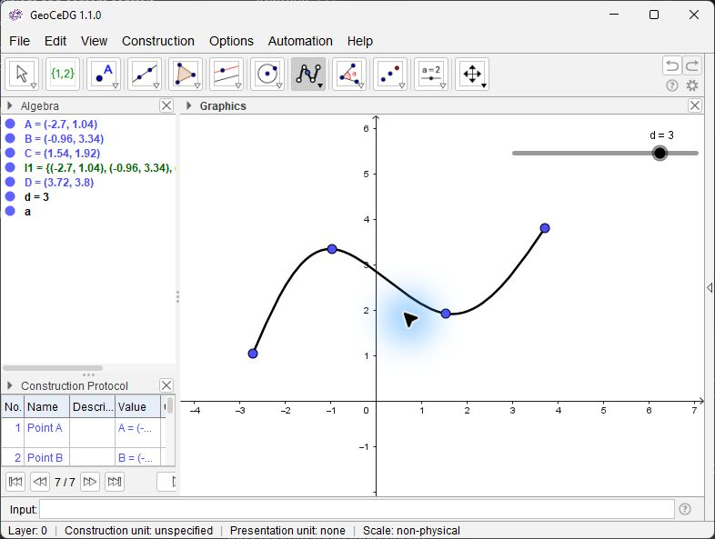
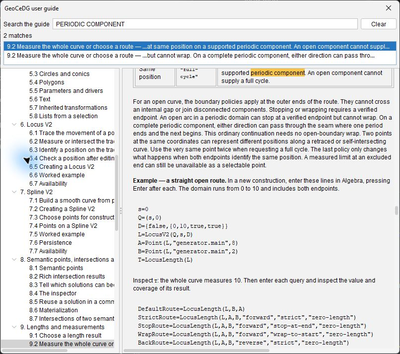
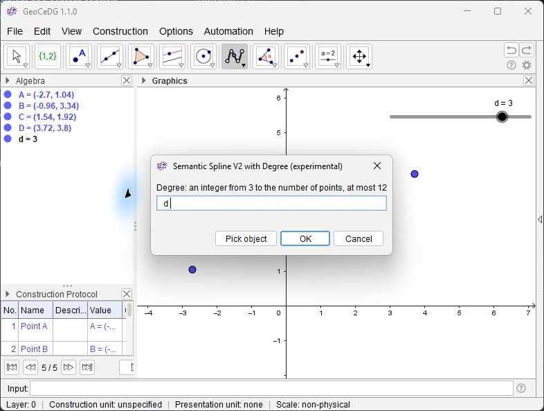
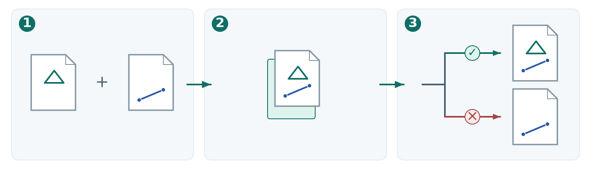
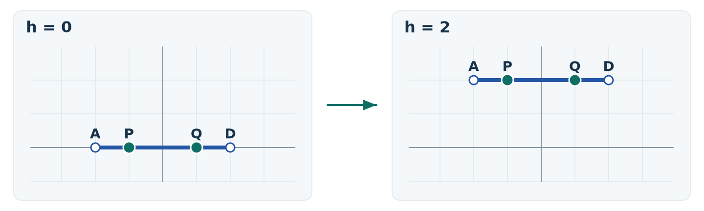
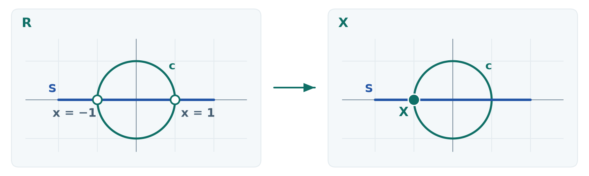
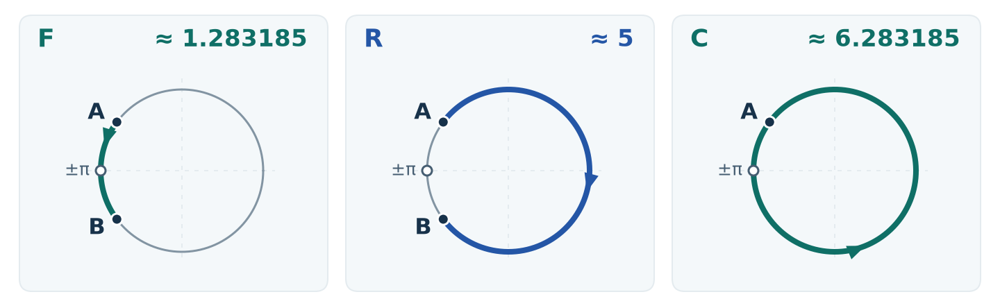
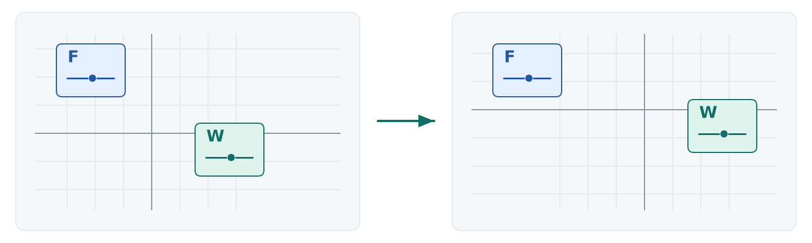
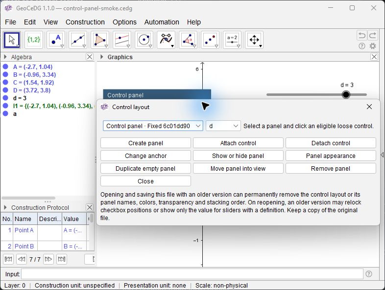

<!-- geocedg-guide-section: about-this-guide -->
# Guía de usuario de GeoCeDG

GeoCeDG 1.1.0 · Edición en español

Empiece por [La primera construcción](#getting-started/2.7), consulte una
herramienta en la [referencia](#command-and-workflow-reference) o pulse
**Ctrl+F** para [buscar en la guía](#getting-started/2.8). Si obtiene un
resultado inesperado, consulte [Problemas y límites conocidos](#known-limitations).

Las dos ediciones emplean las mismas marcas:

- **[N] Nuevo en GeoCeDG** — capacidad incorporada por GeoCeDG.
- **[A] Ampliado en GeoCeDG** — ampliación de una capacidad heredada.
- **[G] Heredado de GeoGebra** — capacidad que ya existe en la revisión de partida.
- **[!] Experimental o con limitaciones relevantes** — consulte el alcance indicado antes de utilizarla.

---

<!-- geocedg-guide-section: what-is-geocedg -->
## 1. Qué es GeoCeDG

GeoCeDG es una plataforma de geometría dinámica para **Geometría Descriptiva
Extendida por Computador (CeDG)**. Complementa al CAD en el razonamiento sobre
problemas espaciales mediante proyecciones y construcciones explícitas. Puede
trabajar con herramientas gráficas o escribir en la Entrada algebraica. Al
modificar un objeto de partida, se actualizan los objetos que dependen de él.

### 1.1 Construir con relaciones

Cree un segmento entre dos puntos y mueva uno de ellos. El segmento y su
longitud cambian juntos. Use el **Protocolo de construcción** para recorrer los
pasos y Álgebra para consultar la definición de cada objeto. La misma idea
permite trazar una curva a partir de un punto que depende de otro.

### 1.2 Trabajar con proyecciones junto al CAD

Por ejemplo, puede estudiar un problema espacial construyendo sus proyecciones
como dibujos planos relacionados y comprobar cómo responden al cambiar los
datos de partida. Es una aplicación de la geometría descriptiva al razonamiento
en 3D. El espacio de trabajo de esta guía ofrece herramientas 2D. Las relaciones
entre las proyecciones se establecen en la propia construcción. La reconstrucción
espacial automática y las asociaciones nativas de objetos 3D quedan fuera de su
alcance actual. Puede acotar el dibujo e intercambiar con CAD la geometría 2D
admitida mediante la [exportación DXF](#dxf-export). Los [límites conocidos](#known-limitations)
detallan el alcance de las vistas y la compatibilidad.

### 1.3 Versión y estado

**Ayuda → Acerca de GeoCeDG** muestra la versión **1.1.0**, la fecha de versión
**2026-10-15** y la identificación de la compilación. Allí puede consultar
la *condición de distribución* y los avisos de la copia en uso.
Una copia instalada puede mostrar **INTERNAL EVALUATION — NOT FOR REDISTRIBUTION**
o **NON-COMMERCIAL DISTRIBUTION — PROFILE NC**. Una *compilación de desarrollo*
tiene su propia indicación. Acerca de enlaza a las condiciones completas,
incluidas EUPL-1.2 y CC BY 4.0 para los componentes de GeoCeDG a los que se
aplican.

### 1.4 Novedades y ampliaciones de GeoCeDG respecto a GeoGebra

La comparación se limita al código de **GeoGebra Classic 5.4.928.0** fijado
en la revisión `9b93256b7df401ff056c37b502d82df4d72b1522`.

| Capacidad | Aportación | Herramientas o comandos | Aplicación práctica | Enlace a la guía |
| --- | --- | --- | --- | --- |
| Geometría dinámica básica | **[G]** Los puntos, rectas, cónicas y polígonos conservan sus dependencias de construcción. | Punto, Segmento, Circunferencia, Polígono | Cambie un punto de partida y observe cómo se actualiza la construcción. | [Geometría básica](#basic-geometry) |
| Curvas semánticas | **[N] [!]** Locus V2 y Spline V2 incorporan un parámetro con el que se pueden situar puntos y medir recorridos. | `LocusV2`, `SplineV2` | Trace un punto móvil o construya una curva suave a partir de una lista de puntos. | [Locus V2](#locus-v2/6.5) · [Spline V2](#spline-v2/7.2) |
| Puntos e intersecciones | **[A] [!]** `Point` e `Intersect` admiten formas V2. Puede inspeccionar el resultado de una intersección antes de crear puntos. | `Point`, `Intersect`, Inspeccionar resultado rico | Elija una posición en la curva o examine las soluciones de una intersección. | [Puntos sobre curvas](#semantic-points-intersections-materialization/8.1) · [Resultados de intersección](#semantic-points-intersections-materialization/8.2) |
| Tangencias y creación de puntos | **[G]** Herramienta ordinaria Tangentes. **[A] [!]** Los cruces V2 admitidos se pueden convertir en puntos. Ciertos contactos admiten una construcción explícita a partir del generador. | Tangentes, Crear punto de intersección seleccionado, `Intersect(L,r,D)` | Incorpore a la construcción un cruce admitido o un contacto comprobado. Una tangencia que aparece en el inspector no basta para crear un punto. | [Soluciones que pueden convertirse en puntos](#semantic-points-intersections-materialization/8.3) · [Puntos estructurales](#semantic-points-intersections-materialization/8.6) |
| Longitud y recorrido | **[A] [!]** `Length` mide curvas V2 admitidas. **[N] [!]** `LocusLength` aporta información sobre el resultado y permite elegir el recorrido cuando corresponde. | `Length`, `LocusLength` | Mida una curva completa, el arco entre dos puntos o una vuelta de una rama periódica admitida. | [Recorrido y longitud](#lengths-and-measurements/9.2) |
| Validez dinámica | **[G]** Los objetos se actualizan al cambiar sus datos de partida. **[A] [!]** Las posiciones V2 y los puntos de intersección seleccionados indican si pierden validez después de un cambio. | Inspeccionar definición…, Inspeccionar resultado rico | Compruebe si un punto conservado sigue disponible al mover un generador. | [Comprobar tras una edición](#locus-v2/6.4) · [Conservar o recuperar un punto](#semantic-points-intersections-materialization/8.6) |
| Pasos, memoria y orientación | **[A]** El protocolo heredado ajusta el alto de las filas. Paralela y Perpendicular pueden recordar una referencia cada una durante la sesión. Los resultados admitidos pueden mostrar una indicación de sentido. | Protocolo de construcción, Paralela, Perpendicular, Mostrar indicación de orientación | Revise un paso de la construcción o repita una familia de rectas alineadas. | [Protocolo de construcción](#interface-and-workflow/3.8) · [Rectas y memoria de referencia](#basic-geometry/5.2) |
| Unidades, cotas y láminas | **[N]** Defina la unidad del dibujo, añada cotas y prepare un marco ISO A. | Unidades del documento…, `AlignedDimension`, `LinearDimension`, `IsoABorder` | Prepare una lámina a escala con cotas legibles. | [Unidades](#documents/4.6) · [Cotas](#lengths-and-measurements/9.5) · [Láminas ISO A](#documents/4.7) |
| Presentación y capas | **[A]** Los estilos de objeto y las capas numéricas heredadas se amplían con controles de presentación y una capa de trabajo. | Preferencias, Capa de trabajo, visibilidad de capas | Agrupe objetos por capa y oculte elementos auxiliares al revisar el dibujo. | [Presentación](#presentation-and-visualization) · [Capa de trabajo](#presentation-and-visualization/12.5) |
| Documento nativo e inserción | **[N]** Guarde en `.cedg`, inserte construcciones admitidas con comprobaciones o examine un ensayo experto antes de decidir. **[!]** Cada vía admite determinados orígenes. | Guardar como…, Insertar archivo…, Insertar con revisión experta… | Incorpore una construcción existente y revise los cambios antes de confirmar cuando esté disponible la revisión experta. | [Formatos](#documents/4.1) · [Inserción](#documents/4.2) |
| Controles y paneles | **[G]** Deslizadores, botones, casillas y campos de entrada. **[N] [!]** Paneles fijos o vinculados al lienzo para controles aptos en Gráficos 1. | Deslizador, Botón, Casilla de control, Casilla de Entrada, Disposición de controles | Mantenga juntos los controles al desplazarse por el dibujo. | [Paneles de controles](#presentation-and-visualization/12.6) |
| Intercambio DXF | **[N] [!]** Exportación de objetos 2D admitidos, con información sobre fidelidad y aproximaciones. | Exportar geometría 2D como DXF (experimental)… | Entregue un trazado a CAD tras comprobar qué objetos se pueden representar. | [Exportación DXF](#dxf-export) |
| Herramientas de usuario y Classic | **[G]** Las herramientas personalizadas se pueden guardar en dibujos `.ggb`. **[A]** GeoCeDG añade un gestor, acceso fijo desde la barra y una biblioteca en la copia instalada. También abre una sesión Classic de diagnóstico separada. | Herramientas de usuario, Abrir sesión de diagnóstico Classic | Reutilice una herramienta o compruebe una construcción antigua dentro de los límites de compatibilidad. | [Herramientas de usuario](#user-tools-and-automation) · [Classic](#classic-compatibility-and-diagnostics) |


---

<!-- geocedg-guide-section: getting-started -->
## 2. Primeros pasos

### 2.1 Iniciar GeoCeDG

Inicie GeoCeDG desde su acceso directo instalado. El título de la ventana indica
`GeoCeDG 1.1.0`, o `GeoCeDG 1.1.0 — <nombre de archivo>` cuando hay un documento
abierto.

Si trabaja desde un checkout de fuentes preparado en lugar de una copia
instalada, el perfil de producto se lanza mediante la tarea Gradle
`:desktop:desktop:runGeoCeDG`. No hace falta ningún argumento adicional para
obtener las capacidades descritas en esta guía, salvo dos que solo existen en
una copia instalada: la biblioteca de herramientas GeoCeDG incluida
(sección 13.2) y una condición de distribución verificada (sección 1.3). Un
checkout de fuentes se ejecuta como compilación de desarrollo sin ellas.

### 2.2 La ventana principal

GeoCeDG se abre en el espacio de trabajo **Construcción CeDG**, que es el
espacio del producto. Su disposición por defecto ofrece:

- la vista **Gráficos**, con ejes visibles y sin cuadrícula;
- la vista **Álgebra**;
- el **Protocolo de construcción**;
- la barra de **Entrada algebraica**, con ayuda de entrada.

Las vistas **Hoja de Cálculo**, **Cálculo Simbólico (CAS)** y **Propiedades del
objeto** están disponibles e inicialmente cerradas. Un documento o una
preferencia guardados pueden abrir otra disposición. **Vista → Restaurar
distribución de Construcción → Construcción CeDG** recupera la del producto.



*Captura de GeoCeDG Desktop en inglés. Álgebra y el Protocolo de construcción están a la izquierda del dibujo. La Entrada algebraica se encuentra debajo.*

### 2.3 Idioma del producto

GeoCeDG ofrece dos idiomas de producto: **inglés** y **español**. El inglés es
el idioma de reserva cuando no se aplica ninguna otra elección.

Elija el idioma en **Opciones → Idioma del producto…**.
La elección afecta a menús, diálogos y ayuda integrada, incluida la edición de
esta guía que abre **Ayuda → Guía de usuario de GeoCeDG**.

### 2.4 Preferencias

**Opciones → Preferencias…** abre la configuración global. Abrirla no selecciona
ningún objeto.

La pestaña **Disposición y presentación** reúne los ajustes de presentación de
GeoCeDG: el tema de presentación y los tamaños de presentación descritos a
continuación, el grupo **Unidades de los documentos nuevos** (sección 4.6), el
grupo **Presentación de cotas** (sección 9.5) y la opción **Indicación de
orientación** (sección 5.2).

### 2.5 Temas de presentación

Un tema de presentación selecciona los colores de superficies conocidas de la
interfaz. Hay exactamente tres, elegibles en **Preferencias → Disposición y
presentación → Tema**:

| Tema | Carácter |
|---|---|
| **Original** | La apariencia histórica de GeoCeDG. Es el valor por defecto y el de reserva. |
| **Papel científico** | Paleta cálida y de bajo contraste, adecuada para trabajo en papel y capturas destinadas a publicación. |
| **Geometría fría** | Paleta fría y neutra, con un lienzo algo más luminoso. |

Un tema cambia solo superficies de presentación: marco, superficie de menú y
barra, paneles, fondo del lienzo de Gráficos y separadores. Nunca cambia el
color, el estilo o la visibilidad de los objetos, el significado de ejes o
cuadrícula, la salida de exportación, ni nada almacenado en un documento. La
elección es una preferencia de usuario: sobrevive al reinicio y no se ve
afectada por abrir un documento.

### 2.6 Tamaños de presentación

**Preferencias → Disposición y presentación → Tamaños de presentación** ofrece
seis controles independientes:

| Control | Qué gobierna | Por defecto |
|---|---|---|
| Tamaño de fuente de la interfaz general | Barra de entrada, ayuda de comandos, diálogos ordinarios | 12 pt |
| Tamaño de fuente de menús | La barra de menús y sus elementos | 14 pt |
| Tamaño de iconos de la barra | Botones de la barra, incluidas las herramientas propias fijadas | 28 px |
| Tamaño de fuente de Álgebra | La vista Álgebra y su editor | 12 pt |
| Tamaño de fuente del Protocolo de Construcción | La tabla del protocolo y su navegación | 12 pt |
| Tamaño de fuente de Gráficos | Ejes, coordenadas y etiquetas de objeto en las vistas Gráficas | 12 pt |

Son independientes: ninguno se deduce de otro. La fuente de los objetos **Texto**
de construcción es un ajuste aparte (**Tamaño de fuente de Texto**) y no forma
parte de este grupo, porque un objeto Texto pertenece al documento.

Los seis son preferencias de usuario. Nunca se escriben en una construcción ni
aparecen en un archivo guardado.


### 2.7 La primera construcción

En un dibujo nuevo, escriba cada línea en **Entrada** y pulse **Intro**
después de cada una.

```text
A=(0,0)
B=(3,4)
s=Segment(A,B)
d=Length(s)
```

En Álgebra, compruebe que `d` vale 5. Elija **Mueve**, arrastre `B` y observe
cómo cambian el segmento y la medida. Si la barra de entrada está oculta,
actívela desde **Automatización → Entrada algebraica**. Los ejemplos usan
los nombres ingleses de los comandos y el punto como separador decimal.

### 2.8 Buscar en la guía

Abra **Ayuda → Guía de usuario de GeoCeDG**. Use el árbol de la izquierda
para abrir una sección. Pulse **Ctrl+F** o haga clic en el campo de búsqueda.
Escriba, por ejemplo, `orientacion` o `LocusLength`. Cada resultado muestra
la sección y un fragmento. Active un resultado con el ratón o baje a la
lista y pulse **Intro**. El documento se desplaza y el árbol marca la sección.
La búsqueda ignora mayúsculas y tildes y muestra hasta 200 coincidencias.
Afine la consulta si hay más. Pulse **Esc** o use el botón de
limpieza para volver a la navegación habitual. Tras cambiar el idioma
del producto, vuelva a abrir la guía para consultar la otra edición.

Para seguir un enlace de la guía, haga clic en él. Con el teclado, pulse
**Alt+Flecha derecha** o **Alt+Flecha izquierda** para recorrer los enlaces y
**Intro** para abrir el seleccionado.



*Captura de la guía en inglés. El resultado seleccionado resalta la coincidencia en el texto y marca su sección en el árbol.*

---

<!-- geocedg-guide-section: interface-and-workflow -->
## 3. Interfaz y flujo de construcción

### 3.1 Vistas

- **Gráficos** es donde se construye y donde actúa la herramienta vigente.
- **Álgebra** lista los objetos con su valor, descripción o definición, según el
  modo elegido en **Opciones → Presentación de Álgebra**.
- **Protocolo de construcción** (**Vista → Inspección de la construcción → Protocolo de construcción**) muestra
  la construcción como una secuencia ordenada, que es la lectura directa de su
  estructura de dependencias. **Vista → Inspección de la construcción → Mostrar barra de navegación
  de la construcción** activa o desactiva el control por pasos asociado a la vista
  Gráfica; no crea objetos ni genera un paso de deshacer.
- **Entrada algebraica** acepta comandos y definiciones.

### 3.2 Menús

Use la barra de menús para encontrar herramientas por tarea. Las herramientas de Construcción se enumeran más abajo. La [referencia](#command-and-workflow-reference) indica las entradas y los atajos.

| Menú | Acciones disponibles |
|---|---|
| **Archivo** | Entradas directas: Nuevo archivo, Abrir…, Abrir reciente…, Abrir sesión de diagnóstico Classic, Guardar, Guardar como…, Vista previa de impresión…, Vista gráfica como imagen…, Exportar geometría 2D como DXF (experimental)…, PSTricks…, PGF/TikZ…, Asymptote…, Definir área de exportación…, Usar Export_1 y Export_2, Mostrar área de exportación, Borrar área de exportación, Definir área de exportación ISO A…, Usar el marco ISO A seleccionado, Cerrar. **Insertar** abre un submenú con Insertar archivo…, Insertar con revisión experta…, Aplicar estilos…. La revisión experta está disponible de forma predeterminada (sección 4.2). |
| **Editar** | Deshacer, Rehacer, Mueve, Gira en torno a un punto, Capa de trabajo, Seleccionar objetos, Limitar/liberar punto, Borrar. Consulte [Menús, preferencias y atajos](#command-and-workflow-reference/16.6). |
| **Vista** | **Views** activa o desactiva Álgebra, Graphics2 (segunda vista gráfica), Hoja de Cálculo, Cálculo Simbólico (CAS) y Propiedades del objeto. **Visibilidad y estilo** — Mostrar/ocultar objeto, Mostrar/ocultar etiqueta, Copiar estilo visual, Mostrar indicación de orientación, Disposición de controles. **Navegación** — Desplaza Vista Gráfica, Zoom por rectángulo, Aproximar, Alejar, Acercar por factor, Alejar por factor, Vista estándar, Mostrar todos los objetos. **Inspección de la construcción** — Protocolo de construcción, Mostrar barra de navegación de la construcción, Inspeccionar definición…. **Configurar zoom de navegación...** configura los atajos y el factor de zoom. **Restaurar distribución de Construcción** restaura el espacio de Construcción CeDG. La entrada Procedimientos diédricos está deshabilitada. |
| **Construcción** | Elija una herramienta por grupo en la tabla siguiente. |
| **Opciones** | **Presentación de Álgebra** (Valor, Descripción, Definición), Ordenar por, Redondeo, Etiquetado, Tamaño de fuente de Texto. Entradas directas: Preferencias…, Ejes, Cuadrícula, Idioma del producto…, Mostrar marcadores de soluciones, Crear automáticamente puntos admisibles de nuevas consultas explícitas, Unidades del documento…, Guardar la configuración. |
| **Automatización** | Entrada algebraica, Laboratorio heredado (sesión separada), Propiedades y guiones del objeto…. Abra **Herramientas de usuario** para gestionar las del documento o usar la [Biblioteca GeoCeDG](#user-tools-and-automation/13.2). |
| **Ayuda** | Ayuda de entrada, Ayuda de herramienta actual, Lista de comandos, Guía de usuario de GeoCeDG, Atajos de teclado, Acerca de GeoCeDG. |

| Submenú de Construcción | Entradas |
|---|---|
| Puntos | Punto, Punto en objeto, Medio o Centro |
| Rectas y vectores | Recta, Segmento, Semirrecta, Vector, Segmento de longitud dada, Equipolente |
| Polígonos | Polígono, Poligonal, Polígono regular, Polígono rígido, Polígono vectorial |
| Herramientas de listas | Crear lista desde la selección |
| Construcciones derivadas | Paralela, Perpendicular, Mediatriz, Bisectriz |
| Parámetros y controladores | Deslizador, Ángulo dada su amplitud, Casilla de control, Botón, Casilla de Entrada, Animar objeto seleccionado, Texto |
| Relaciones e intersecciones | Intersección, Tangentes, Relación, Polar o Conjugado, Inspeccionar resultado rico, Crear punto de intersección seleccionado, Crear puntos de intersección seleccionados, Crear todos los puntos de intersección admisibles |
| Círculos y cónicas | Circunferencia (centro, punto), Circunferencia por tres puntos, Circunferencia: centro y radio, Arco de circunferencia, Cónica por cinco puntos, Elipse, Parábola, Compás, Semicircunferencia, Arco tres puntos, Sector circular, Sector tres puntos, Hipérbola |
| Curvas semánticas | Locus V2, Punto sobre Locus V2 desde referencia, Punto sobre curva semántica (dirección explícita), Spline V2, Spline V2 con grado, Spline V2 cerrada, Inspeccionar definición de curva semántica… |
| Métricas y validación | Ángulo, Distancia o Longitud, Cota alineada, Cota lineal, Longitud semántica total del lugar geométrico (experimental), Longitud semántica parcial del lugar geométrico (experimental), Área, Pendiente |
| Transformaciones de semejanza | Simetría central, Simetría axial (reflexión), Traslación, Rotación, Homotecia |
| Anotaciones y medios | Imagen, Marco ISO A |
| Procedimientos de proyección manual | Procedimientos diédricos CeDG (no autorizados) |

### 3.3 Barra de herramientas y desplegables

Abra la flecha junto a una herramienta para ver las demás de su grupo. La tabla describe la barra predeterminada de izquierda a derecha.

| Grupo | Herramientas |
|---|---|
| Mueve | Mueve, Gira en torno a un punto, Capa de trabajo |
| Herramientas de listas | Crear lista desde la selección |
| Puntos e intersección | Punto, Punto en objeto, Medio o Centro, Limitar/liberar punto, Intersección |
| Rectas y vectores | Recta, Segmento, Semirrecta, Vector, Segmento de longitud dada, Equipolente |
| Polígonos | Polígono, Poligonal, Polígono regular, Polígono rígido, Polígono vectorial |
| Construcciones derivadas | Paralela, Perpendicular, Mediatriz, Bisectriz, Ángulo dada su amplitud, Tangentes |
| Círculos y cónicas | Circunferencia (centro, punto), Circunferencia por tres puntos, Circunferencia: centro y radio, Arco de circunferencia, Cónica por cinco puntos, Elipse, Parábola |
| Curvas semánticas | Locus V2, Spline V2, Spline V2 con grado, Spline V2 cerrada, Punto sobre curva semántica (dirección explícita), Punto sobre Locus V2 desde referencia |
| Ángulos y longitudes | Ángulo, Distancia o Longitud, Cota alineada, Cota lineal, Longitud semántica total del lugar geométrico (experimental), Longitud semántica parcial del lugar geométrico (experimental) |
| Transformaciones | Simetría central, Simetría axial (reflexión), Traslación, Rotación, Homotecia |
| Parámetros y controladores | Deslizador, Casilla de control, Botón, Casilla de Entrada, Texto |
| Navegación | Desplaza Vista Gráfica, Zoom por rectángulo, Aproximar, Alejar, Copiar estilo visual |

Los desplegables de Curvas semánticas y Navegación muestran la última herramienta que elegiste en ese grupo. Si una herramienta está deshabilitada, pasa el puntero por encima para ver el motivo.

### 3.4 Seleccionar, crear y editar

Seleccione con la herramienta **Mueve**. Cree eligiendo una herramienta y
marcando los datos requeridos, o escribiendo una definición en Entrada
algebraica.

La Entrada algebraica muestra una previsualización mientras escribe. **Intro**
confirma una transacción; **Escape** cancela; perder el foco no crea nada. No se
crea nada hasta pulsar Intro.

Para editar un objeto numérico ordinario puede hacer doble clic, pulsar **F2**,
editar directamente su fila de Álgebra o escribir una asignación compatible como
`k=0.25` en la Entrada algebraica. Las cuatro rutas conservan el mismo objeto; la
edición es explícita y constituye un único paso de deshacer.

**Deshacer** es `Ctrl`+`Z` y **Rehacer** es `Ctrl`+`Y`, también disponibles en
**Editar**.

### 3.5 Inspeccionar una definición

**Inspeccionar definición…** (menú contextual, o **Vista → Inspección de la
construcción**) muestra cómo está definido un objeto, en solo lectura. Para las
curvas semánticas y sus objetos derivados, **Inspeccionar definición de curva
semántica…** muestra además la estructura semántica: rama, componente, dirección
semántica, estado de la dirección (actual y admisible, o retenida/inactiva),
fuente, proveedor, parámetro y, en fuentes periódicas, la elevación periódica y
el lado de costura.

La inspección nunca modifica un objeto, nunca cambia su identidad y nunca cambia
el modo global de presentación de Álgebra.

Algunos objetos muestran una **definición de solo lectura**. No es un defecto:
significa que la redefinición directa arbitraria de ese objeto no es una
operación aprobada. Edite en su lugar los datos que lo definen. Propiedades lo
explica cuando corresponde.

### 3.6 Redefinir un objeto

Edita una definición en Álgebra, por ejemplo con **F2**. GeoCeDG actualiza
los objetos que dependen de ella. Si una construcción semántica depende
del objeto y la edición cambia las entradas registradas, revise las
opciones del diálogo. **Conservar identidad** mantiene el objeto y
actualiza sus dependientes si la edición lo permite. **Reemplazar** le
da una identidad nueva y enumera los objetos afectados. **Cancelar**
deja el dibujo como estaba. Un tipo incompatible o una definición
circular se rechazan.

**Ejemplo.** En un dibujo nuevo, introduzca las líneas una a una.

```text
c=Circle((0,0),2)
C=Point(c)
f=Line(C,xAxis)
D=Intersect(f,yAxis)
E=Midpoint(D,C)
a=LocusV2(E,C)
```

Redefine `E` como `E=Midpoint(D,C+(1,0))`. Compara el lugar antes y
después o use Deshacer para pasar de uno a otro. Ambas definiciones
dependen del mismo generador `C`. Un punto creado a partir de una
intersección de curvas semánticas sigue disponible mientras su propia
solución sea elegible. Si queda indefinido, consulte [Materialización](#semantic-points-intersections-materialization/8.6) e [Intersecciones de dos curvas](#semantic-points-intersections-materialization/8.7).

### 3.7 Buscar un objeto y leer su ayuda en Álgebra

Use **Buscar por nombre** en la barra de Álgebra. Escriba parte del nombre
o el nombre completo, incluido el subíndice si lo hay. Pulse **Intro** o use
las flechas de coincidencia anterior y siguiente para seleccionar y llevar
a la vista la fila. Borre el texto para terminar la búsqueda. Esta función
busca los nombres visibles de los objetos de la lista.

Deje el puntero sobre una fila para consultar el **Valor** o la **Definición**
que complementa el modo de visualización actual. Un objeto indefinido o
sin definición disponible muestra el aviso correspondiente.

### 3.8 Leer el Protocolo de construcción

Abra **Vista → Inspección de la construcción → Protocolo de construcción**.
Use la tabla para leer los pasos o muestre la barra de navegación de la
construcción en ese mismo submenú. El protocolo ajusta la altura cuando
una descripción ocupa varias líneas. Puede cambiar el tamaño de su letra
en **Preferencias → Disposición y presentación**. Para cambiar el resultado,
vuelva a la construcción y edite los objetos de partida.

### 3.9 Insertar un número existente en un diálogo

Use **Seleccionar objeto** en el campo de parámetro de un punto por dirección
sobre Locus V2, de ángulo o factor al rotar o aplicar homotecia a un Locus V2 o Spline V2,
o de grado de Spline V2. Elija la fila del número o ángulo en Álgebra. El nombre
se inserta donde está el cursor o reemplaza el texto seleccionado. Complete la
expresión y confirme. Por ejemplo, si ya tiene `d=3`, elija su fila en el diálogo
de grado de Spline V2. GeoCeDG comprueba el grado al confirmar.



*Captura de GeoCeDG Desktop en inglés. El campo del grado contiene el nombre d capturado desde Álgebra.*

**Esc** desarma la captura y una segunda pulsación cancela el diálogo.
Si pulsar un deslizador en Gráficos 1 no ofrece una referencia, selecciónalo
en Álgebra. El botón solo aparece en los cuatro campos indicados.

---

<!-- geocedg-guide-section: documents -->
## 4. Documentos

```text
.cedg = documento nativo de GeoCeDG
.ggb  = entrada de compatibilidad
```

### 4.1 Formato nativo y formato de compatibilidad

**[N]** `.cedg` es la extensión nativa de documento de GeoCeDG. Guarde su trabajo como
`.cedg`.

`.ggb` se acepta como entrada de compatibilidad. Abrirlo conserva el
archivo original. Use **Guardar como…** para guardar el trabajo en
un archivo nativo `.cedg`.

La extensión es una identidad de producto y de entrada/salida. No cambia el
significado geométrico, la madurez de los objetos, la identidad durable ni el
comportamiento de los comandos, y renombrar un archivo no transforma su
contenido. Internamente ambos archivos conservan hoy el código de aplicación
heredado `classic` y la misma disposición de archivo; GeoCeDG no introduce un
formato nuevo.

### 4.2 Comandos de documento

| Acción | Dónde |
|---|---|
| Nuevo archivo | Archivo |
| Abrir… | Archivo |
| Abrir reciente… | Archivo |
| Insertar archivo… | Archivo → Insertar |
| Aplicar estilos… | Archivo → Insertar |
| Guardar | Archivo |
| Guardar como… | Archivo |
| Vista previa de impresión… | Archivo |
| Cerrar | Archivo → Cerrar |

**Guardar** escribe en la ruta nativa actual cuando existe; en caso contrario se
comporta como **Guardar como…**. No hay degradación silenciosa de `.cedg` a
`.ggb` ni conversión destructiva en ninguna dirección.

Si un guardado falla su prevalidación, el archivo anterior en disco se conserva y
sus cambios quedan sin guardar. Nada se escribe a medias.

**Abrir…** ofrece un único tipo de archivo, documentos GeoCeDG (`.cedg`, `.ggb`,
`.ggt`, `.html`, `.htm`). GeoCeDG no admite archivos OFF: abrir uno muestra un
mensaje y no cambia nada.

**Insertar archivo…** inserta la construcción de un documento `.cedg` o `.ggb` en
el dibujo actual, completa o nada. Antes de cambiar nada, GeoCeDG comprueba cada
objeto del documento y prueba la inserción sobre una copia. Se admiten puntos,
rectas, semirrectas, segmentos, vectores, circunferencias, elipses, funciones,
polígonos, ángulos de tres puntos, ángulos libres con deslizador, números,
booleanos, textos dependientes y estáticos, listas
y sucesiones, y también objetos Locus V2 y Spline V2, cotas lineales y alineadas,
láminas ISO A y objetos construidos con herramientas. Los documentos con guiones,
objetos 3D u otros tipos de objeto se rechazan con un mensaje que los nombra, y no
cambia nada. Los objetos existentes nunca se reemplazan: un objeto insertado cuyo
nombre está ocupado recibe el siguiente nombre indexado libre (`A` pasa a ser
`A_1`). Una herramienta que necesitan los objetos insertados se añade una vez, o
se usa la propia del dibujo cuando es idéntica; otra herramienta distinta con el
mismo nombre rechaza la inserción. Se rechaza un documento que necesita a la vez
herramientas y objetos Locus V2 o Spline V2. Las coordenadas nunca se escalan y
las unidades del dibujo nunca cambian; cuando el documento insertado tiene otra
unidad física, la barra de estado lo indica (sección 4.6). La inserción es un
solo paso de Deshacer, conserva la identidad del dibujo y no cambia lo que haya
copiado; una lámina ISO A se inserta sin el vínculo con el área de exportación de
su documento. Tras una inserción la selección se vacía y queda activa la
herramienta **Mueve**. Si la inserción falla una vez iniciada, GeoCeDG restaura el
dibujo y su historial de Deshacer y lo indica. En el caso poco frecuente de que la
restauración no pueda verificarse, el dibujo queda aislado: no puede editarse,
guardarse ni exportarse, y solo puede guardar la última versión verificada en un
archivo nuevo, reabrir el documento desde su archivo o cerrarlo.

Al insertar un ángulo libre con deslizador entre distintos modos de presentación,
GeoCeDG comprueba una copia temporal antes de ofrecer usar el formato del dibujo
actual. La confirmación muestra ejemplos del cambio de formato. Un texto creado
con `Text(theta)` puede adoptar el nuevo formato si `theta` es un ángulo
verificado y ningún paso posterior de la construcción usa el texto. La
confirmación muestra el texto antes y después del cambio. El texto estático
conserva su contenido y posición. El dibujo actual conserva su modo angular y
su precisión. El pegado habitual asigna los objetos a la vista Gráfica activa.
Su pertenencia a las demás vistas Gráficas puede cambiar. Puede cancelar o
cerrar la confirmación para conservar el dibujo tal como está.

Si el aviso ofrece reintentar con formatos iguales, abra el dibujo de origen,
iguale el formato angular al del dibujo actual, revise la construcción y su
presentación y guarde una copia. Puede intentar insertar esa copia. Se
aplicarán las comprobaciones habituales. Los objetos excluidos, los guiones y
la compatibilidad de herramientas sin determinar tienen diagnósticos propios.

**[N] [!]** **Insertar con revisión experta…** está disponible en **Archivo → Insertar**.
Admite construcciones pasivas 2D que superen las comprobaciones de integridad.
El programa prueba la inserción sobre una copia del dibujo actual, incluidos
los cambios sin guardar. Revise los objetos, las diferencias y las incertidumbres antes
de confirmar. Cuando está disponible, la vista previa muestra el dibujo del
ensayo. Puede aceptar cambios de capa, vista, presentación o geometría válida
que el informe identifique. Una revisión bloqueada indica la
condición que impide insertar. Cancelar deja el dibujo como estaba. Una
inserción correcta ocupa un paso de Deshacer. Revise el dibujo y elija
**Guardar como…** para conservar una copia separada. Ambas vías de
inserción rechazan un origen con paneles de controles. La revisión experta
también rechaza un dibujo receptor con paneles (sección 12.6).



*Esquema de inserción experta. 1. Elija un origen. 2. Revise el ensayo en una copia. 3. Confirme una inserción disponible o cancele.*

**Aplicar estilos…** copia color, estilo de línea, grosor de línea, estilo de
punto, tamaño de punto y opacidad de relleno desde los estilos predeterminados de
un documento `.cedg` o `.ggb` (los estilos que ese documento da a los objetos
nuevos de cada tipo, no los de sus objetos existentes) a los objetos
seleccionados, o a todos si no hay selección. Las curvas Locus V2 y SplineV2
reciben color, tipo y grosor de línea del predeterminado de su tipo. Las cotas
nativas, las láminas ISO A y los demás resultados Locus V2 conservan sus estilos.
La geometría, los nombres, las capas, los rótulos, la visibilidad y
las unidades nunca cambian. Un solo Deshacer restaura los estilos anteriores; un
documento que no puede leerse no cambia nada.

En Preferencias, la sección Predeterminados permite elegir estilos de creación
distintos para Locus V2 y SplineV2. Guardar la configuración conserva sus estilos
entre sesiones. Los predeterminados de un dibujo guardado tienen prioridad al
crear objetos en él. Los objetos que ya existen conservan su presentación.
El modo de etiqueta elegido para un deslizador, como «Nombre + valor», se
conserva al guardar, copiar, deshacer y rehacer.

### 4.3 Qué conserva un documento

Un `.cedg` guardado conserva la construcción y su estructura de dependencias:
curvas semánticas, sus dominios y parámetros explícitos, puntos semánticos con su
rama y su parámetro canónico, puntos de intersección materializados con sus
selectores durables y la disposición visual del documento.

Para cada objeto con identidad durable registra además los objetos durables de
los que depende. Un documento guardado por una versión anterior conserva esos
registros exactamente: abrirlo y guardarlo nunca los reescribe. Un registro se
actualiza al formato actual solo cuando se redefine ese objeto (sección 3.6).
Una versión de GeoCeDG anterior a este formato rechaza un documento que contiene
un registro actualizado en lugar de leerlo mal.

También registra las unidades del documento cuando están definidas
(sección 4.6).

No conserva las preferencias de la aplicación. Idioma, tema, tamaños de
presentación, unidades de los documentos nuevos y biblioteca de herramientas
propias instaladas pertenecen al perfil GeoCeDG, no al documento.

### 4.4 Relación con Classic

La sesión de diagnóstico Classic de GeoCeDG es un proceso separado con
preferencias aisladas. Lee documentos ordinarios, pero no adquiere la creación de
curvas semánticas de GeoCeDG. Véase la sección 14.

Al abrir un `.cedg` nativo válido en Classic, las capas guardadas
explícitamente en los números se conservan al guardar y en el historial,
incluida la capa 0. Classic admite las capas de 0 a 9. Las capas superiores
se limitan a 9 al abrir. Conserve una copia en GeoCeDG si el documento
utiliza capas superiores.

### 4.5 Exportación de imágenes y área de exportación

**Archivo** ofrece **Vista gráfica como imagen…** (PNG,
PDF, SVG, EMF y EMF+), **Exportar geometría 2D como DXF (experimental)…**
(sección 11), **PSTricks…**, **PGF/TikZ…** y **Asymptote…**; **Vista previa de
impresión…** (en Archivo) imprime la misma imagen. No se ofrecen STL, Collada,
Collada HTML, la hoja dinámica y su publicación, GIF animado ni WebM.

**El área de exportación.** Una imagen muestra siempre un rectángulo de la vista
Gráfica 1 o de la vista Gráfica 2, su *área de exportación*, elegido en este
orden:

1. el área que elijas en **Archivo**: **Definir área de
   exportación…** (cuatro límites en coordenadas del mundo, partiendo del área
   actual o de la vista visible), **Usar Export_1 y Export_2**, o una lámina ISO A
   o un área ISO A (sección 4.7);
2. si no, los puntos `Export_1` y `Export_2` del documento, cuando existen ambos
   y definen un rectángulo;
3. si no, la parte visible de la vista.

Un rectángulo de selección trazado con el ratón nunca es un área de exportación.
El área no tiene que estar visible: todo lo que contiene se dibuja completo
—puntos, rectas, cónicas, polígonos, funciones, ejes, cuadrícula, texto y
Locus V2—, también donde queda fuera de la ventana. **Mostrar área de
exportación** la contornea en la vista Gráfica 1; el contorno nunca se exporta.
**Borrar área de exportación** vuelve a las reglas 2 y 3. El área que elija
pertenece a la sesión: no se guarda en el documento, no es un paso de deshacer
ni marca el documento como modificado, y Nuevo y Abrir la borran.

**Tamaño exacto.** Todos los formatos reproducen exactamente el área de
exportación, sin margen añadido ni recorte:

- PNG usa el número entero de píxeles más próximo para la resolución elegida y
  hace corresponder con ellos los cuatro límites del área.
- PDF usa una página exactamente del tamaño del área (con 0,001 pt de
  tolerancia), sin márgenes de página ni ajuste a la página.
- SVG declara el área exacta como su `viewBox`; la anchura y la altura conservan
  su proporción y los círculos siguen siendo círculos.
- EMF y EMF+ redondean los límites de la imagen a unidades enteras del
  dispositivo; el marco físico registrado en el archivo es el tamaño de salida
  elegido, redondeado a la centésima de milímetro más próxima y nunca derivado
  de la resolución.

**Qué contiene una imagen.** La previsualización del diálogo Guardar, el archivo
guardado, la impresión y la copia de la vista gráfica como imagen
(`Ctrl`+`Mayús`+`C` o el botón de portapapeles del diálogo) muestran la misma
área y omiten las capas ocultas (sección 12.5). Los objetos con posición
absoluta en pantalla conservan esa posición en la imagen. Las imágenes de fondo
pertenecen al fondo de la vista y no se ocultan con su capa, ni en la vista ni
en la imagen.

**Texto en PDF.** Para PDF el diálogo de imagen ofrece **Exportar textos como
figuras**. Está activada por defecto, y de nuevo cada vez que elige PDF: los
textos y los rótulos se dibujan entonces como contornos vectoriales. Desactívela
para conservarlos como texto: el PDF incorpora entonces las fuentes que usa como
fuentes Type 1. Ambas formas se comprobaron con Ghostscript, Poppler y Xpdf.

**Tamaño físico y escala de dibujo.** En un documento con unidad de
construcción (sección 4.6), los diálogos de imagen, impresión y LaTeX dan a la
salida el tamaño que resulta de esa unidad y de la *escala de dibujo* `a:b` de
la ventana: una longitud del modelo se dibuja a `a/b` de su tamaño real (`1:1`
tamaño real, `1:2` mitad, `2:1` doble). Elija una escala predefinida (`1:1`,
`1:2`, `1:5`, `1:10`, `2:1`, `5:1`) o escriba otro par de números enteros
positivos; se muestra simplificada (`2:4` pasa a `1:2`), y una entrada no válida
se rechaza y deja la escala sin cambios. La escala de dibujo pertenece a la
sesión de la ventana: no se guarda, no es un paso de deshacer y no marca el
documento como modificado; la barra de estado la muestra como **Escala: a:b**.
Nuevo, Abrir y toda sustitución del documento
completo la devuelven a `1:1`; deshacer, rehacer, editar o reemplazar una
herramienta y acciones parecidas la conservan. El zoom, la ventana y la
resolución nunca cambian un tamaño físico: la resolución solo fija el número de
píxeles, y la unidad de presentación solo cambia cómo se expresan las
longitudes. En una imagen PDF de un documento así, los anchos de línea y los
marcadores de punto también son físicos: una línea de grosor `t` mide `0.4·t` pt
de ancho y un punto de tamaño `s` ocupa `s` pt, con cualquier zoom, como en
PGF/TikZ; los textos, los rótulos, los arcos de ángulo, los rayados y los ejes
conservan tamaños que siguen el zoom del momento de la exportación (sección 15).
Un tamaño que un formato no puede representar, por ejemplo menor
que un píxel, se rechaza con un mensaje en lugar de recortarse. En un documento
sin unidad de construcción los diálogos conservan sus escalas de dispositivo,
rotuladas como no físicas, y no se ofrece ninguna escala técnica; la nota breve
«No física: sin unidad de construcción» muestra la explicación completa como
información emergente.

**La misma área en otras rutas.** `ExportImage`, las funciones de guion
`writePNGtoFile`, `getPNGBase64`, `exportSVG` y `exportPDF`, y la opción de
línea de órdenes `--export` producen la misma área. Sin una escala propia usan
el tamaño físico de un documento con unidad de construcción; una escala o un
tamaño que se les indique explícitamente sigue siendo un ajuste de dispositivo
y nunca cambia la escala de dibujo. `ExportImage` con el tipo `gif` o `webm` y
la opción `--exportAnimation` se rechazan con un error, y la línea de órdenes
nunca deja un archivo vacío.

**LaTeX.** PSTricks, PGF/TikZ y Asymptote parten de la misma área de
exportación, y editar sus límites define el área de exportación (no se dibuja
ningún rectángulo de selección). Omiten las capas ocultas y los objetos
ocultos, igual que las imágenes. Con unidad de construcción, sus unidades x e y
son la escala física de la escala de dibujo y se muestran pero no se pueden
editar; sin ella siguen siendo ajustes de dispositivo no físicos. Un Locus V2 o
un Spline V2 se escribe como un trayecto por cada componente válida
certificada, aproximado dentro de la tolerancia de curvas semánticas del
diálogo (por defecto `0.001` unidades del modelo); las componentes nunca se unen
a través de un hueco. Los comentarios al principio del código y en cada curva,
y el informe del diálogo, indican si la exportación es completa: una curva de la
que solo algunas componentes pudieron certificarse se escribe con esas
componentes y se marca como incompleta, y si una curva cambia durante la
generación o la tolerancia no puede cumplirse, no se genera código.

**Límites en esta versión.**

- Un `Locus` heredado se dibuja solo con las muestras que ya tiene, que cubren la
  ventana en la que se calculó; fuera de esa ventana puede verse incompleto.
  Locus V2 no tiene ese límite.
- La previsualización del diálogo Guardar solo aparece cuando el archivo elegido
  ya existe y el selector de archivos tiene al menos 600 píxeles de ancho; para
  un nombre de archivo nuevo el área de previsualización queda vacía.
- Las coordenadas de los trayectos en PDF y SVG se escriben con cinco cifras
  significativas; los tamaños de página, marco y `viewBox` son exactos.

### 4.6 Unidades del documento

**[N]** Un documento puede registrar qué significa físicamente una unidad del modelo.
Las unidades son metadatos del documento: cambiarlas reinterpreta el modelo y
nunca convierte coordenadas, valores, definiciones, identidades ni el orden de
construcción, y ninguna orden de construcción las lee.

| Ajuste | Valores | Significado |
|---|---|---|
| Unidad de construcción | sin especificar, `mm`, `cm`, `m`, `usm` | la longitud física de una unidad del modelo; *sin especificar* es el valor por defecto y significa que el modelo no tiene escala física |
| Unidad de presentación | igual que la unidad de construcción, `mm`, `cm`, `m`, `usm` | la unidad en la que se expresan las magnitudes dimensionales; requiere una unidad de construcción |
| Unidad personalizada (`usm`) | factor, nombre opcional, símbolo opcional | como máximo una por documento, definida como 1 usm = k m |

**Unidades del documento.** **Opciones → Unidades del
documento…** abre el diálogo. Aceptar aplica todos sus cambios como un único
paso de deshacer y marca el documento como modificado; Cancelar, o Aceptar sin
cambios, no hace nada. Deshacer y rehacer restauran exactamente las unidades
anteriores. Un cambio de unidades por sí solo también deja sin guardar un
documento por lo demás vacío, de modo que Nuevo y Cerrar preguntan antes de
descartarlo.

**Unidad personalizada.** Escriba el factor en metros con `.` como separador
decimal, por ejemplo `0.0254` o `2.54E-5`; debe ser finito y mayor que cero. Se
rechazan la coma, los separadores de miles, `NaN` e `Infinity`. El nombre y el
símbolo son opcionales y admiten de 1 a 64 caracteres, sin caracteres de control
ni espacios al principio o al final. `usm` solo puede seleccionarse una vez
definida la unidad personalizada, y la unidad personalizada no puede eliminarse
mientras una unidad del documento la use. Una entrada rechazada muestra un aviso
y deja el documento sin cambios.

**Barra de estado.** Junto a **Capa: n** la barra de estado muestra
**Unidad de construcción: …**, **Unidad de presentación: …** y **Escala: a:b**, la
escala de dibujo de la ventana (sección 4.5); en un documento sin unidad de
construcción muestra **Escala: no física**. Una unidad
personalizada se muestra por su símbolo, o como `usm`; las descripciones
emergentes explican cada unidad y dan el factor de la unidad personalizada. Un
clic en cualquiera de las dos unidades abre Unidades del documento.

**Documentos nuevos.** El grupo **Unidades de los documentos nuevos** de
**Opciones → Preferencias… → Disposición y presentación** elige las unidades de
construcción y de presentación de los documentos nuevos en blanco: al iniciar sin
archivo, tras **Nuevo archivo** y en una ventana nueva. Es una preferencia del
perfil GeoCeDG; nunca cambia el documento actual, y una unidad de presentación
por defecto sin unidad de construcción por defecto no tiene efecto. Aplicar las
unidades por defecto no es un paso de deshacer, y un documento nuevo sin tocar
sigue guardado.

**Unidad en los valores de las cotas.** El diálogo Unidades del documento tiene
también **Mostrar la unidad en los valores de las cotas**. Decide si los textos de
las cotas (sección 9.5) terminan con la unidad, como en `120 mm`, o muestran solo
el número, `120`; nunca cambia un número, la geometría ni las unidades.
Cambiarlo es un paso de deshacer, y la elección se guarda con el documento. Los
documentos nuevos en blanco empiezan con la elección del grupo **Presentación de
cotas** de Preferencias, desactivada salvo que usted la active; un documento
abierto conserva su propia elección, y un documento guardado sin ella, como un
documento de una versión anterior de GeoCeDG, sigue mostrando la unidad. Un
documento que oculta la unidad se guarda con una forma más nueva de los
metadatos de unidades, que las versiones anteriores de GeoCeDG se niegan a abrir.

**Abrir y guardar.** Un documento abierto conserva siempre sus propias unidades;
las preferencias nunca se le aplican. Un documento sin metadatos de unidades
sigue sin ellos: abrirlo y guardarlo lo escribe exactamente como antes. Un
documento cuyos metadatos de unidades están mal formados, o fueron escritos por
una versión más reciente de GeoCeDG, se rechaza al abrirlo con un mensaje que
nombra el problema, y el documento actual queda como estaba.

**Copiar y pegar.** Pegar copia los números sin cambios y nunca cambia las
unidades del documento de destino. Cuando los objetos copiados proceden de un
documento con otra unidad física, la barra de estado lo indica durante unos diez
segundos; el aviso no es un paso de deshacer y no se guarda. En una ventana
estrecha el aviso se acorta al espacio libre de la barra de estado; su descripción
emergente muestra el texto completo. Insertar un
documento (**Archivo → Insertar → Insertar archivo…**) muestra el mismo aviso;
nunca reemplaza lo que haya copiado, así que un pegado posterior usa su propia
copia y su aviso.
No se muestra aviso cuando alguno de los dos documentos no tiene unidad física.

**Exportaciones.** Con unidad de construcción, las imágenes, la impresión y
LaTeX usan el tamaño físico y la escala de dibujo de la sección 4.5, y DXF
registra la unidad en su cabecera (`mm`, `cm`, `m`) o, para una unidad
personalizada, en su manifiesto acompañante obligatorio (sección 11). Las
coordenadas nunca se convierten. Sin unidad de construcción ninguna exportación
afirma una escala física, y DXF sigue sin unidades.

### 4.7 Láminas ISO A

```text
IsoABorder( <Point>, <ISO A Index>, <Landscape>, <Scale Numerator>, <Scale Denominator>, <Model Units per Millimetre>, <Inner Frame> )
```

**[N]** Una **lámina ISO A** dibuja el papel de una lámina de la serie A de ISO 216
(A0 a A10) a una escala de dibujo, con un marco interior opcional y una
etiqueta como `A3 — 1:50`. Es una construcción ordinaria que depende del punto
de su esquina superior izquierda. En español el comando también se escribe
`MarcoISOA`.

- Los tamaños son los nominales de ISO 216 en milímetros; A3 horizontal mide
  420 × 297 mm. Horizontal pone el lado largo en horizontal; nada se gira y el
  punto sigue siendo la esquina superior izquierda.
- La primera salida es el **borde del papel**: oculto por defecto (punteado si
  lo muestra), es la lámina y el rectángulo que se usa como área de
  exportación. La segunda es el **marco interior**, a 20 mm del borde
  izquierdo y a 10 mm de los demás, dibujado continuo; cuando el marco está
  desactivado, o es imposible (A10 vertical), sigue existiendo pero queda
  indefinido. La tercera es la **etiqueta**, en la esquina inferior derecha
  del marco (dentro del papel si no hay marco); se oculta como cualquier
  texto. Las esquinas se obtienen con `Vertex(lámina, k)`.
- El tamaño en unidades del modelo es el tamaño del papel convertido una vez:
  milímetros × denominador ÷ numerador × unidades del modelo por milímetro.
  Con unidad de construcción `mm` a 1:50 una lámina A3 horizontal mide
  21000 × 14850. La escala y el factor de unidad son entradas escritas al
  crear la lámina: cambiar después la escala de dibujo o las unidades del
  documento nunca cambia la lámina.
- Un índice ISO que no sea un entero de 0 a 10, un término de escala que no
  sea un entero de 1 a 10^9, un factor no positivo o un tamaño que el
  ordenador no puede representar dejan las salidas indefinidas; corregir la
  entrada restituye los mismos objetos.

**Herramienta.** Construcción → Anotaciones y medios → **Marco ISO A** (solo
en el menú; no hay botón en la barra de herramientas). El documento necesita
una unidad de construcción física (sección 4.6): sin ella la acción no está
disponible y su motivo remite a **Unidades del documento…**; no se supone
ninguna unidad. Haga clic en un punto, o en un lugar vacío para crear un punto
de esquina oculto; un único punto seleccionado se usa directamente. El diálogo
ofrece el tamaño (A3 por defecto), la orientación (horizontal por defecto), la
escala de dibujo (partiendo de la escala de la sesión, con valores
predefinidos o un `a:b` libre), **Marco interior** (activado para A0–A4,
desactivado para A5–A10, no disponible para A10 vertical) y **Mostrar la
etiqueta de la lámina**. Aceptar crea la lámina en un solo paso de deshacer;
Cancelar elimina el punto creado por el clic. Una unidad personalizada cuyo
factor hace que la conversión a milímetros no sea representable se rechaza con
su motivo. Una lámina se mueve arrastrando su marco (o su papel si se muestra);
una lámina sin marco se mueve editando su punto o mostrando su papel.

**Área de exportación.** Una lámina nueva nunca sustituye el área de
exportación. Tras crearla GeoCeDG pregunta **¿Usar esta lámina como área de
exportación?**; **Archivo → Área de exportación → Usar el marco ISO A
seleccionado** enlaza una lámina existente (seleccione cualquiera de sus
objetos). Una lámina enlazada es el área de exportación de la sección 4.5: el
borde de su papel, también mientras está oculto, nunca el marco, y sigue a la
lámina cuando se mueve. El enlace pertenece a la sesión: no se guarda, Nuevo y
Abrir lo borran, y deshacer, rehacer, borrar o reconstruir la lámina lo
liberan; la exportación usa entonces la regla siguiente de la sección 4.5, la
barra de estado indica que el enlace se liberó y la misma acción vuelve a
enlazar la lámina. **Definir área de exportación ISO A…** fija una vez un área
de exportación del tamaño ISO, a partir de una esquina superior izquierda, un
tamaño y una orientación, a la escala de dibujo y la unidad actuales, sin crear
objetos.

**Tamaño físico y escala.** Para una lámina enlazada la barra de estado
muestra la lámina y el tamaño de página con que se exportaría con la unidad y
la escala de dibujo actuales, y los diálogos de imagen, impresión y LaTeX
muestran el mismo aviso. Las dos comprobaciones son independientes: si ese
tamaño de página es el tamaño nominal del papel y si la escala de la sesión es
la de la etiqueta. **Usar escala de la lámina** (en el aviso, en la
advertencia de activación o con un clic en el segmento de la barra de estado)
pone la escala de dibujo de la sesión a la escala de la lámina; nunca cambia la
geometría. Si la unidad de construcción ha cambiado desde que se creó la
lámina, la escala sola no puede restituir el tamaño nominal y el mensaje lo
dice. Si el tamaño no puede determinarse de forma fiable —sin unidad, con una
unidad personalizada extrema o con una lámina muy alejada del origen—, GeoCeDG
lo indica en lugar de afirmar que coincide. Enlazar una lámina cuyo tamaño de
página no es el nominal muestra esta advertencia en el acto; la escala nunca
cambia sin su acción.

**Exportación.** Las imágenes, la impresión, el portapapeles y LaTeX dibujan
el marco, la etiqueta y el borde del papel si se muestra; una lámina A3 1:50
enlazada en `mm` exporta una página PDF de 420 × 297 mm con escala de sesión
1:50. DXF escribe el borde del papel y el marco como entidades `LWPOLYLINE`
cuyo último vértice repite el primero, no escribe el texto de la etiqueta e
indica `iso_a_border` como productor del área de exportación.

**Classic y versiones anteriores.** La sesión de diagnóstico Classic de esta
versión de GeoCeDG entiende el comando pero no ofrece la herramienta, el
diálogo ni el enlace al área de exportación. Una versión anterior de GeoCeDG o
GeoGebra de origen informan de un error de carga por cada lámina; sus salidas
y los objetos construidos sobre ellas se pierden al guardar desde esa versión.
Las macros heredadas `sheetISOAnLand` y `sheetISOAnVert` de la plantilla
histórica no cambian y siguen funcionando; ningún documento se migra.

---

<!-- geocedg-guide-section: basic-geometry -->
## 5. Geometría básica

GeoCeDG hereda las herramientas ordinarias de construcción plana del núcleo
compartido. Esta sección cubre lo necesario para trabajar con las capacidades
CeDG; no es un manual completo de cada herramienta heredada.

### 5.1 Puntos

Cree un punto libre con la herramienta **Punto** o escribiendo un par de
coordenadas:

```text
A=(0,0)
```

**Punto en objeto** restringe un punto a un objeto existente. **Punto medio**
crea el punto medio de dos puntos o de un segmento.

Un punto colocado sobre una curva *semántica* es una construcción distinta y más
rica; se describe en la sección 8.

### 5.2 Rectas, segmentos, semirrectas y vectores

```text
g=Line(A,B)
s=Segment(A,B)
r=Ray(A,B)
v=Vector(A,B)
```

Las herramientas correspondientes están en **Construcción → Rectas y vectores**.
**Segmento de longitud dada** y **Vector desde un punto** admiten un dato
numérico.

**Indicación de orientación.** **Vista → Visibilidad y estilo → Mostrar indicación de orientación**
(también **Opciones → Preferencias… → Disposición y presentación →
Indicación de orientación**) dibuja una pequeña punta de flecha hueca con el
sentido que usa el núcleo para una recta, un segmento o una semirrecta en
Gráficos 1:
`Line(A,B)` va de `A` a `B`, y las paralelas, perpendiculares, mediatrices,
simetrías, giros, traslaciones y homotecias heredan el sentido de aquello de lo
que se construyen. Las rectas cuyo sentido depende solo de cómo se escribió una
ecuación o de una configuración (por ejemplo `y = 2x + 1`, una tangente a una
cónica o la bisectriz de tres puntos) no muestran indicación. La opción está
desactivada por defecto, es una preferencia de usuario que se conserva al
reiniciar y nunca aparece en un archivo guardado, una exportación, una
impresión ni el portapapeles.

**[A] Referencia recordada.** En Gráficos 1 de Windows, **Ctrl+clic** en **Paralela**
o **Perpendicular**, en la barra o su desplegable, activa o desactiva la memoria
de esa herramienta. Un clic normal en la barra aplica la elección de la sesión.
La barra de estado muestra el modo con memoria y la disponibilidad de su
referencia. Los menús de la aplicación y los scripts usan la herramienta normal.

En modo con memoria, haga clic en una referencia y luego en un punto. La
herramienta recuerda la referencia cuando construye la recta. Puede usar los
ejes visibles `xAxis` e `yAxis`, además de rectas, segmentos, semirrectas, lados
de polígonos, vectores y funciones lineales. Con una referencia disponible,
basta hacer clic en otro punto o en un lugar vacío para construir la siguiente
recta. Para sustituirla, elija primero la nueva referencia y complete la
construcción.

Cada herramienta recuerda su propia referencia. Cambiar de herramienta o
pulsar Esc cancela el gesto incompleto y conserva las memorias. Un eje oculto
suspende su uso hasta que vuelva a mostrarse. Las referencias ordinarias se
suspenden también si quedan fuera del paso actual, están indefinidas o están
en una capa oculta. Undo/Redo, una reconstrucción, Nuevo y Abrir requieren
una nueva selección. El archivo guarda las rectas construidas. La memoria
pertenece a la sesión de Gráficos 1.

### 5.3 Circunferencias y cónicas

```text
c=Circle((0,0),1)
k=Circle(A,B,C)
e=Ellipse(A,B,C)
```

**Construcción → Círculos y cónicas** ofrece además arcos, sectores,
semicircunferencias, el compás, la cónica por cinco puntos, la parábola y la
hipérbola.

### 5.4 Polígonos

**Construcción → Polígonos** proporciona las herramientas ordinarias de
polígono, poligonal, polígono regular, polígono rígido y polígono vectorial. Se
comportan como en el núcleo compartido.

### 5.5 Parámetros y controladores

Un parámetro es un valor explícito y editable del que dependen otras
construcciones. Cree uno escribiendo una asignación o con la herramienta
**Deslizador**:

```text
k=1
```

Deslizadores, casillas, botones, campos de entrada y el ángulo de amplitud dada
están en **Construcción → Parámetros y controladores**. Un parámetro es la vía
normal para gobernar un lugar geométrico, una transformación o cualquier relación
que quiera estudiar dinámicamente.

**Ángulo dada su amplitud** en Gráficos 1 oculta el ángulo que crea y mantiene
visible el punto girado. El ángulo es un objeto ordinario: aparece en la Vista
Algebraica, donde puede mostrarlo, y se guarda oculto o visible como cualquier
otro objeto. El comando `Angle(B, A, 40°)`, los guiones y la herramienta en
Gráficos 2 siguen mostrando el ángulo.

### 5.6 Texto

La herramienta **Texto** crea un objeto Texto de construcción. El Texto pertenece
al documento; su tamaño lógico de fuente es una propiedad del documento
(**Tamaño de fuente de Texto**) y, en GeoCeDG, un Texto anclado a coordenadas
reales crece o decrece visualmente con el zoom de cada vista Gráfica mientras su
contenido, su anclaje y su tamaño lógico permanecen invariables. Un Texto con
posición absoluta en pantalla conserva el tamaño fijo heredado.

### 5.7 Transformaciones heredadas

**Construcción → Transformaciones de semejanza** proporciona la reflexión
respecto a un punto o a una recta, la traslación por vector, la rotación por
ángulo y la homotecia desde un punto. Aplicadas a objetos ordinarios se comportan
como en el núcleo compartido; aplicadas a curvas semánticas tienen la semántica
adicional descrita en la sección 10.

### 5.8 Listas desde una selección

**Crear lista desde la selección** (**Construcción → Herramientas de listas**,
y su propio grupo de la barra, justo a la derecha de Mover) construye una lista
ordinaria con los objetos en el orden exacto en que los selecciona. Seleccione
los objetos uno a uno (puntos, segmentos, números o cualquier mezcla) y después
seleccione de nuevo el **primer objeto** para terminar. Seleccionar de nuevo cualquier otro objeto lo quita de la
selección, de modo que ningún objeto se añade dos veces; una lista que repite un
elemento se escribe en la Entrada algebraica, por ejemplo `{A,B,A}`. **Escape** u
otra herramienta cancela y no crea nada.

La lista terminada es un paso de deshacer y una lista dependiente ordinaria: se
actualiza cuando cambian sus elementos y sigue las reglas habituales cuando un
elemento se redefine o se borra. Una lista de puntos puede darse a Spline V2,
por ejemplo `SplineV2(l1)` o `SplineV2(l1,4)`.

---

<!-- geocedg-guide-section: locus-v2 -->
## 6. Locus V2

### 6.1 Trazar el movimiento de un punto

**[N] [!]** Un Locus V2 traza las posiciones de un punto mientras cambia otro valor.
Por ejemplo, puede trazar el punto medio de un segmento móvil. El
objeto que varía es el **generador**. El **dominio** indica a
GeoCeDG hasta dónde puede variar.

### 6.2 Medir o intersecar el trazado

Puede medir un Locus V2, inspeccionar sus intersecciones o colocar puntos
en posiciones concretas del recorrido. Ampliar la vista ayuda a ver la
curva y conserva las medidas y las intersecciones. Para un lugar geométrico ordinario de GeoGebra, escriba `Locus(P,Q)`
con `Q` sobre un recorrido y `P` un punto que dependa de él.

### 6.3 Identificar una posición en el trazado

El **parámetro** indica una posición en el recorrido del generador. Su
sentido indica hacia dónde se avanza. Cada **rama** tiene una clave,
como `generator.main`. Si el punto trazado queda indefinido durante
el recorrido, GeoCeDG deja un hueco. Cada tramo continuo es un
**componente**. Declara los extremos del dominio numérico y si se incluye
cada uno. Los límites del deslizador son independientes de este dominio.

### 6.4 Comprobar una posición después de editar

**[A] [!]** Al editar un objeto de partida se actualizan la curva y sus resultados.
Si una posición previa queda temporalmente fuera de alcance, el inspector
de definición la muestra como conservada pero inactiva. Restaure los
valores de partida para recuperarla. Consulte [Puntos sobre curvas](#semantic-points-intersections-materialization/8.1).

### 6.5 Crear un Locus V2

En **Construcción → Curvas semánticas → Locus V2**, seleccione primero el
punto dependiente y después su generador sobre el recorrido. Para indicar
un dominio numérico usa la Entrada algebraica.

Desde la Entrada algebraica, las formas del comando son:

```text
LocusV2( <Dependent Point>, <Constrained Point> )
LocusV2( <Dependent Point>, <Scalar State>, <Domain Descriptor> )
LocusV2( <Dependent Point>, <Scalar State>, <True Driver>, <Domain Descriptor> )
```

Un descriptor de dominio es una lista
`{periódico, {inicio, fin, incluyeInicio, incluyeFin}}`.

### 6.6 Ejemplo resuelto

Introduzca cada línea una sola vez, pulsando Intro tras cada una:

```text
u=0
G=(u,0)
dom={false,{0,4,true,true}}
L=LocusV2(G,u,dom)
U=Point(L,"generator.main",1)
V=Point(L,"generator.main",3)
LL=Length(L)
LP=Length(L,U,V)
```

Resultados esperados: **`LL` = 4** y **`LP` = 2**.

El lugar geométrico es aquí el segmento del eje *x* entre `(0,0)` y `(4,0)`,
porque usted declaró explícitamente el dominio conductor `[0,4]`. Obsérvese que
el dominio procede de `dom`, no del rango de ningún deslizador ni de lo dibujado.

### 6.7 Disponibilidad

La creación de Locus V2 es comportamiento normal de GeoCeDG y no necesita ningún
argumento de arranque. El argumento histórico `--enableLocusV2=false` se conserva
como override de diagnóstico y compatibilidad que arranca GeoCeDG *sin* la
superficie de creación V2; cambia únicamente la exposición, nunca la identidad
durable, la serialización ni el significado geométrico.

La sesión de diagnóstico Classic nunca adquiere la creación V2, se usen los
argumentos que se usen.

Locus V2 conserva la madurez `experimental` y es exclusivo de GeoCeDG. Admite los
generadores, dominios explícitos y objetivos documentados. **No** es un `Path`
genérico: no se implican operaciones que esperen un objeto camino arbitrario.

---

<!-- geocedg-guide-section: spline-v2 -->
## 7. Spline V2

### 7.1 Construir una curva suave a partir de puntos

**[N] [!]** Use **Spline V2** para unir una secuencia de puntos con una curva suave.
Después puede [construir sobre ella](#semantic-points-intersections-materialization/8.1)
o [medirla](#lengths-and-measurements/9.1). Puede crear una curva abierta o
cerrada. Para una spline ordinaria de GeoGebra, escriba `Spline({A,B,C,D})` con
cuatro puntos existentes en el orden en que quiera unirlos.

### 7.2 Crear una Spline V2

**Construcción → Curvas semánticas** ofrece tres herramientas. Todas trabajan
sobre puntos que ya existen:

| Herramienta | Resultado |
|---|---|
| **Spline V2** | una Spline V2 abierta de grado 3 |
| **Spline V2 con grado** | una Spline V2 abierta del grado que introduzca |
| **Spline V2 cerrada** | la Spline V2 cerrada (periódica) por los puntos |

Seleccione al menos tres puntos en el orden que debe seguir la curva y después
seleccione de nuevo el **primer punto** para terminar. Mientras selecciona, un
polígono de control fino muestra el orden; es solo una guía, nunca la curva.
Seleccionar de nuevo cualquier otro punto lo deselecciona, y no se crea nada
hasta terminar. **Escape** o elegir otra herramienta cancela y no crea nada.
Cada herramienta terminada crea una Spline V2 y un paso de deshacer.

- **Grado.** **Spline V2** usa siempre grado 3 y no pregunta nada. Para elegir
  el grado, use **Spline V2 con grado**: al terminar pide el grado, un entero de
  3 al número de puntos, como máximo 12. Cancelar esa pregunta no crea nada.
- **Forma cerrada.** Solo **Spline V2 cerrada** crea una curva cerrada; repite
  por usted el primer punto al final. Seleccionar de nuevo el primer punto solo
  termina: nunca cierra una curva, y los puntos cercanos o superpuestos nunca se
  toman como cierre.
- **Puntos.** Las herramientas no crean puntos; créelos antes, por ejemplo con
  la herramienta **Punto**.

Elegir una herramienta Spline V2 nunca abre ni cierra la **Ayuda de entrada**.
Si usted la abre, o elige **Ayuda → Ayuda de herramienta actual**, con una
herramienta Spline V2 activa, muestra el comando `SplineV2`. Sus formas pueden
escribirse en la Entrada algebraica:

```text
SplineV2( <List of Points> )
SplineV2( <List of Points>, <Degree> )
SplineV2( <List of Points>, <Degree>, <Weight Function> )
SplineV2( <Point>, <Point>, <Point>, ... )
```

`SplineV2({A,B,C,D},4)` fija un grado explícito, y `SplineV2(A,B,C,D,A)` repite
el primer punto para la forma cerrada. Las formas fallan de manera distinta: un
grado explícito fuera de 3 al número de puntos se rechaza con un error al pulsar
Intro, mientras que una forma sin grado acepta más puntos de los que permite la
política acotada (más de 32) y da una spline indefinida.

Tanto si procede de una herramienta como de la Entrada algebraica, el comando
conserva su lista de puntos y su grado como objetos con nombre de la
construcción (por ejemplo `l1` y `a`), para que el documento los conserve con sus
identidades.

La clave de rama por defecto de una Spline V2 es `spline-v2/main`.

### 7.3 Elegir puntos para construir o medir

Los puntos que se pasan a `SplineV2` definen la curva. Puede usarlos como
extremos de una medida cuando identifican una posición única en la lista
de puntos. Para crear un punto que siga la curva, use la herramienta o
el comando que se explica a continuación. Las mismas coordenadas pueden
corresponder a varias posiciones del recorrido.

### 7.4 Puntos sobre una Spline V2

Hay dos vías:

- **Interactiva.** Elija la herramienta **Punto** ordinaria y haga clic sobre el
  *trazo* de la curva. Hacer clic dentro de una curva cerrada no la selecciona.
  Si la preimagen semántica es única, se crea un punto. Si hay varias
  preimágenes, elija explícitamente o cancele; nada se elige por proximidad. Ese
  punto puede arrastrarse con **Mueve** y conserva su identidad mientras la
  continuación sea única.
- **Parámetro explícito.** Use la forma con dirección, que es exacta y
  automatizable:

```text
P=Point(S,"spline-v2/main",0.25)
```

Un punto creado con parámetro explícito se controla mediante ese parámetro, no
mediante un arrastre que lo sustituya en silencio. El parámetro puede ser un
número con nombre para poder editarlo.

### 7.5 Ejemplo resuelto

En una construcción nueva:

```text
h=0
A=(-2,h)
B=(-2/3,h)
C=(2/3,h)
D=(2,h)
S=SplineV2({A,B,C,D},3)
P=Point(S,"spline-v2/main",0.25)
Q=Point(S,"spline-v2/main",0.75)
M=Length(S)
MP=Length(S,P,Q)
```

Resultados esperados: **`M` = 4** y **`MP` = 2**.

Editar `h` traslada la spline sin cambiar ninguna de las dos longitudes. Es la
dependencia dinámica funcionando como corresponde: la medida sigue a la
definición semántica, no al dibujo.

### 7.6 Persistencia

Una Spline V2, sus puntos semánticos y sus parámetros se guardan en el documento
nativo `.cedg` y se reconstruyen al reabrirlo, conservando sus identidades
durables.

### 7.7 Disponibilidad

Igual que Locus V2, la creación de Spline V2 es comportamiento normal de GeoCeDG
sin argumento de arranque, conserva la madurez `experimental` y no está
disponible en la sesión de diagnóstico Classic.

---

<!-- geocedg-guide-section: semantic-points-intersections-materialization -->
## 8. Puntos semánticos, intersecciones y materialización

### 8.1 Puntos semánticos

**[A] [!]** Un **punto semántico** identifica una posición en un Locus V2 o una Spline V2
mediante la curva y el lugar que ocupa en el recorrido. En un cruce, dos
posiciones del recorrido pueden tener las mismas coordenadas. El punto conserva
la posición elegida y puede servir para medir un recorrido (§9.3).



*Esquema de la spline de la sección 7.5. Al cambiar h, la curva y sus puntos asociados se desplazan juntos.*

**Colocar con un clic.** Con **Punto** o **Punto en objeto**, pulse sobre una
curva admitida. Si GeoCeDG puede colocar el punto directamente, lo crea. Si
el panel ofrece una posición, selecciónela y pulse **Confirmar**, aunque
solo haya una. Si hay varios objetos bajo el puntero, elija primero la curva.
No hace falta un punto auxiliar. Desplazar o ampliar la misma vista conserva
una oferta pendiente. Cambiar de vista o de herramienta, editar la curva o
modificar la política de colocación puede invalidarla. Si caduca, pulse de
nuevo.

**Colocar desde una referencia.** Elija **Construcción → Curvas semánticas →
Punto sobre Locus V2 desde referencia**. Seleccione la curva y luego el punto
existente `Q` en Gráficos o Álgebra. En el panel situado sobre la barra de
entrada, elija la posición y pulse **Confirmar**. Para partir del propio clic,
active **Posición de clic** en esa herramienta y pulse sobre la curva. El
panel aparece en una fila inferior aunque se oculte la barra de entrada.
**Cancelar**, **Reiniciar** o `Escape` permiten volver a empezar sin crear
un punto.

- **r world** es el radio de búsqueda en unidades de construcción. Su valor
  inicial en la herramienta de referencia es 0,1. Con **Posición de clic**
  en esa herramienta se sigue usando el radio introducido. Con un clic
  ordinario en **Punto**, GeoCeDG obtiene el radio de la vista y lo conserva
  hasta la confirmación.
- **Política** muestra las tolerancias de empate en distancia y de parámetro,
  además de los límites de evaluaciones (**Misses semánticos**), subdivisiones,
  iteraciones de refinamiento y candidatos. Escriba números positivos con
  punto decimal para el radio y las tolerancias, y enteros positivos para
  los límites. **Aplicar** guarda los ajustes para la siguiente selección. Aumentar
  los límites puede permitir que termine una búsqueda. No hace admisible
  una curva fuera del alcance de la herramienta.
- Puede aparecer una posición local verificada aunque GeoCeDG no pueda
  establecer que es única en toda la curva. Una oferta marcada **Dirección
  forward; proximidad numérica no certificada** permite colocar el punto en
  una posición admitida, sin garantizar una proyección exacta ni la distancia
  mínima. Si no hay oferta, consulte el diagnóstico. El rechazo de una
  consulta puede dejar abierta la existencia de una solución matemática.

El punto creado sigue la curva. Mover `Q` después no tiene efecto directo,
aunque puede afectar al resultado si `Q` ya intervenía en la definición de
la curva. Si la posición elegida deja de estar disponible, el punto queda
indefinido hasta recuperarla. La herramienta no elige otra rama por su
cuenta. Si conoce la posición, use `Point(L,u)` con un parámetro numérico en
la rama principal o `Point(L,"generator.main",u)` para indicar la rama.
También puede elegir **Punto sobre curva semántica (dirección explícita)**
en **Construcción → Curvas semánticas**, seleccionar la curva e introducir
su clave de rama y su parámetro. La sección 7.4 da la clave de Spline V2.

**Permitir arrastre.** El panel activa inicialmente el arrastre de puntos
nuevos sobre objetos admitidos. Desactive la casilla para crear un punto fijo
que sigue dependiendo de su origen. El panel conserva las opciones de
referencia y arrastre mientras trabaja en el documento actual. Para mover un punto desbloqueado,
cambie a **Mueve** e inicie otro gesto. Las construcciones Locus V2 y Spline V2
admitidas conservan la misma rama y el mismo tramo durante el arrastre,
incluso al pasar por la unión de un recorrido periódico cuando la continuidad
está establecida. El puntero puede separarse del trazo. Ante un hueco, una
ambigüedad u otra barrera, el punto se queda en su última posición válida.
Suelte el botón e inicie otro arrastre para volver a intentarlo. Un gesto
que cambia el punto añade un paso de Deshacer. La disponibilidad depende de
la curva y del documento. Por ejemplo, un punto en una región no admitida
o una cónica indefinida pueden impedir una operación cuyo fallo GeoCeDG
no puede deshacer con seguridad.

**Colocar un punto ordinario con Q.** Pulse con el botón derecho sobre un
objeto nativo 2D admitido y elija **Crear punto desde referencia Q**.
Seleccione `Q` en Gráficos o Álgebra y pulse **Confirmar**. También puede
activar **Desde referencia Q** en el panel de **Punto** o **Punto en objeto**
y seleccionar primero el objeto y luego `Q`. Se admiten rectas, semirrectas,
segmentos, cónicas 2D y partes de cónicas admitidas. Quedan fuera de este modo
los ejes, objetos 3D, cotas, funciones, implícitas, polilíneas y lugares
heredados. La colocación nativa aplica la regla habitual de punto sobre objeto
y prescinde del radio de búsqueda V2. Para colocar con un clic ordinario,
deje **Desde referencia Q** desactivado.

**Ejemplo — colocar un punto sobre un segmento a partir de Q.** Introduzca
las dos líneas en una construcción nueva.

```text
source=Segment((0,0),(2,0))
ReferenceQ=(1,0.03)
```

Abra el menú contextual del segmento y siga el procedimiento con referencia
para objetos ordinarios. Al confirmar, aparece un punto sobre el segmento
en `(1,0)`. Mueva `ReferenceQ` y compruebe que el punto no se desplaza. Mueva
un extremo del segmento y compruebe que el nuevo punto sigue sobre él.

**Guardar y reabrir.** Guarde los documentos nativos como `.cedg`. GeoCeDG
puede conservar la posición exacta de los puntos libres admisibles sobre
cónicas 2D completas cuando también puede reconstruir fielmente sus objetos
definidores. Para otros estados se utiliza la representación compatible,
que puede perder información exacta del parámetro. Classic y los lectores
anteriores también pueden perder esa información adicional al volver a
guardar. Conserve el original de GeoCeDG cuando abra una copia en otro lector.

### 8.2 Resultados ricos de intersección

**[A] [!]** `Intersect(...)` aplicado a una curva semántica no devuelve una lista de puntos.
Devuelve un **resultado rico de intersección**: un objeto que porta cada raíz
hallada por el solucionador junto con su evidencia —rama y componente de cada
lado, parámetros semánticos, residuo, veredicto de admisibilidad y un **token
exacto** durable que identifica esa solución.

```text
c=Circle((0,0),1)
R=Intersect(S,c)
```

Las formas de comando relevantes son:

```text
Intersect( <Locus V2>, <Supported Object> )
Intersect( <Locus V2>, <Locus V2> )
Intersect( <Rich Intersection Result>, <Solution Token> )
```

Un resultado rico es un objeto dependiente normal: se recalcula cuando cambian
sus entradas.

### 8.3 Saber qué soluciones pueden convertirse en puntos

En el inspector, **Certificada; elegible** indica que puede crear un punto
a partir de esa solución. **Solo resultado rico** indica que puede
consultarla. El inspector también identifica las soluciones que ya tienen
punto y avisa si una edición ha dejado desactualizado el resultado mostrado.

Consulte el indicador de completitud si necesita todas las
soluciones. Puede utilizar un cruce elegible aunque el resultado no pueda
demostrar que encontró todos los cruces. Un contacto o una solución
ambigua pueden aparecer en la lista sin ofrecer creación de un punto.

### 8.4 El inspector

Seleccione el resultado rico en Álgebra y elija **Inspeccionar resultado rico**
(**Construcción → Relaciones e intersecciones**, o el menú contextual). El
inspector lista las soluciones con su evidencia y permite:

- **Crear uno** — materializar la solución resaltada;
- **Crear uno y cerrar**;
- **Crear seleccionados** — materializar un grupo elegido explícitamente
  (`Ctrl` o `Mayús` para seleccionar varios);
- **Crear todos los admisibles** — materializar toda raíz actualmente admisible;
- **Cerrar**.

El inspector permanece disponible para continuar después de crear un punto. Las
soluciones ya materializadas se identifican como tales.



*Esquema del ejemplo de la sección 8.2. Inspeccione los dos cruces, seleccione la solución izquierda y cree un punto para usarlo en el dibujo.*

**Mostrar marcadores de soluciones** muestra marcadores transitorios de las
soluciones candidatas. Los marcadores son solo presentación: no son objetos, no
se guardan y no confieren admisibilidad.

### 8.5 Reutilizar una solución en un comando

El inspector normalmente se ocupa de seleccionar la solución. Para
automatizar, `Intersect(R,"<token>")` recibe el identificador exacto de
la solución. Cópialo del resultado cuando lo necesites. Cada identificador
corresponde a una solución, con independencia de sus coordenadas
visibles o del número de fila.

### 8.6 Materialización

**[A] [!]** Crear un punto a partir de una solución elegible permite usarlo como
entrada de otra construcción. El punto sigue esa solución al cambiar
sus objetos de partida.

Tres reglas gobiernan su ciclo de vida:

- **El recálculo nunca crea puntos.** Cambiar una entrada recalcula el resultado
  rico; no añade puntos a su construcción en silencio.
- **Perder la admisibilidad deja el punto existente inactivo (dormant)**, no
  eliminado. Queda indefinido mientras su solución no sea actualmente admisible, y
  el inspector de definición informa de su dirección como *retenida/inactiva — no
  actual*.
- **Solo su propio selector lo reactiva.** Cuando la misma solución vuelve a ser
  admisible bajo su selector exacto, se reactiva ese mismo punto. No se inventa
  ningún punto nuevo ni se reasigna ningún punto por proximidad.

**Crear automáticamente puntos admisibles de nuevas consultas explícitas**
(en **Opciones**) es una opción explícita y visible que se
aplica solo a una consulta recién enviada. La consulta y los puntos que crea
forman un único paso compuesto de deshacer. No se ejecuta al seleccionar, reabrir
o recalcular un resultado.

#### Puntos estructurales: `Point(L, D)` e `Intersect(L, r, D)`

```text
Point( <Locus V2>, <Driver Point> )
Intersect( <Locus V2>, <Object>, <Driver Point> )
```

`Point(L, D)` es el punto del Locus V2 `L` en la posición del conductor que
corresponde al punto `D`. `Intersect(L, r, D)` es el mismo punto, creado como
intersección de `L` con `r`: solo está definido cuando se demuestra que ese punto
está en `r`. El tercer argumento nunca es un valor inicial de una búsqueda
numérica.

```text
c=Circle((0,0),2)
N=Point(c)
v=Line((0,0),(0,1))
g=Line((0,3),(1,3))
X=Intersect(Line(N,v),g)
L=LocusV2(X,N)
K=Point(c)
S=Point(L,K)
T=Intersect(L,g,K)
```

Arrastre `K` por la circunferencia. Compruebe en Álgebra que `S` y `T`
muestran las coordenadas de `(x(K),3)` en cada posición. El generador `N`
permanece en su sitio.

**Precondiciones y autoridad constructiva.** Las dos formas exigen que el
documento haya adoptado la autoridad constructiva. En un documento con la política
heredada, GeoCeDG ofrece esa adopción; sin ella no se crea nada y la política se
conserva (causa `CONSTRUCTIVE_AUTHORITY_REQUIRED`). `D` debe ser un punto del
soporte del conductor de `L` (el mismo objeto, no una copia), un punto que defina
ese soporte o la salida de una intersección admitida que tenga el soporte entre
sus entradas. La posición del conductor debe estar dentro de una componente
certificada de `L`.

**Fallos.** Cuando un hecho no se puede demostrar, el punto queda indefinido con
una causa tipada en lugar de una posición supuesta; por ejemplo,
`DRIVER_SUPPORT_MISMATCH`, `PROVENANCE_NOT_ESTABLISHED`,
`OUTSIDE_CERTIFIED_COMPONENTS`, `MEMBERSHIP_NOT_TRANSFERRED` o, en `Intersect`,
`INCIDENCE_REFUTED_IN_CONSTRUCTIVE_CONFIGURATION` cuando `r` no pasa por el punto
(en el ejemplo, `Intersect(L,Line((0,1),(1,1)),K)`).

**Dinámica e identidad.** El punto depende de `L`, de `D` y, en `Intersect`, de
`r`; se recalcula con ellos y queda indefinido, nunca trasladado a otro punto,
mientras falla una precondición. Su identidad es su propia identidad duradera con
esas entradas; no contiene ningún token, parámetro, coordenada ni índice.

**Persistencia.** El documento guarda solo el comando. El punto se reconstruye a
partir de sus entradas tras reabrir, copiar, Deshacer y Rehacer; no se guarda
ningún parámetro ni certificado. Los lectores anteriores a esta versión rechazan
las dos formas.

### 8.7 Intersecciones de dos curvas semánticas

Un par de curvas semánticas consume la misma maquinaria de resultado rico. Varias
raíces distintas pueden ser individualmente admisibles. Una raíz cuya
multiplicidad o identidad no esté resuelta —una tangencia, por ejemplo— permanece
solo como resultado rico.

Una raíz de dos curvas semánticas puede materializarse cuando **ambas** curvas
tienen un **modelo certificado**: una descripción exacta de la curva que permite a
GeoCeDG demostrar que la raíz existe, que es la única de su clase en su región y
que las dos curvas se cruzan en ella. Tienen modelo certificado:

- una Spline V2, como hasta ahora, de modo que los pares **Spline V2 × Spline V2**
  conservan su comportamiento;
- un Locus V2 trazado por un punto conducido sobre una circunferencia, un arco de
  circunferencia o un segmento, cuando el punto trazado se obtiene del punto
  conductor solo mediante rectas por dos puntos, rectas paralelas y
  perpendiculares, intersecciones de dos rectas, puntos medios, y traslaciones,
  rotaciones, reflexiones y homotecias de parámetros fijos —incluida una
  traslación escrita como expresión de un punto y un vector fijo, `P+v`, `v+P` o
  `P-v`, donde `v` es un objeto vector como `u=(1,0)` o un literal de dos números
  como `(1,0)`—;
- un Locus V2 de un número cuyo punto trazado recorre una recta a ritmo constante
  cuando el número cambia;
- las imágenes por semejanza de cualquiera de ellos.

Por tanto, los pares Spline V2 × Locus V2, Locus V2 × Spline V2 y
Locus V2 × Locus V2 se materializan exactamente igual que los pares de splines
cuando ambos lados cumplen la condición. Cuando un lado carece de modelo
certificado —por ejemplo, un lugar trazado a través de una intersección de recta
y circunferencia, sobre otro lugar o a través de cualquier otra expresión, como
`(x(C)/2,y(C))`, `C+2u`, `C+u+u` o `C+A` con un punto `A`— el par permanece solo
como resultado rico, y los diagnósticos del resultado indican que un lado carece del
modelo. Una raíz situada en la costura donde se cierra la circunferencia
conductora permanece sin resolver.

La certificación es local: cada raíz admisible se demuestra por sí misma, mientras
que la completitud global del resultado sigue normalmente en `NOT_ESTABLISHED`
(sección 8.3).

Esta sección describe el flujo de trabajo y los conceptos necesarios. El
tratamiento matemático completo de la identidad de las intersecciones queda fuera
del alcance de una guía de usuario.

---

<!-- geocedg-guide-section: lengths-and-measurements -->
## 9. Longitudes y medidas

### 9.1 Elegir el tipo de medida

**[N] [!]** Use `LocusLength` para consultar el valor medido, qué
parte del recorrido se ha cubierto y las limitaciones del cálculo. Funciona
con Locus V2 y Spline V2. Las longitudes se expresan en unidades de construcción
y son no negativas en ambos sentidos. Si necesita un número para otro cálculo,
use `Length(L)` para toda la curva o `Length(L,A,B)` para el recorrido
predeterminado. También puede aplicar `Length(M)` a un resultado `M` obtenido
con `LocusLength`. En los tres casos GeoCeDG solo devuelve un número cuando
el resultado admite un uso numérico.

En **Construcción → Medidas y validación**, elija **Longitud semántica total
del lugar geométrico (experimental)** y seleccione la curva. Para **Longitud
semántica parcial del lugar geométrico (experimental)**, seleccione la curva
y dos puntos admisibles, primero el de origen y después el de destino. Ambas
herramientas abren el inspector. Para un resultado introducido en Álgebra,
seleccione su fila y elija **Inspeccionar resultado rico** en el menú contextual
o en **Construcción → Relaciones e intersecciones**. Consulte **Valor métrico**,
**Estado de cálculo**, **Cobertura métrica**, **Resultado del recorrido** y
los diagnósticos. Los campos de garantía numérica y error indican cómo
interpretar una estimación.

### 9.2 Medir la curva completa o elegir un recorrido

```text
LocusLength(L)
LocusLength(L,A,B)
LocusLength(L,A,B,"direction","boundary","same-position")
```

La primera forma mide el dominio declarado de `L`. Si la construcción recorre
varias veces un tramo de la curva, cuenta cada pasada. La segunda mide desde
`A` hasta `B` con `"forward","strict","zero-length"`. Para cambiar el recorrido,
indique las tres opciones juntas. Escriba las palabras en minúsculas y entre
comillas en ambos idiomas. También puede usar objetos de texto que las
contengan.

| Argumento | Valor | Cuándo usarlo |
|---|---|---|
| Sentido | `"forward"` | Siga la orientación definida por la curva, habitualmente en el sentido creciente del parámetro. |
| Sentido | `"reverse"` | Siga la orientación opuesta. El valor sigue siendo una longitud. |
| Frontera abierta | `"strict"` | Exija que el recorrido llegue al destino. Si no puede alcanzarlo, el resultado carece de valor. |
| Frontera abierta | `"stop-at-end"` | Mida hasta el extremo que encuentre en el sentido elegido si el destino queda atrás. El resultado es incompleto y no llega al destino. |
| Frontera abierta | `"wrap-to-start"` | Continúe desde el extremo opuesto de un componente abierto admitido. La medida suma los dos tramos y omite el salto entre extremos. |
| Misma posición | `"zero-length"` | Obtenga cero cuando los dos extremos identifiquen la misma posición del recorrido. |
| Misma posición | `"full-cycle"` | Mida una vuelta completa desde esa misma posición en un componente periódico admitido. Un componente abierto carece de ciclo completo. |

En una curva abierta, las políticas de frontera se aplican a los extremos
exteriores del recorrido. No permiten cruzar un hueco interior ni unir
componentes desconectados. Para detenerse o volver al inicio hace falta
un extremo verificado. Un arco abierto de un dominio periódico puede
detenerse, pero no puede volver al inicio. En un componente periódico
completo se puede pasar, en ambos
sentidos, por la unión donde termina un periodo y empieza el siguiente. Esa
continuación ordinaria no necesita un salto entre extremos abiertos. Dos
puntos con las mismas coordenadas pueden representar posiciones distintas
si la curva repite un tramo o se cruza consigo misma. Para pedir un ciclo
completo, indique dos veces el mismo punto. La última política solo cambia
lo que sucede cuando ambos extremos identifican la misma posición. Se puede
medir hasta el límite de un extremo excluido aunque ese extremo no se pueda
seleccionar como punto.

**Ejemplo — recorrido recto abierto.** En una construcción nueva, introduzca
estas líneas en Álgebra y pulse Intro después de cada una. El dominio va de
0 a 10 e incluye ambos extremos.

```text
s=0
Q=(s,0)
D={false,{0,10,true,true}}
L=LocusV2(Q,s,D)
A=Point(L,"generator.main",8)
B=Point(L,"generator.main",2)
T=LocusLength(L)
```

Inspeccione `T`: la curva completa mide 10. Introduzca después cada consulta
y compruebe el valor y la cobertura del resultado.

```text
DefaultRoute=LocusLength(L,B,A)
StrictRoute=LocusLength(L,A,B,"forward","strict","zero-length")
StopRoute=LocusLength(L,A,B,"forward","stop-at-end","zero-length")
WrapRoute=LocusLength(L,A,B,"forward","wrap-to-start","zero-length")
BackRoute=LocusLength(L,A,B,"reverse","strict","zero-length")
```

- `DefaultRoute` mide 6, de 2 a 8.
- `StrictRoute` carece de valor. Al avanzar desde 8 se llega al extremo 10
  sin poder pasar por 2.
- `StopRoute` mide 2, de 8 a 10, con cobertura incompleta.
- `WrapRoute` mide 4, al sumar el tramo de 8 a 10 y el de 0 a 2.
- `BackRoute` mide 6, de 8 a 2 directamente en sentido inverso.

**Ejemplo — recorrido periódico y ciclo completo.** En una construcción
nueva, use como conductor un punto de una circunferencia de radio 1. El
periodo comienza en `-pi` y termina antes de `pi`. Ambos ángulos identifican
la misma unión. Introduzca cada línea por separado.

```text
periodicCircle=Circle((0,0),1)
periodicDriver=Point(periodicCircle)
Q=periodicDriver+(0,0)
L=LocusV2(Q,periodicDriver)
A=Point(L,"generator.main",2.5)
B=Point(L,"generator.main",-2.5)
F=LocusLength(L,A,B,"forward","strict","zero-length")
R=LocusLength(L,A,B,"reverse","strict","zero-length")
Z=LocusLength(L,A,A,"forward","strict","zero-length")
C=LocusLength(L,A,A,"forward","strict","full-cycle")
```

Inspeccione los resultados. `F` mide aproximadamente 1,283185 y pasa por
la unión de los periodos, mientras que `R` mide aproximadamente 5. `Z` es
0 y `C` mide aproximadamente 6,283185. La visualización puede redondear
estos valores. El sentido lo define la construcción y no hay una opción de
recorrido más corto. El comando no admite un argumento de rama ni de
tolerancia. Use las definiciones de los puntos para elegir las posiciones.



*Esquema del ejemplo periódico. F cruza la unión en ±π, R recorre el otro arco y C da una vuelta hasta volver a A.*

### 9.3 Elegir extremos válidos y diagnosticar un resultado sin valor

Para una longitud parcial, cada punto debe identificar una posición de la
curva medida por la forma en que se construyó. Puede usar:

- Un punto creado sobre esa curva, incluso por su parámetro.
- Un punto usado una sola vez para construir esa Spline V2, o su spline de
  origen si mide la imagen de una semejanza.
- El punto generador que traza ese Locus V2 en la posición actual del conductor.
- Un punto creado desde una intersección admisible de la curva (sección 9.4).
- En una curva transformada, la imagen de un punto admisible obtenida con
  la misma transformación y los mismos objetos de parámetro.
- Una copia dependiente, como `Q=P`, de un punto admisible.

En el ejercicio de Spline V2 de la sección 7.5, `Length(S,P,Q)` usa dos
puntos creados sobre `S` y `Length(S,A,C)` usa dos de sus puntos constructores.
Añada `K=(-2,0)` y pruebe `Length(S,K,Q)`. Esta última longitud queda
indefinida porque `K` solo coincide en coordenadas con `A`. Una copia
libre, un punto de otra curva o uno de una construcción ajena, como un punto
medio, tampoco tiene la relación necesaria. Si el mismo punto constructor
ocupa varias posiciones en la lista de origen, elija la posición explícitamente.

Si el comando rechaza la entrada, compruebe el número y el tipo de argumentos.
Si se crea un resultado sin valor, consulte el inspector. Puede haber un extremo
inválido, una opción desconocida, un destino inalcanzable, un hueco o una
medida no disponible. Compruebe que la curva y ambos puntos siguen definidos
con el valor actual del conductor. La longitud total puede no estar disponible
si el dominio no está admitido o solo se ha establecido en parte. En los casos
previstos GeoCeDG puede dar una estimación condicionada, con su garantía y
error en el inspector. Distinga los resultados incompletos o estimados de una
medición confirmada para todo el recorrido solicitado.

### 9.4 Medir desde una intersección

Use **Inspeccionar resultado rico** sobre el resultado de intersección y cree
un punto admisible (secciones 8.4 y 8.6). Use ese punto como extremo en
`LocusLength` o `Length` sobre cualquiera de las curvas semánticas que
participaron en la intersección, o sobre la única curva semántica si el otro
objeto es ordinario. Por ejemplo, use `Length(S,X,Q)` después de crear `X`
desde una solución admisible sobre `S`. Al invertir las entradas de la
intersección, cada punto sigue asociado a las mismas curvas. El orden de los
extremos de la longitud sigue determinando el sentido del recorrido.

Si la solución deja de ser admisible al cambiar la construcción, la longitud
queda indefinida hasta que la misma solución vuelve a estar disponible. Para
una curva transformada, transforme el extremo con las mismas entradas que la
curva. La consulta `Intersect(S,S)` no proporciona un punto para este procedimiento.

### 9.5 Cotas

```text
AlignedDimension( <Point>, <Point>, <Offset> [, <Overshoot>, <Gap>] )
LinearDimension( <Point>, <Point>, <Line or Vector>, <Offset> [, <Overshoot>, <Gap>] )
```

**[N]** Una **cota alineada** mide la distancia verdadera entre dos puntos; una **cota
lineal** la mide según una dirección dada por una recta, un segmento, una
semirrecta, un eje o un vector. Ambas dibujan una cota de ingeniería: una línea
de cota con una flecha en cada extremo, una línea de referencia en cada punto y
el valor escrito a lo largo de la línea de cota. En español también se escriben
`CotaAlineada` y `CotaLineal`.

- El valor es la primera salida, un número ordinario en unidades del modelo:
  `d=AlignedDimension(A,B,1)` da al valor el nombre `d`. Nunca depende de las
  unidades del documento, de la escala de dibujo, del zoom ni de la pantalla.
- El texto muestra el valor en la unidad de presentación (sección 4.6): con
  unidad de construcción `cm` y unidad de presentación `mm`, una longitud de `12`
  se lee `120 mm`. Cambiar las unidades cambia solo el texto. Sin unidades
  físicas el texto es el número sin unidad; un valor que no puede convertirse se
  lee `?` seguido de la unidad. Cuando el documento oculta la unidad en los
  valores de las cotas (sección 4.6), lo predeterminado en los documentos nuevos,
  el texto es solo el número, `120`, o `?`.
- `Offset` (desplazamiento) es la distancia con signo de los puntos medidos a la
  línea de cota: positiva a la izquierda de `A → B` (alineada) o de la dirección
  (lineal), negativa a la derecha. `Overshoot` (prolongación) alarga las líneas
  de referencia más allá de la línea de cota y `Gap` (separación) deja un hueco
  junto a los puntos; ambas valen `0` si se omiten. Mover los puntos nunca hace
  saltar la cota al otro lado.
- El valor se lee paralelo a la línea de cota y nunca aparece invertido. Cuando
  la línea pasa por la vertical, el sentido de lectura gira 180° y el valor pasa
  al otro lado de la línea; es solo presentación. Cuando el valor es más largo que
  la línea de cota, se eleva más allá de los extremos de las líneas de referencia
  para que ninguna línea lo cruce.

**Herramientas.** Construcción → Métricas y validación → **Cota alineada**: haga
clic en dos puntos y después donde debe ir la línea de cota. **Cota lineal**: dos
puntos, una recta o un vector y después el clic de colocación. Las herramientas
crean números ocultos para el desplazamiento, la prolongación y la separación;
la prolongación y la separación son 2 mm y 1 mm sobre el papel cuando el
documento tiene una unidad física y una escala de dibujo, y si no unos pocos
píxeles de la vista actual, fijados al crear la cota. Con una unidad física son
longitudes sobre el papel tomadas una sola vez, no distancias en pantalla: con
un zoom que amplía el dibujo, como es habitual en los documentos en milímetros,
parecen grandes en pantalla pero se imprimen con 2 mm y 1 mm. Un paso de
deshacer por cota.

**Grosor de línea y preferencias.** La línea de cota y las dos líneas de
referencia empiezan con grosor de línea 2; cada una conserva su propio estilo,
que puede cambiar en sus propiedades y que se guarda con ella. En la pestaña
Estilo de las propiedades, junto al deslizador de grosor, también puede escribir
el grosor como número entero dentro del rango del deslizador y pulsar `Intro`; un
valor fuera del rango se rechaza y deja el estilo sin cambios. El mismo campo
está en el menú de estilo de línea de la barra de estilo de Gráficos 1 y
Gráficos 2, a la derecha de su deslizador de grosor; allí, cerrar el menú también
aplica un valor válido y `Escape` lo cancela. El grupo
**Presentación de cotas** de **Opciones → Preferencias… → Disposición y
presentación** fija el **Grosor inicial de línea** de las cotas creadas después
con las herramientas, y si los documentos nuevos muestran la unidad en los
valores de las cotas (sección 4.6). Estas preferencias nunca cambian las cotas
existentes ni un documento abierto.

**Mover la línea de cota.** Con Mover, arrastre la línea de cota, una línea de
referencia o el valor: solo cambia el desplazamiento y los puntos medidos nunca
se mueven. Un paso de deshacer al soltar. Esto funciona cuando el
desplazamiento es un número libre, con nombre y sin bloquear, como el que crean
las herramientas o como en `s=1` seguido de `AlignedDimension(A,B,s)`; una cota
escrita con un desplazamiento literal o calculado, como
`AlignedDimension(A,B,1)`, no se puede arrastrar directamente.

**Hacer arrastrable un desplazamiento escrito.** Haga clic derecho en la línea
de cota, en una línea de referencia, en el valor o en el valor de la cota en la
Vista Algebraica, y elija **Hacer desplazamiento arrastrable**. Un
desplazamiento literal pasa a ser un número libre, oculto y con nombre, situado
justo antes de la cota: `AlignedDimension(A,B,1)` se convierte en `offset1 = 1`
y `AlignedDimension(A,B,offset1)` (o en el siguiente nombre libre, `offset2`,
…). El valor, el dibujo y los objetos construidos sobre la cota no cambian, y
un paso de deshacer revierte la acción; después la línea de cota se puede
arrastrar como se ha descrito. Arrastrar por sí solo nunca convierte un
desplazamiento literal; la acción siempre es explícita. Un desplazamiento escrito como expresión (como
`2*3`, `pi` o `s+1`), un desplazamiento con nombre bloqueado o dependiente, o
una cota no definida no cambian: la entrada aparece desactivada y su ayuda
emergente explica el motivo. Cuando el desplazamiento ya es un número libre, la
entrada también aparece desactivada. En la Vista Gráfica la entrada aparece en
el menú abierto para la línea de cota, una línea de referencia o el valor;
cuando hay varios objetos bajo el puntero y el menú se abre para otro objeto,
elija la línea de cota en su selector de objetos y el menú se vuelve a abrir
con la entrada.

**Exportación.** Las imágenes (PNG, PDF, SVG, EMF e impresión) muestran la cota
completa. PSTricks, PGF/TikZ y Asymptote escriben las flechas y el valor girado
y centrado. DXF escribe solo la línea de cota y las dos líneas de referencia
como entidades `LINE`: el valor no se exporta y la exportación lo informa; no
hay entidad DXF `DIMENSION`.

**Versiones anteriores.** Una versión de GeoCeDG sin estos comandos, Classic y
la versión base upstream fijada informan de un error de carga por cada cota. Los
demás objetos se cargan; el valor de la cota se conserva como un número fijo, sus
líneas y su texto quedan indefinidos, y los objetos construidos sobre ellos
quedan indefinidos. Guardar desde esa versión elimina las cotas.

`Dimension( <Objeto> )` es un comando heredado distinto: el tamaño de una lista,
una matriz, un punto o un vector.

---

<!-- geocedg-guide-section: transformations -->
## 10. Transformaciones

### 10.1 Formas admitidas

Las transformaciones de semejanza bidimensionales ordinarias aceptan una curva
semántica como primer argumento:

```text
Translate( L, v )
Rotate( L, angle )
Rotate( L, angle, center )
Reflect( L, point )      / Mirror( L, point )
Reflect( L, line )       / Mirror( L, line )
Dilate( L, factor )
Dilate( L, factor, center )
```

Las mismas herramientas están disponibles en **Construcción → Transformaciones
de semejanza**.

La inversión respecto a circunferencia o cónica, la cizalladura, el estiramiento
no uniforme, las aplicaciones afines o proyectivas arbitrarias y las
transformaciones 3D **no** están admitidas sobre curvas semánticas.

### 10.2 El resultado es una nueva entidad semántica

Transformar una curva semántica produce **otra curva semántica**, con identidad
durable propia y su propio lugar en el grafo de dependencias. No es una imagen
transformada del original ni una copia de sus muestras de dibujo.

La transformación actúa sobre la geometría, no sobre el parámetro semántico: para
una fuente `L` y una transformación `T`, el resultado se evalúa como `T(L(u))` en
el mismo parámetro `u`. La identidad de la fuente nunca se reutiliza, ni siquiera
para una aplicación identidad.

### 10.3 Comportamiento dinámico

El resultado depende de la curva fuente y de todos los datos ordinarios de la
transformación. Edite el vector, el ángulo, el centro o el factor y la curva
transformada los sigue.

```text
O=(0,0)
k=1
T=Dilate(S,k,O)
```

La longitud de `T` se escala por `abs(k)`. La traslación, la rotación y la
reflexión conservan las longitudes.

En `k=0` la imagen colapsa, pero conserva su dominio válido: es una imagen
colapsada, no un punto sin parametrizar, y un clic nuevo no inventa una preimagen
sobre ella. Al restaurar `k`, el núcleo recupera los puntos semánticos existentes.

Las intersecciones de curvas transformadas derivan sus propios selectores y
tokens; no se heredan de la intersección de origen.

Para medir entre puntos de `T`, transforme puntos admisibles de `S` con los mismos
objetos, por ejemplo `Dilate(P,k,O)`. Un punto semántico o de intersección de `S`
no es por sí mismo un extremo sobre `T`; los puntos constructores de una Spline V2
siguen siendo extremos sobre sus imágenes (sección 9.3).

### 10.4 Reflexión respecto a un eje

Los ejes coordenados incorporados no tienen identidad persistente de objeto
ordinario, de modo que no pueden seleccionarse como espejo de una reflexión
semántica. Construya la recta explícitamente —por ejemplo `a: y = 0`— y
selecciónela.

---

<!-- geocedg-guide-section: dxf-export -->
## 11. Exportación DXF

### 11.1 Qué es y qué no es la exportación DXF

**[N] [!]** **Archivo → Exportar geometría 2D como DXF
(experimental)…** escribe un dibujo DXF ASCII (AC1015) a partir de geometría 2D
del modelo ya resuelta.

Es un adaptador de interoperabilidad. No es una captura de pantalla, no recorta a
la ventana, no modifica la construcción y nunca es autoridad geométrica. Nada del
archivo exportado realimenta el modelo.

La exportación DXF extendida está activada por defecto en
GeoCeDG, con independencia de las curvas semánticas: son dos decisiones
separadas y ninguna implica la otra. El argumento histórico
`--enableExtendedDxf=false` se conserva como override de desactivación.

### 11.2 Correspondencias nativas exactas

Para estas familias la entidad DXF nativa representa el objeto resuelto en
coordenadas del modelo sobre su dominio declarado, sin discretización
intencionada:

| Fuente | Entidad DXF |
|---|---|
| punto | `POINT` |
| segmento | `LINE` |
| semirrecta | `RAY` |
| recta | `XLINE` |
| circunferencia | `CIRCLE` |
| arco de circunferencia | `ARC` |
| elipse / arco elíptico | `ELLIPSE` |
| polígono / poligonal | `LWPOLYLINE` |

«Exacto» significa aquí que no se introdujo ninguna aproximación deliberada. No
es una afirmación de aritmética simbólica.

### 11.3 Geometría aproximada exclusiva de exportación

Las curvas sin entidad DXF exacta aprobada se exportan como geometría
`LWPOLYLINE` acotada, producida por refinamiento diádico determinista en
**coordenadas del modelo**:

| Fuente | Representación |
|---|---|
| parábola / hipérbola | `LWPOLYLINE` acotada sobre un intervalo finito explícito |
| función acotada / curva paramétrica | `LWPOLYLINE` acotada; se exige dominio finito explícito |
| Locus V2 | una `LWPOLYLINE` por rama y componente válido |
| Spline V2 | `LWPOLYLINE` acotada |

La aproximación se deriva de la **geometría semántica**. No se deriva de la caché
de dibujo, del viewport, del nivel de zoom ni de la resolución de pantalla. La
misma construcción y la misma petición producen los mismos bytes.

Los huecos de dominio inválido nunca se puentean, los componentes constructivos
coincidentes permanecen distintos, y la proximidad de extremos nunca establece por
sí sola un cierre periódico.

### 11.4 Spline V2 y la entidad `SPLINE`

```text
DXF SPLINE exact entity      = NOT IMPLEMENTED
SplineV2 DXF representation  = APPROXIMATE LWPOLYLINE
```

No existe entidad `SPLINE` exacta en la línea base de exportación aprobada, y no
se produce ninguna. Una Spline V2 se exporta como geometría poligonal aproximada
con su evidencia registrada. Una futura `SPLINE` racional exacta exigiría una
autorización separada con evidencia de exactitud matemática y de conformidad
independiente de los lectores.

### 11.5 Resultados de fidelidad

La fidelidad se asigna por componente fuente, no una vez por archivo:

| Resultado | Significado |
|---|---|
| `EXACT` | entidad nativa, sin discretización intencionada |
| `APPROXIMATE` | discretización intencionada con método, tolerancia, garantía y evidencia de trabajo |
| `UNSUPPORTED` | fuente válida, sin correspondencia aprobada para su familia o dominio |
| `INVALID` | indefinida, no finita, caduca, con dominio mal formado, fuera de presupuesto o incapaz de satisfacer la evidencia solicitada |

Los acompañan códigos de motivo, entre ellos `MISSING_DOMAIN`, `NON_FINITE`,
`DISCONTINUITY_UNRESOLVED`, `TOLERANCE_NOT_ESTABLISHED`, `WORK_LIMIT`,
`STALE_SOURCE_REVISION` y `UNSUPPORTED_FAMILY`. Ninguna omisión es silenciosa.

### 11.6 Garantía: `ESTIMATED_ERROR`

La evidencia de aproximación lleva un nivel de garantía. El nivel utilizado por
la exportación actual es:

```text
ESTIMATED_ERROR
```

Es evidencia determinista de muestreo y derivadas, no una demostración. **No** es
una cota de error global certificada, y esta guía no la describe como tal. Un
`CERTIFIED_ERROR_BOUND` exigiría un contrato de demostración por intervalos,
curvatura o envolvente que la línea base actual no proporciona.

### 11.7 Preflight y diálogo de exportación

Antes de escribir nada, la exportación ejecuta un **preflight** y le muestra la
petición y sus consecuencias. El diálogo presenta actualmente sus rótulos en
inglés con independencia del idioma de producto.

| Campo | Significado |
|---|---|
| Objects | `Complete 2D geometric construction` o `Current selection` |
| Model-coordinate tolerance | tolerancia solicitada, por defecto `0.001` |
| Approximation | si se permite la aproximación aprobada de curvas tipadas |
| Closed domains | dominios finitos explícitos, como `inicio:fin` o `fuente@rama:inicio:fin`, separados por `;` |
| Allowed evidence | `ESTIMATED_ERROR` |
| Maximum evaluations / dyadic depth / vertices per component / total vertices | límites deterministas de trabajo |
| Coordinates / units | `Cartesian 2D world / UNITLESS` para un documento sin unidad de construcción; con ella, por ejemplo `Cartesian 2D world / mm ($INSUNITS 4); coordinates unchanged` (`cm` 5, `m` 6), y para una unidad personalizada el aviso de `usm` y el manifiesto obligatorio |
| Partial output | `Disabled (strict complete request)` |
| Sidecar | solicitar manifiesto incluso en una exportación totalmente exacta |

El informe de preflight enumera después los recuentos de componentes exactos,
aproximados, no soportados, inválidos y omitidos antes de que elija destino. El
diálogo Guardar propone el nombre del documento abierto con la extensión `.dxf`
(por ejemplo `MiConstruccion.cedg` → `MiConstruccion.dxf`), o
`geocedg-export.dxf` para un documento que nunca se ha guardado; el documento no
cambia de nombre.

En una petición de construcción completa, la entrada es la población geométrica
tipada. Las listas, los parámetros numéricos, los resultados ricos de
intersección y el Texto no tienen correspondencia DXF aprobada y se notifican como
ajenos a esa población antes del preflight. Eso no es salida parcial. Una
selección explícita vigente nunca se filtra por esta regla.

### 11.8 Comportamiento estricto por defecto

La salida parcial por componentes está **desactivada** por defecto: una petición
que no pueda satisfacerse íntegramente se rechaza en lugar de truncarse en
silencio. Los objetos ocultos se incluyen y se notifican de forma visible; cada
uno lleva el indicador de visibilidad del DXF (código de grupo 60 = 1), de modo
que un visor que lo respeta no dibuja el objeto, mientras que un visor que lo
ignora lo sigue mostrando. Los objetos de una capa oculta (sección 12.5) también
se incluyen, en su capa, que el DXF marca como desactivada.

### 11.9 Manifiesto acompañante

Se escribe un `<dibujo>.dxf.manifest.json` determinista en UTF-8 siempre que la
exportación contenga geometría aproximada, geometría omitida o parcial, un
componente solicitado no soportado, o una terminación por límite de trabajo, y
siempre para un documento cuya unidad de construcción es la unidad
personalizada `usm`. En los demás casos una exportación completamente exacta
puede omitirlo, y usted puede solicitarlo explícitamente.

El manifiesto (versión 2 del esquema) registra el esquema y la proveniencia de
la compilación, el SHA-256 del DXF, las unidades (unidad de construcción,
`$INSUNITS` y, para `usm`, su factor en metros), las capas ocultas escritas como
desactivadas, el área de exportación y cada fuente fuera de ella, la política
completa de la petición y sus límites de trabajo, y por cada componente: el identificador de fuente y su alcance, la clave de rama, el
componente, el intervalo semántico, el handle y el tipo de entidad DXF, la
fidelidad, el método de aproximación, la tolerancia solicitada, la estimación
alcanzada, la garantía, el número de evaluaciones, el número de vértices y la
profundidad, además de cada aviso estructurado y cada omisión.

DXF y manifiesto se escriben en archivos temporales del mismo directorio, se
validan y se promueven juntos bajo una política de reversión definida.

### 11.10 Independencia del viewport

Las coordenadas son coordenadas cartesianas del modelo, nunca convertidas; la
cabecera indica la unidad de construcción como describe la sección 11.7. Ni la
exportación ni su fidelidad dependen del zoom, el desplazamiento, el tamaño de la
ventana, los DPI o la vista vigente. La misma revisión de construcción y la misma
petición producen siempre la misma salida.

**Área de exportación.** Cuando ha elegido un área de exportación en
**Archivo** (o `Export_1` y `Export_2` la definen), el DXF
contiene solo las fuentes y las componentes de Locus V2 cuya geometría toca ese
rectángulo, cada una completa y sin cambios; nada se recorta. Una componente de
Locus V2 o de Spline V2 solo se deja fuera cuando se demuestra que está fuera.
Todo lo que queda fuera se enumera como fuera del área de exportación, en el
informe y en el manifiesto si lo hay; no es un error y no impide la exportación.
La vista visible nunca se usa: sin un área elegida el DXF contiene toda la
población, sea cual sea el zoom.

### 11.11 Frontera actual de exportación

No hay importación DXF, exportación de viewport, exportación de texto,
exportación del `Locus` muestreado heredado, contorneado de curvas implícitas,
`SPLINE` exacta ni exportación 3D. El grosor y estilo de línea, el relleno, la
opacidad, el tamaño de punto y las etiquetas no se transportan; la capa, el
color RGB, la visibilidad vigente y el estado desactivado de las capas ocultas
sí.

---

<!-- geocedg-guide-section: presentation-and-visualization -->
## 12. Presentación y visualización

Todo lo de esta sección es presentación. Nada de ello cambia la geometría, la
identidad ni las medidas. Las capas ocultas (12.5) se guardan con el documento y
son lo único que cambia la salida de exportación: las exportaciones de imagen y
LaTeX las omiten, y DXF escribe sus capas como desactivadas.

### 12.1 Temas y lienzo

Los tres temas de presentación se describen en la sección 2.5. Un tema fija los
colores del marco, de la superficie de menú y barra, de los paneles y de los
separadores, así como el fondo del lienzo de Gráficos. Un fondo elegido
explícitamente por usted para una vista conserva su significado.

### 12.2 Fuentes y tamaño de iconos

Los seis tamaños de presentación independientes se describen en la sección 2.6:
fuente de la interfaz general, fuente de menús, tamaño de iconos de la barra,
fuente de Álgebra, fuente del Protocolo de Construcción y fuente de Gráficos. El
**Tamaño de fuente de Texto** de construcción es aparte y pertenece al documento.

### 12.3 Estilo de los objetos

El color, el estilo de línea, el estilo de punto, la visibilidad y el etiquetado
de los objetos individuales son propiedades ordinarias del objeto, accesibles
desde **Propiedades** o **Vista → Visibilidad y estilo**. **Copiar estilo
visual** los transfiere entre objetos. En la barra de estilo de Gráficos 1 y
Gráficos 2, el menú de estilo de línea tiene un campo numérico de grosor a la
derecha de su deslizador de grosor: escriba un número entero dentro del rango
del deslizador y pulse `Intro`; cerrar el menú también aplica un valor válido, y
`Escape` lo cancela (sección 9.5).

### 12.4 Zoom y navegación

**Vista → Navegación** ofrece desplazamiento, el acercar y alejar heredados, la
vista estándar, mostrar todos los objetos y las acciones GeoCeDG descritas a
continuación. Las mismas acciones están en el desplegable Navegación de la barra.

**Zoom por rectángulo** espera un pulsar-arrastrar-soltar ordinario en el lienzo
y amplía al rectángulo trazado. Conserva la relación de escala X/Y vigente y
`Escape` cancela el gesto.

**Vista → Configurar zoom de navegación…** fija un factor de zoom (10 por
defecto) y atajos independientes, inicialmente sin asignar, para **Acercar por
factor** y **Alejar por factor**. Multiplican o dividen ambas escalas de vista en
torno al cursor vigente, o al centro real de la vista cuando no hay cursor
vigente. Mientras edita un atajo, el diálogo informa de inmediato de
*Disponible*, *Sin asignar (válido)*, *No válido* o de la acción con la que
colisiona; **Aplicar** permanece desactivado hasta que todo el borrador es
válido, y **Cancelar** conserva la configuración anterior.

Estos atajos actúan en toda la ventana, también mientras escribe en la Entrada,
así que una tecla que escribe texto no puede ser uno de ellos: **Mayús** con una
letra, un dígito, un signo de puntuación o una tecla de edición (por ejemplo
`Mayús`+`A`) se rechaza con una explicación, porque al escribir la mayúscula se
haría zoom; también `Ctrl`+`Alt` (con o sin `Mayús`) con esas teclas, porque en
Windows escribe los caracteres de `AltGr` (`@`, `€`, `[` …). Elija `Ctrl` o `Alt`
sin el otro, o una tecla de función, como `Ctrl`+`Mayús`+`K`, `Ctrl`+`Alt`+`F11` o
`Mayús`+`F7`. Un atajo de ese tipo guardado por una
versión anterior se ignora: aparece sin asignar hasta que elija otro, y se
conservan el factor de zoom y el otro atajo.

Desde el teclado, haga clic en una zona vacía de la vista Gráfica para darle el
foco y use `Ctrl`+`+` y `Ctrl`+`-`. No los escriba en la Entrada algebraica.

Ninguna operación de zoom o navegación cambia medidas, coordenadas, identidad ni
proveniencia.

### 12.5 Capas y capa de trabajo

**[A]** Cada objeto está en una capa de 0 a 99; los objetos de capas más altas se
dibujan sobre los de capas más bajas. GeoCeDG añade una **capa de trabajo** para
la sesión actual y **capas ocultas** que se guardan con el documento.

- **Capa de trabajo.** Los objetos nuevos se crean en la capa de trabajo,
  vengan de una herramienta, de la Entrada algebraica, de un guion, de
  `Execute`, de una herramienta de usuario, de Locus V2 o de Spline V2. La barra
  de estado, en la parte inferior de la ventana, la muestra como **Capa: n**.
  Un documento nuevo empieza en la capa 0; un documento abierto empieza en la
  capa más alta que usan sus objetos dibujables y que no está oculta o, si no
  hay ninguna, en la capa más baja que no está oculta. Deshacer, rehacer y
  redefinir conservan las capas guardadas en el documento, y **Pegar** conserva
  las capas de los objetos copiados.
- **Cómo elegirla.** **Capa de trabajo** está en el grupo **Mueve** de la barra de
  herramientas, después de Mover y Gira en torno a un punto. Es una
  herramienta de un solo uso: haga clic en un objeto para usar su capa, o en un
  espacio vacío para elegir una capa de 0 a 99. Tras una elección válida la
  herramienta vuelve a **Mueve**. Cancelar deja la capa anterior. Hacer clic en
  **Capa: n** en la barra de estado abre el mismo selector.
- **Ocultar una capa.** En la Vista algebraica, elija **Ordenar por capa**: los
  grupos de capa se listan en orden numérico (la capa 10 tras la 9, no tras la
  1), y cada uno tiene un ojo. Al hacer clic en él se oculta o se muestra la capa
  entera en las vistas gráficas. Sus objetos no se dibujan ni se pueden
  seleccionar allí, pero cada objeto conserva su propia visibilidad, así que su
  marcador no cambia. La capa de trabajo no se puede ocultar, y elegir una capa
  oculta en el selector la vuelve a mostrar.
- **Se guardan, pero nunca son un paso de deshacer.** Las capas ocultas se
  guardan en el documento `.cedg` y se vuelven a ocultar al abrirlo; abrir un
  documento nunca muestra una de sus capas ocultas. Ocultar o mostrar una capa
  marca el documento como modificado, así que Nuevo y cerrar piden guardarlo,
  aunque el documento no tenga objetos. No es un paso de deshacer: Deshacer y
  Rehacer nunca cambian qué capas están ocultas. La capa de trabajo pertenece a
  la sesión y no se guarda. Nuevo vuelve a mostrar todas las capas.
- **Información dañada.** Un documento cuya información de capas ocultas está
  dañada, nombra una capa fuera de 0 a 99, oculta todas las capas o procede de
  una versión más reciente no se abre: un mensaje nombra el problema y el
  documento actual queda exactamente como estaba.
- **Versiones anteriores.** Las versiones anteriores de GeoCeDG y GeoGebra
  Classic leen las capas superiores a 9 como la capa 9 y muestran todas las
  capas. Si guardan el documento, se pierden las capas superiores a 9 y las
  capas ocultas.
- **No es lo mismo que `ShowLayer` y `HideLayer`.** Estos comandos siguen
  fijando la visibilidad de cada objeto de una capa, y esa visibilidad se guarda
  con el documento.

**Exportaciones con una capa oculta.** PNG, PDF, SVG, EMF, la impresión, la
previsualización de Guardar, la copia de la vista gráfica como imagen, PGF/TikZ,
PSTricks y Asymptote omiten las capas ocultas (sección 4.5). DXF conserva sus
objetos en sus capas y escribe esas capas como desactivadas, de modo que un
programa de CAD las muestra ocultas (sección 11.8).

### 12.6 Organizar controles en un panel

**[N] [!]** En **Gráficos 1**, active **Mueve** y abra **Vista → Visibilidad y estilo →
Disposición de controles**. Cree un panel. Con el gestor abierto, arrastre el
encabezado para moverlo, el tirador inferior derecho para cambiar su
tamaño o un miembro para recolocarlo dentro del panel. Con el panel
elegido, pulse primero un control suelto en Gráficos 1 y luego **Añadir
control**. Puede añadir deslizadores numéricos, botones, casillas
independientes y campos de entrada con posición absoluta y disponibles en
esa vista. Un control pertenece a un solo panel. Use **Separar control**
para devolverlo a la vista como control suelto. Si queda fuera de la vista,
elija entre colocarlo en ella y recuperar su posición de respaldo.

| Opción del gestor | Qué hace |
| --- | --- |
| Cambiar anclaje | **Fijo** mantiene el panel en la ventana al desplazar o ampliar el dibujo. **Vinculado al lienzo** mueve el origen del panel con el dibujo y conserva el tamaño visual. |
| Apariencia del panel | Permite editar nombre, color y transparencia. La vista previa se aplica al confirmar y se descarta al cancelar. |
| Mostrar u ocultar panel | Muestra u oculta también los controles del panel. |
| Duplicar panel vacío | Con el panel seleccionado vacío, crea otro en la posición elegida. |
| Llevar panel a la vista | Recupera un panel que quedó fuera del área visible. |
| Eliminar panel | Quita el panel y devuelve sus controles a la vista. |



*Esquema de un desplazamiento en Gráficos 1. F está fijo a la ventana. W está vinculado al lienzo.*

Los paneles nuevos quedan delante. Un panel superior bloquea los clics en
los controles cubiertos, incluso si se ven a través del fondo. Un campo de
entrada parcialmente cubierto tampoco se puede editar. Con clic derecho
en un miembro accesible puede abrir **Propiedades…** de ese control o
**Abrir disposición de controles**. En el fondo o el encabezado puede
abrir el gestor del panel. Termine primero cualquier captura o edición
activa. Los cambios confirmados admiten Deshacer y Rehacer.

**Prueba rápida.** Cree un deslizador con la herramienta **Deslizador**,
colóquelo fuera del panel, añádalo y mueva el panel. Compruebe que el control
se desplaza con él y sigue cambiando el valor en Álgebra. Guarde en `.cedg`,
vuelva a abrir el dibujo y compruebe que sigue agrupado. La sesión Classic de la misma
distribución conserva la disposición al guardar y muestra los controles en
sus posiciones de respaldo.



*Captura de GeoCeDG Desktop en inglés. Al volver a abrir el dibujo, el gestor sigue mostrando el deslizador d en el panel.*

Gráficos 1 admite hasta 32 paneles y 256 controles agrupados en total.
Los paneles no se anidan ni se
transfieren a otro dibujo. La copia ordinaria de un control lo copia suelto.
La inserción rechaza un origen que contenga paneles, incluso vacíos. El
dibujo receptor puede conservarlos solo por las vías comprobadas que lo
admitan. La revisión experta pasiva rechaza un receptor con paneles.
Al abrir y volver a guardar con una versión anterior se puede perder la
disposición o la apariencia, volver a bloquear la posición de una casilla
o mostrar solo el valor de un deslizador con definición. Conserve el
archivo original.

### 12.7 Ajustar rótulos y leer indicadores

- Con **Mueve**, arrastre el rótulo visible de un objeto para separarlo del
  dibujo. Al guardar se conserva el desplazamiento. Si la vista recorta
  la posición cerca del borde, amplíe la zona visible para recuperarla.
- En el menú compacto de grosor, **Esc** cierra el menú y descarta el texto
  pendiente. Se conservan la herramienta y los cambios ya confirmados.
- Seleccione un punto definido de una intersección ordinaria de recta y
  cónica para ver la insignia con su número actual. Ese número describe
  el orden de las salidas visibles. Para intersecciones de curvas V2 use
  el [inspector](#semantic-points-intersections-materialization/8.4).

---

<!-- geocedg-guide-section: user-tools-and-automation -->
## 13. Herramientas de usuario y automatización

### 13.1 Herramientas de usuario persistentes

**Automatización → Herramientas de usuario → Gestionar herramientas de
usuario…** administra una biblioteca de paquetes de herramientas `.ggt` que
pertenece al **perfil GeoCeDG**, no al documento abierto.

Para instalar una:

1. Abra el gestor.
2. Pulse **Instalar .ggt…**, seleccione el paquete y revise el nombre y cualquier
   rechazo.
3. Elija la herramienta en el menú para activarla. Activarla registra la
   definición en el documento; después seleccione sus datos para producir los
   resultados.
4. Opcionalmente fíjela en la barra, ordénela, asígnele un grupo de barra y
   dele un icono PNG. Sin icono, la barra muestra una inicial compacta y conserva
   el nombre completo en la ayuda emergente y en la información de accesibilidad.

La instalación sobrevive a cerrar el documento, abrir otro y reiniciar. Eliminar
la instalación no borra los resultados ya construidos.

### 13.2 Herramienta, documento y biblioteca

Son tres ámbitos distintos, y mantenerlos separados evita casi toda confusión:

- la **biblioteca** es una preferencia de aplicación del perfil GeoCeDG;
- una **herramienta del documento** (una macro embebida) pertenece al `.cedg` y
  reconstruye sus resultados desde el documento;
- **invocar** una herramienta instalada copia la definición necesaria al
  documento, de modo que una construcción sigue siendo portable después de
  eliminar la entrada de la biblioteca.

Cuando un documento reabierto contiene una macro embebida equivalente a una
instalada, GeoCeDG compara el conjunto completo de definiciones y sus digests. La
entrada instalada sigue siendo la única elección visible y habilitada, mientras
que la macro embebida continúa perteneciendo al documento y reconstruyendo sus
resultados. Nunca se elimina ni se sustituye. Si una herramienta instalada ofrece
el mismo nombre de comando con una definición *distinta*, su entrada instalada
queda deshabilitada solo en ese documento. Ninguna asociación se decide por
nombre, orden de carga o posición en la barra.

**La biblioteca GeoCeDG.** Una copia instalada de GeoCeDG ofrece además las
doce herramientas de solo lectura de la **biblioteca GeoCeDG** incluida,
listadas tras sus herramientas instaladas en el gestor y en el menú
**Herramientas de usuario**, cada una con su propio icono: `SquarebyDiagonal`,
`CirclebyD`, `circArcbyAngle`, `ellipseLength12`, `IFPositiveSelectPoint`,
`EllipseAxis`, `conj2mainAxesEllipse`, `pointJump`, `relCoor`,
`translationCoor`, `DuctSymbol` y `SymmSymbol`. Sus líneas y curvas se dibujan
en negro con grosor de línea 3. No pueden eliminarse ni recibir otro icono; solo
puede cambiar su posición en la barra de herramientas. Un paquete instalado con
el mismo nombre de comando tiene prioridad, y una macro del documento abierto
tiene prioridad sobre ambos. Si la biblioteca de una instalación no supera su
comprobación de integridad, no se ofrece ninguna de sus herramientas y un
mensaje lo indica una vez. La biblioteca solo existe en una copia instalada, y
su madurez es `experimental`. Sus herramientas son construcciones ordinarias
sobre objetos existentes, sin semántica geométrica nueva: `EllipseAxis` solo es
válida si `C` está en el eje que pasa por `O` perpendicular a `OB`, y
`pointJump`, `relCoor` y `translationCoor` son herramientas auxiliares 2D que no
establecen una proyección espacial ni un sistema de referencia.

Sin paquete instalado, **Herramientas del documento (solo locales)…** permite de
todos modos gestionar la definición portable.

**Macros embebidas en un documento abierto.** GeoCeDG no reproduce la barra de
herramientas de un documento abierto: la barra procede del perfil GeoCeDG. Las
macros embebidas en un `.cedg` o en un `.ggb` (por ejemplo, una plantilla
heredada) se ofrecen en **Automatización → Herramientas de usuario →
Herramientas del documento**, separadas de sus herramientas instaladas y de la
biblioteca GeoCeDG incluida. Elija una para usarla como herramienta interactiva:
seleccione sus entradas en la vista Gráfica o Algebraica, como con cualquier
herramienta (un punto también puede crearse haciendo clic en un lugar vacío; un
número o un ángulo se pide en un diálogo). La lista muestra siempre las macros
del documento actual: abrir otro documento las sustituye; **Archivo → Nuevo archivo** las
conserva, como hace GeoGebra, y se guardan con el documento nuevo. Una macro
equivalente a una herramienta instalada solo se ofrece en su entrada instalada;
una macro del documento cuyo nombre usa una definición instalada *distinta* sigue
en Herramientas del documento, donde ejecuta la definición propia del documento.
Escribir el nombre del comando en la Entrada algebraica sigue funcionando, y
**Gestionar herramientas de usuario… → Herramientas del documento (solo
locales)…** sigue enumerando y gestionando las macros.

### 13.3 Límites

Una herramienta de usuario no puede sobrescribir un comando nativo como `Point`,
`Length`, `LocusV2`, `SplineV2` o `Intersect`. Las herramientas que necesitan
guiones, objetos semánticos u operaciones no planas no admitidos se rechazan con
una explicación; no eluden la política del producto. Los paquetes que exceden el
tamaño admitido y los archivos inválidos o parciales fallan de forma cerrada.

Con varias ventanas abiertas, el gestor vuelve a comprobar la biblioteca antes de
modificarla y le pide reintentar si otra ventana la está actualizando.

### 13.4 Guiones

**Automatización → Propiedades y guiones del objeto…** abre la pestaña Guiones
del diálogo de Propiedades existente. GeoGebraScript actúa mediante comandos, no
mediante gestos de ratón sintéticos.

---

<!-- geocedg-guide-section: classic-compatibility-and-diagnostics -->
## 14. Compatibilidad Classic y herramientas de diagnóstico

### 14.1 Para qué sirve la sesión de diagnóstico Classic

**[A]** **Archivo → Abrir sesión de diagnóstico Classic** lanza una aplicación Classic
heredada en un **proceso separado con preferencias aisladas**. Existe para que
pueda comparar comportamientos con la línea base heredada, abrir un documento
heredado con herramientas heredadas y usar facilidades heredadas que el perfil de
producto GeoCeDG no expone deliberadamente —de forma señalada, **Crear
herramienta** para redactar un `.ggt` desde cero.

### 14.2 Qué conserva y qué no

La sesión Classic conserva sus propias herramientas, su barra y su configuración
upstream, incluida la selección de idioma upstream. La continuidad sigue siendo
allí configurable por separado, mientras que el perfil de producto GeoCeDG la
bloquea **desactivada** para que las selecciones semánticas sean deterministas y
no una búsqueda de la posición más próxima a la anterior.

Classic **no puede crear** objetos Locus V2 ni Spline V2. La activación por
defecto de la superficie semántica se aplica únicamente al perfil de producto
GeoCeDG y no puede filtrarse a Classic, se usen los argumentos de arranque que se
usen.

### 14.3 Recursos heredados de diagnóstico

**Automatización → Laboratorio heredado (sesión separada)** abre un archivo
elegido explícitamente por usted en un proceso Classic de diagnóstico separado.
Ese diálogo **no** verifica el archivo contra el catálogo heredado canónico y no
lo promueve como autoridad científica. Para recursos canónicos registrados y
verificados por hash, use el script del repositorio
`tools/legacy/open-laboratory.ps1`.

No se instala ninguna barra heredada en el espacio de trabajo Construcción.

Son rutas de diagnóstico para un usuario técnico, no funciones normales del
producto. Las macros heredadas pueden tener rangos de validez, degeneraciones,
limitaciones dinámicas y aproximaciones numéricas muestreadas no documentados.

---

<!-- geocedg-guide-section: known-limitations -->
## 15. Resolver problemas y conocer los límites

Estas son las limitaciones que afectan a lo que hoy puede hacer en la aplicación.

**Curvas semánticas y medidas**

- Locus V2 y Spline V2 conservan la madurez `experimental` aunque estén activadas
  por defecto. «Activado por defecto» es exposición, no estabilidad: su contrato
  público todavía puede refinarse.
- Locus V2 no es un `Path` genérico. Admite los generadores, dominios explícitos
  y objetivos documentados.
- Las curvas semánticas son exclusivas de GeoCeDG. Se guardan en el documento
  nativo, y una aplicación upstream externa queda fuera de la garantía de
  compatibilidad.
- `Length(S,P,Q)` solo admite extremos con proveniencia explícita sobre `S`
  (sección 9.3). Un punto que simplemente está sobre la curva —un punto libre, un
  punto medio, una expresión, una copia `CopyFreeObject`— no es un extremo, y un
  punto semántico o de intersección de `S` no es un extremo sobre una copia
  transformada de `S`.
- Las raíces de dos curvas semánticas solo pueden materializarse cuando ambas
  curvas tienen un modelo certificado (sección 8.7). En otro caso el par permanece
  solo como resultado rico y sus diagnósticos lo indican.
- Una raíz de intersección tangente, ambigua, caduca o insuficientemente
  certificada permanece solo como resultado rico y no puede materializarse.
- Los ejes predefinidos no pueden ser el objetivo de una intersección semántica
  ni el espejo de una reflexión semántica; construya la recta explícitamente
  (sección 10.4).
- De los puntos definidos por expresiones, solo las traslaciones de la
  sección 8.7 tienen modelo certificado; un lugar trazado a través de cualquier
  otra expresión permanece solo como resultado rico en las intersecciones de pares.

**Exportación**

- La `SPLINE` DXF exacta no está implementada; Spline V2 se exporta como
  `LWPOLYLINE` aproximada.
- La evidencia de aproximación es `ESTIMATED_ERROR`, no una cota de error global
  certificada.
- No hay importación DXF, exportación de viewport, exportación de texto,
  exportación del `Locus` heredado, contorneado de curvas implícitas ni
  exportación 3D.
- LaTeX escribe Locus V2 y Spline V2 como trayectos aproximados con su
  evidencia; no hay salida exacta de Bézier ni de spline, tampoco para un
  Spline V2 cúbico (4.5).
- Un `Locus` heredado en una imagen solo está completo dentro de la ventana en
  la que se muestreó (4.5).
- En una imagen PDF de un documento con unidad de construcción, los textos, los
  rótulos, los arcos de ángulo, los rayados y los ejes conservan tamaños que
  siguen el zoom del momento de la exportación; solo las líneas y los marcadores
  de punto tienen tamaño físico (4.5).
- La salida DXF solo se ha comprobado abriéndola en AutoCAD 2026; no se han
  comprobado otros programas CAD ni otras versiones.

**No disponible**

- Las láminas ISO A no tienen cajetín, juegos de láminas, espacio papel ni
  ventanas gráficas; DXF escribe su marco y su papel sin el texto de la
  etiqueta, y una versión que no conoce `IsoABorder` pierde las láminas al
  guardar (sección 4.7).
- La semántica espacial —identidad de objetos tridimensionales, marcos de
  proyección y certificados de proyección canónica— no está disponible en el
  producto. El espacio **Procedimientos diédricos CeDG** es visible pero no está
  autorizado.
- No existe DSL CeDG, workbench, servicio de estudios ni capa de optimización.

**Plataforma y estado del producto**

- Windows es la única plataforma de trabajo validada.
- La identidad de marca es textual y provisional: no hay logotipo, juego de
  iconos ni arte de instalador definitivos de GeoCeDG, y el entorno de ejecución
  sigue usando cadenas y recursos de interfaz heredados.
- Los archivos `.cedg` y los `.ggb` compatibles conservan internamente el código
  de aplicación heredado `classic`; no hay un formato de archivo nuevo.
- El diálogo de exportación DXF se presenta en inglés con independencia del
  idioma de producto.
- El campo de grosor del menú de estilo de línea de la barra de estilo se
  desactiva mientras otra ventana de la aplicación cubre ese menú; en ese caso
  use **Propiedades** (12.3).


### 15.1 Si algo no funciona como esperaba

| Síntoma | Qué comprobar |
| --- | --- |
| No aparece una herramienta o una vista | Consulte [Menús, preferencias y atajos](#command-and-workflow-reference/16.6). Compruebe el perfil, la vista activa y los tipos de objeto seleccionados. |
| Un comando da error de sintaxis | Compruebe el nombre inglés, el orden de los argumentos y los separadores. Consulte la ayuda de entrada y la [referencia de sintaxis](#command-and-workflow-reference/16.2). |
| La longitud aparece indefinida | Compruebe que los extremos pertenezcan al recorrido adecuado y estén disponibles. Véase [Recorrido y longitud](#lengths-and-measurements/9.2). |
| Un cruce aparece en el inspector y no se puede crear un punto | Consulte [Soluciones que pueden convertirse en puntos](#semantic-points-intersections-materialization/8.3). Un contacto o un resultado ambiguo puede requerir otra construcción. |
| No se puede pulsar un control | Compruebe si otro panel lo cubre, si el panel está oculto o si hay una herramienta o edición activa. Véase [Paneles de controles](#presentation-and-visualization/12.6). |
| Un archivo no se puede insertar | Revise el diagnóstico, los formatos, las unidades y si el origen contiene paneles. Consulte [Inserción](#documents/4.2). Para abrirlo por separado, use **Archivo → Abrir…**. |
| No aparece un objeto en DXF | Revise [el informe de exportación](#dxf-export/11.7) y el alcance antes de confirmar. |

### 15.2 Glosario breve

| Término | En la práctica |
| --- | --- |
| Dependencia | Relación que hace que un objeto cambie cuando cambia uno de sus objetos de partida. |
| Generador | Punto u otro objeto que recorre las posiciones que producen un Locus V2. |
| Parámetro | Número que indica una posición en un recorrido. Puede haber varias posiciones con las mismas coordenadas. |
| Rama y componente | La rama identifica un recorrido. Un componente es un tramo de ese recorrido donde la curva está disponible sin cruzar un hueco. |
| Punto asociado | Punto que conserva su posición de recorrido aunque cambie la curva. |
| Crear un punto desde un cruce | Convertir un cruce admitido del inspector en un punto utilizable en la construcción. También se denomina materializar. |
| Costura | Lugar donde se encuentran el inicio y el fin de una vuelta. |
| Indefinido | Estado de un objeto o medida que carece de resultado válido para sus entradas actuales. |

---

<!-- geocedg-guide-section: command-and-workflow-reference -->
## 16. Referencia de comandos y flujos

### 16.1 Tabla de referencia

| Tarea | Ruta GUI | Comando | Tipo de resultado | Notas importantes |
|---|---|---|---|---|
| Crear un lugar geométrico semántico | Construcción → Curvas semánticas → Locus V2 | `LocusV2(G,u,dom)` | curva semántica | el dominio es explícito; no procede del rango de un deslizador |
| Crear una spline semántica | Construcción → Curvas semánticas → Spline V2, Spline V2 con grado o Spline V2 cerrada | `SplineV2({A,B,C,D},3)` | curva semántica | seleccione los puntos en orden y después de nuevo el primero; los puntos constructores no son puntos semánticos |
| Crear una lista en el orden de selección | Construcción → Herramientas de listas → Crear lista desde la selección | `{A,B,C}` | lista | orden exacto de clic; seleccione de nuevo el primer objeto para terminar |
| Elegir la capa de trabajo | Barra de herramientas → grupo Mueve → Capa de trabajo, o clic en **Capa: n** en la barra de estado | — | estado de sesión | de un solo uso; clic en un objeto para usar su capa o en un espacio vacío para elegir de 0 a 99; no se guarda |
| Definir las unidades del documento | Opciones → Unidades del documento…, o clic en una unidad de la barra de estado | — | metadatos del documento | un paso de deshacer; reinterpreta el modelo y nunca convierte coordenadas; se guarda con el documento |
| Punto sobre curva semántica, interactivo | Herramienta Punto, clic en el trazo | — | punto semántico | preimagen única, o elección explícita; nunca por proximidad |
| Punto sobre curva semántica, por parámetro | Construcción → Curvas semánticas → Punto sobre curva semántica | `Point(S,"spline-v2/main",0.25)` | punto semántico | clave de rama y parámetro canónico; el parámetro puede ser un número con nombre |
| Punto sobre un Locus V2, por parámetro | ídem | `Point(L,"generator.main",1)` | punto semántico | clave de rama por defecto del generador |
| Longitud total | Construcción → Métricas y validación | `Length(S)` | número | adaptador escalar sobre el resultado métrico rico |
| Longitud parcial | Construcción → Métricas y validación | `Length(S,P,Q)` | número | ambos extremos necesitan proveniencia semántica admisible |
| Evidencia métrica rica | Construcción → Métricas y validación | `LocusLength(S)` / `LocusLength(S,P,Q)` | resultado rico | estado, cobertura, estimación de error, diagnósticos |
| Cota alineada | Construcción → Métricas y validación → Cota alineada | `AlignedDimension(A,B,1)` | número, líneas y texto | el valor está en unidades del modelo; el texto sigue las unidades del documento |
| Cota lineal | Construcción → Métricas y validación → Cota lineal | `LinearDimension(A,B,g,1)` | número, líneas y texto | medida según una recta o un vector; el lado del desplazamiento lo fija `A → B` o la dirección |
| Crear una lámina ISO A | Construcción → Anotaciones y medios → Marco ISO A | `IsoABorder(P,3,true,1,50,1,true)` | dos poligonales y un texto | necesita una unidad de construcción física; escala y factor de unidad capturados una vez; solo en el menú (sección 4.7) |
| Intersecar curva semántica y objeto | Construcción → Relaciones e intersecciones → Intersección | `Intersect(S,c)` | resultado rico de intersección | no es una lista de puntos |
| Intersecar dos curvas semánticas | ídem | `Intersect(S,T)` | resultado rico de intersección | varias raíces pueden ser admisibles cada una |
| Materializar soluciones | Inspeccionar resultado rico → Crear uno / Crear seleccionados / Crear todos los admisibles | `Intersect(R,"<token>")` | punto | recalcular nunca crea puntos; no transcriba tokens |
| Trasladar | Construcción → Transformaciones de semejanza | `Translate(S,v)` | nueva curva semántica | conserva las longitudes |
| Rotar | ídem | `Rotate(S,angle,center)` | nueva curva semántica | conserva las longitudes |
| Reflejar | ídem | `Reflect(S,line)` / `Mirror(S,line)` | nueva curva semántica | construya la recta espejo explícitamente; los ejes no son seleccionables |
| Homotecia | ídem | `Dilate(S,k,O)` | nueva curva semántica | la longitud se escala por `abs(k)`; en `k=0` colapsa pero conserva su dominio |
| Exportar DXF | Archivo → Exportar geometría 2D como DXF (experimental)… | — | archivo DXF (+ manifiesto) | preflight primero; petición completa estricta por defecto |
| Exportar una imagen | Archivo → Vista gráfica como imagen… | `ExportImage` | archivo PNG, PDF, SVG, EMF/EMF+ | área de exportación exacta (sección 4.5) |
| Elegir el área de exportación | Archivo → Definir área de exportación… | — | — | solo de sesión; el contorno nunca se exporta |
| Usar una lámina como área de exportación | Archivo → Usar el marco ISO A seleccionado | — | estado de sesión | el borde del papel, en vivo, nunca el marco; deshacer, rehacer y borrar lo liberan |
| Área de exportación ISO A | Archivo → Definir área de exportación ISO A… | — | estado de sesión | calculada una vez a la escala de dibujo y la unidad de la sesión |
| Abrir un documento | Archivo → Abrir… | — | — | `.cedg` nativo, `.ggb` entrada de compatibilidad |
| Insertar un documento | Archivo → Insertar → Insertar archivo… | — | — | solo objetos admitidos, todo o nada; un paso de Deshacer |
| Aplicar los estilos de un documento | Archivo → Insertar → Aplicar estilos… | — | — | solo seis estilos de objeto; un paso de Deshacer |
| Guardar un documento | Archivo → Guardar / Guardar como… | — | — | guarde el trabajo nativo como `.cedg` |
| Inspeccionar una definición | menú contextual → Inspeccionar definición… | — | — | solo lectura; no cambia el modo de presentación de Álgebra |
| Inspeccionar la estructura semántica | Construcción → Curvas semánticas → Inspeccionar definición de curva semántica… | — | — | rama, componente, dirección, estado, parámetro |

### 16.2 Resumen de sintaxis

```text
LocusV2( <Dependent Point>, <Constrained Point> )
LocusV2( <Dependent Point>, <Scalar State>, <Domain Descriptor> )
LocusV2( <Dependent Point>, <Scalar State>, <True Driver>, <Domain Descriptor> )

SplineV2( <List of Points> )
SplineV2( <List of Points>, <Degree> )
SplineV2( <List of Points>, <Degree>, <Weight Function> )
SplineV2( <Point>, <Point>, <Point>, ... )

Point( <Locus V2>, <Branch Key>, <Canonical Parameter> )

Length( <Metric Result> )
Length( <Locus V2> )
Length( <Locus V2>, <Start Semantic Point>, <End Semantic Point> )

LocusLength( <Locus V2> )
LocusLength( <Locus V2>, <Start Semantic Point>, <End Semantic Point> )
LocusLength( <Locus V2>, <Start Semantic Point>, <End Semantic Point>,
             <Direction>, <Boundary Policy>, <Same-position Policy> )

AlignedDimension( <Point>, <Point>, <Offset> )
AlignedDimension( <Point>, <Point>, <Offset>, <Overshoot>, <Gap> )
LinearDimension( <Point>, <Point>, <Line>, <Offset> )
LinearDimension( <Point>, <Point>, <Vector>, <Offset> )
LinearDimension( <Point>, <Point>, <Line>, <Offset>, <Overshoot>, <Gap> )
LinearDimension( <Point>, <Point>, <Vector>, <Offset>, <Overshoot>, <Gap> )
IsoABorder( <Point>, <ISO A Index>, <Landscape>, <Scale Numerator>, <Scale Denominator>, <Model Units per Millimetre>, <Inner Frame> )

Intersect( <Locus V2>, <Supported Object> )
Intersect( <Locus V2>, <Locus V2> )
Intersect( <Rich Intersection Result>, <Solution Token> )
Point( <Locus V2>, <Driver Point> )
Intersect( <Locus V2>, <Object>, <Driver Point> )
```

Una Spline V2 es una curva semántica de la familia Locus V2, por lo que las
formas escritas arriba para `<Locus V2>` la aceptan.

### 16.3 Nombres de comando e idioma

GeoCeDG muestra los nombres de comando en inglés en los dos idiomas de producto:
las definiciones en la vista Álgebra y en el Protocolo de construcción, el
texto que se edita al redefinir un objeto, las sugerencias de autocompletado y
el texto que insertan, la Ayuda de entrada, la sintaxis de los comandos, los
mensajes de error de comando y los comandos que muestra el editor de guiones.
Esta guía tampoco traduce los identificadores de comando.

Con el español seleccionado, los nombres de comando localizados se siguen
aceptando al escribirlos; por ejemplo, `LugarGeométricoV2` para `LocusV2`,
`LongitudLugarGeométrico` para `LocusLength`, `Longitud` para `Length`,
`Interseca` para `Intersect`, `Punto` para `Point` y `Refleja` para
`Reflect`/`Mirror`; `SplineV2` tiene el mismo nombre en ambos idiomas. El
autocompletado también encuentra un comando por su nombre localizado, pero
sugiere e inserta el nombre inglés. Lo que se escribe se conserva solo como
entrada: después, el objeto se muestra con el nombre de comando inglés.

Algunos textos siguen en el idioma del producto:

- las descripciones de los argumentos de una sintaxis: con el español
  seleccionado, la Ayuda de entrada muestra
  `Circle( <Punto>, <Número o valor numérico (radio)> )`;
- los nombres de las funciones matemáticas: con el español seleccionado,
  `Circle((0, 0), sen(1))` se muestra con el seno español `sen`;
- las descripciones, los rótulos y los nombres automáticos de los objetos nuevos.

GeoGebraScript usa los nombres de comando ingleses (internos) en todos los
idiomas. El editor de guiones muestra los nombres de comando en inglés. Un guion
que no se modifica se guarda exactamente como estaba; un nombre de comando
localizado escrito en un guion se convierte a su comando inglés al guardarlo.

El idioma del producto no cambia cómo se guardan los documentos: los archivos
`.cedg` y `.ggb` almacenan los nombres internos de los comandos, y un documento
se abre con los mismos comandos y valores en cualquiera de los dos idiomas.

Si un objeto, una variable de función o una herramienta de usuario tiene el
mismo nombre que un comando mostrado en una definición que se edita, por ejemplo
un número llamado `Circle`, GeoCeDG rechaza la edición con el mensaje
`CANONICAL_HEAD_SHADOWED` y no cambia nada; cambie el nombre de ese objeto o
edite el comando.

Las claves de rama como `"generator.main"` y `"spline-v2/main"`, los tokens
exactos, las extensiones de archivo y los literales de código son identificadores
y no se traducen nunca.

### 16.4 Teclado

| Tecla | Acción |
|---|---|
| `Intro` | confirmar la transacción de Entrada algebraica |
| `Escape` | cancelar la entrada, salir de una herramienta, cancelar un gesto de rectángulo |
| `Ctrl`+`Z` / `Ctrl`+`Y` | deshacer / rehacer |
| `Ctrl`+`+` / `Ctrl`+`-` | acercar / alejar, con la vista Gráfica enfocada |
| `F2` | editar el objeto seleccionado |
| `F1` | ayuda de la herramienta |
| `Tab` | recorrer los controles |
| `Ctrl`+`Mayús`+`U` | Vista gráfica como imagen… |
| `Ctrl`+`Mayús`+`C` | copiar la vista gráfica como imagen del área de exportación |
| `Ctrl`+`Mayús`+`D` | Exportar geometría 2D como DXF (experimental)… |

### 16.5 Uso de las herramientas de construcción

Abra el grupo de Construcción indicado en la primera columna, elija la herramienta y seleccione sus entradas en orden. **[G]** Herramientas heredadas de GeoGebra, con las ampliaciones indicadas en el capítulo correspondiente.

| Grupo y herramienta | Qué seleccionar y qué se obtiene |
|---|---|
| **Puntos → Punto / Punto en objeto** | Haga clic en un espacio vacío para crear un punto libre. Para restringirlo, haga clic en un recorrido como un segmento o en el interior de una región como un polígono relleno. Las curvas semánticas tienen reglas adicionales (sección 8). |
| **Puntos → Medio o Centro** | Seleccione dos puntos o un segmento para obtener el punto medio. Seleccione una circunferencia o una cónica con centro para obtener su centro. |
| **Rectas y vectores → Recta / Segmento / Semirrecta / Vector** | Seleccione dos puntos en orden. La semirrecta empieza en el primero y el vector apunta del primero al segundo. |
| **Rectas y vectores → Segmento de longitud dada / Equipolente** | Para el segmento, seleccione el punto inicial e introduzca la longitud. Para el vector, seleccione un punto inicial y un vector existente del que copiar la dirección, el sentido y el módulo. |
| **Construcciones derivadas → Paralela / Perpendicular** | Seleccione el punto por el que pasará la nueva recta y la recta de referencia. La sesión puede recordar cada referencia por separado (sección 5.2). |
| **Construcciones derivadas → Mediatriz / Bisectriz** | Para la mediatriz, seleccione un segmento o dos extremos. Para la bisectriz, seleccione un punto de cada lado con el vértice en segundo lugar, o seleccione dos rectas secantes para obtener sus dos bisectrices. |
| **Polígonos → Polígono / Poligonal** | Seleccione los vértices en orden y vuelva a pulsar el primero para terminar. El polígono cierra el contorno y crea una región rellena. La poligonal deja la cadena abierta. |
| **Polígonos → Polígono regular** | Seleccione dos vértices del primer lado e introduzca el número de lados, como mínimo tres. |
| **Polígonos → Polígono rígido / Polígono vectorial** | Vuelva a pulsar el primer vértice para terminar. El polígono rígido se mueve conservando su forma y también se puede crear a partir de un polígono existente. En el polígono vectorial los demás vértices se definen respecto al primero. Mueva el primer vértice para trasladarlo. |
| **Círculos y cónicas → Circunferencia (centro, punto) / Circunferencia por tres puntos / Circunferencia: centro y radio** | Seleccione el centro y un punto de paso, tres puntos no alineados de la circunferencia, o el centro e introduzca un radio positivo, respectivamente. |
| **Círculos y cónicas → Compás / Semicircunferencia** | Seleccione un segmento o dos puntos para copiar su distancia como radio y luego el centro. Para la semicircunferencia seleccione los extremos del diámetro. |
| **Círculos y cónicas → Arco de circunferencia / Sector circular** | Seleccione el centro, el punto inicial y el punto que indica la dirección del extremo. El segundo punto fija el radio. El sector rellena también la región limitada por el arco y los radios. |
| **Círculos y cónicas → Arco tres puntos / Sector tres puntos** | Seleccione el inicio, un punto por el que debe pasar el arco y el final. Use tres puntos no alineados. El punto intermedio determina qué arco se toma. |
| **Círculos y cónicas → Cónica por cinco puntos / Elipse / Hipérbola / Parábola** | Para la cónica seleccione cinco puntos que la determinen. Para la elipse o hipérbola, seleccione los dos focos y un punto de la curva. Para la parábola, seleccione el foco y la recta directriz. |
| **Parámetros y controladores → Deslizador / Ángulo dada su amplitud** | Haga clic en una posición y fije el tipo, el intervalo y el paso del deslizador. Para el ángulo, seleccione un punto de un lado y luego el vértice, e introduzca la amplitud y el sentido. |
| **Parámetros y controladores → Casilla de control / Botón / Casilla de Entrada** | Haga clic donde quiera colocar el control. Una casilla de control establece un valor lógico y puede mostrar u ocultar los objetos que elija en su diálogo. Un botón tiene un rótulo y puede ejecutar un guion al hacer clic. La casilla de entrada edita su objeto vinculado al confirmar el valor escrito. Cambie el vínculo o el guion en Propiedades del objeto cuando esté disponible. |
| **Parámetros y controladores → Animar objeto seleccionado / Texto** | Seleccione un objeto animable, como un deslizador, y active la acción para iniciar o detener la animación. La acción también está en el menú GeoCeDG del objeto. Para crear texto, elija una posición o un punto de anclaje y escriba en el editor. |
| **Relaciones e intersecciones → Tangentes / Relación / Polar o Conjugado** | Para las tangentes, seleccione el punto o la recta y un objeto compatible como una circunferencia o cónica. Las entradas válidas y el número de tangentes dependen del objeto. Relación compara dos objetos en un diálogo, por ejemplo si dos rectas son paralelas. Seleccione un punto y una cónica para la polar, o una recta y una cónica para el diámetro conjugado cuando esté definido. |
| **Métricas y validación → Ángulo / Distancia o Longitud / Área / Pendiente** | Para el ángulo seleccione tres puntos con el vértice en segundo lugar, o dos rectas. Mida una distancia con dos puntos, o seleccione un segmento, polígono o circunferencia para medir su longitud o perímetro. Seleccione un polígono, circunferencia o cónica adecuada para el área, o una recta para la pendiente. Véase [Medidas de curvas](#lengths-and-measurements/9.1). |
| **Transformaciones de semejanza** | Seleccione primero el objeto. Para Simetría central o Simetría axial (reflexión), seleccione el centro o el eje. Para Traslación, seleccione el vector. Para Rotación u Homotecia, seleccione el centro e introduzca el ángulo o el factor de escala. La sección 10 explica las curvas semánticas admitidas. |
| **Anotaciones y medios → Imagen** | Elija la posición en Gráficos y seleccione un archivo de imagen local. La imagen queda como objeto del documento y se puede recolocar o anclar desde sus propiedades. |

Para las herramientas semánticas, consulte las secciones 6 a 10. Active **Opciones → Mostrar marcadores de soluciones** para ver los marcadores seleccionables del resultado rico de intersección activo. Haga clic en un marcador para elegir su solución. En **Construcción → Relaciones e intersecciones**, **Crear punto de intersección seleccionado** usa la solución admisible seleccionada, **Crear puntos de intersección seleccionados** requiere varias selecciones admisibles y **Crear todos los puntos de intersección admisibles** usa todo el conjunto admisible. La acción para un solo punto también aparece en el menú GeoCeDG del objeto. **Opciones → Crear automáticamente puntos admisibles de nuevas consultas explícitas** es una opción aparte para las consultas nuevas. Las secciones 8.4–8.7 explican qué resultados son admisibles.

### 16.6 Menús, preferencias y atajos

| Tarea | Dónde y cómo |
|---|---|
| Seleccionar o mover objetos | En **Editar → Seleccionar objetos**, haga clic o arrastre un rectángulo para seleccionar. **Editar → Mueve** también permite arrastrar los objetos móviles. Para girar un objeto móvil con el ratón, elija **Editar → Gira en torno a un punto**, seleccione el centro y arrastre. El primer desplegable contiene Mueve, Gira en torno a un punto y Capa de trabajo. |
| Limitar o liberar un punto | **Editar → Limitar/liberar punto** también está en el desplegable de puntos e intersecciones. Seleccione un punto libre y un recorrido o región compatible. Seleccione un punto ya restringido para liberarlo cuando la operación esté permitida. Las dependencias existentes pueden impedir el cambio. |
| Borrar un objeto o revertir una edición | **Editar → Borrar** permite eliminar un objeto al hacer clic sobre él. Con el foco en la construcción, pulse `Supr` para borrar la selección. Un objeto dependiente puede borrarse también o quedar indefinido. Use **Editar → Deshacer** (`Ctrl+Z`) o **Editar → Rehacer** (`Ctrl+Y`). |
| Elegir qué muestra Álgebra | **Opciones → Presentación de Álgebra** alterna entre Valor, Descripción y Definición. **Opciones → Ordenar por** agrupa por dependencia, tipo de objeto, orden de construcción o capa. |
| Ajustar cifras o etiquetas nuevas | **Opciones → Redondeo** elige las posiciones decimales o cifras significativas de la presentación. **Opciones → Etiquetado** controla las etiquetas automáticas de objetos nuevos (en automático, todos, ninguno o solo puntos). Puede cambiar las etiquetas existentes en Propiedades del objeto. |
| Ajustar texto, ejes o cuadrícula | **Opciones → Tamaño de fuente de Texto** cambia el tamaño del texto del documento y lo marca como modificado. **Opciones → Ejes** y **Opciones → Cuadrícula** alternan su visibilidad en la vista gráfica activa. **Opciones → Guardar la configuración** conserva las preferencias de la aplicación. Guarde el archivo por separado para conservar los cambios del documento. |
| Mostrar u ocultar un objeto o etiqueta | **Vista → Visibilidad y estilo → Mostrar/ocultar objeto** permite marcar los objetos y cambiar de herramienta para terminar. **Mostrar/ocultar etiqueta** actúa al pulsar un objeto. **Copiar estilo visual** toma primero el origen y luego cada destino. En el mismo submenú, **Mostrar indicación de orientación** alterna la presentación de la orientación donde se admite. |
| Desplazar o ampliar la vista | **Vista → Navegación → Desplaza Vista Gráfica** permite arrastrar el fondo o un eje. **Aproximar** y **Alejar** actúan donde se hace clic. **Zoom por rectángulo** encuadra el rectángulo que se arrastra. **Vista estándar** restablece el encuadre habitual y **Mostrar todos los objetos** encuadra la construcción visible. El desplegable de la barra contiene Desplaza Vista Gráfica, Zoom por rectángulo, Aproximar, Alejar y Copiar estilo visual. |
| Mostrar la barra de entrada o buscar un comando disponible | **Automatización → Entrada algebraica** muestra u oculta la barra. **Ayuda → Ayuda de entrada** y **Ayuda → Lista de comandos** la muestran y abren el panel de comandos. Explore las categorías o seleccione un comando para ver la sintaxis de la instalación. El panel permite consultar todos los comandos heredados que ofrece la Entrada algebraica. En la vista CAS, use el autocompletado de esa vista para las operaciones propias de CAS. |
| Consultar la herramienta activa | **Ayuda → Ayuda de herramienta actual** muestra el nombre y las instrucciones de la herramienta activa. Los modos Spline V2 tienen ayuda propia. **Ayuda → Atajos de teclado** abre el resumen de atajos del producto. |

Abra **Opciones → Preferencias…** y elija una categoría de la barra de preferencias. Haga clic derecho en una fila de Álgebra y elija **Propiedades del objeto…** para ir directamente al objeto. Las pestañas disponibles dependen del objeto y de las vistas abiertas.

| Categoría de preferencias | Ajustes disponibles |
|---|---|
| **Objetos** | **Básico** para nombre, rótulo, visibilidad o estado auxiliar. **Álgebra** para las opciones de definición o valor disponibles. **Color**, **Estilo**, **Posición**, **Avanzado** y **Guiones** aparecen cuando corresponde. Seleccione el objeto en la lista antes de cambiar sus propiedades. |
| **Vista Gráfica / Vista Gráfica 2** | Límites, proporción entre los ejes, fondo y ayudas, etiqueta, unidad y divisiones de cada eje, y tipo, espaciado y estilo de la cuadrícula. Vista Gráfica 2 aparece cuando esa vista está abierta y tiene ajustes propios. Las etiquetas y unidades de los ejes son independientes de **Unidades del documento…**. |
| **Álgebra** | Visibilidad de objetos auxiliares, descripciones y ordenación. |
| **Disposición y presentación** | Además del tema y los tamaños de GeoCeDG, puede elegir si se muestran la barra de entrada, la ayuda de comandos y la barra de herramientas, dónde se colocan las barras y si se permiten los títulos de vista, las barras de estilo y el panel lateral. |
| **Patrones por omisión** | Elija un tipo de objeto y ajuste la apariencia predeterminada de los objetos nuevos. **Archivo → Insertar → Aplicar estilos…** puede copiar los estilos predeterminados de otro documento (sección 4.2). |
| **Avanzado** | Unidades angulares, parámetros de recorrido y región, marca de ángulo recto, notación de coordenadas, ayudas emergentes y teclado virtual. GeoCeDG mantiene desactivada la continuidad. Use Disposición y presentación o el menú Opciones para los tamaños de letra. |
| **Hoja de Cálculo / Cálculo Simbólico (CAS)** | Abra primero la vista correspondiente. La hoja de cálculo permite ajustar encabezados, cuadrícula, barras de desplazamiento y comportamiento de entrada en las celdas. En CAS puede ajustar el tiempo límite, la visualización de exponentes racionales y la barra de navegación. |

El menú contextual heredado puede mostrar u ocultar el objeto o la etiqueta, activar el rastro, fijar el objeto o marcarlo como auxiliar, renombrar, editar, borrar o abrir sus propiedades. Las formas de ecuación, la animación y el registro en la hoja de cálculo aparecen solo para objetos que las admiten. En Álgebra, el submenú **GeoCeDG** añade animación, inspección de resultados ricos, creación de un punto de intersección, Vista estándar, Mostrar todos los objetos, Propiedades y guiones del objeto, ayuda de la herramienta actual e inspección de definición. En Gráficos, el clic derecho puede abrir un selector con otras entradas. La barra de estilo de Gráficos ofrece controles para la herramienta o selección actual, como color, opacidad, trazo, estilo de punto o etiqueta. La sección 12.7 explica el grosor numérico y la colocación de rótulos.

| Acción adicional de teclado | Resultado |
|---|---|
| `Ctrl+A` | Selecciona todos los objetos cuando la construcción tiene el foco. En un campo de texto selecciona texto. |
| `Ctrl+C` / `Ctrl+V` | Copia los objetos seleccionados para pegarlos en la misma ventana de construcción o en otra. Use Gráficos o Álgebra, fuera de un campo de texto. La sección 4.6 explica las capas y las unidades. |
| `Ctrl+N` | Abre una ventana nueva. **Archivo → Nuevo archivo** inicia una construcción en la ventana actual. |

### 16.7 Abrir, guardar y exportar archivos

- **Archivo → Abrir reciente…** muestra los últimos documentos abiertos. Si la lista está vacía, la acción queda deshabilitada. **Archivo → Cerrar** cierra la ventana y pregunta por los cambios pendientes cuando corresponde.
- **Archivo → Guardar como…** escribe un documento nativo `.cedg`. Los destinos con otra extensión se rechazan. Abra `.ggb` como entrada de compatibilidad y guarde el trabajo posterior de GeoCeDG en `.cedg`.
- **Archivo → Abrir…** carga los paquetes `.ggt` como herramientas del documento actual. Para `.html` o `.htm`, el lector de compatibilidad busca datos incrustados de una construcción de GeoGebra. Una página web genérica queda fuera de ese lector. **Archivo → Vista previa de impresión…** abre la disposición de impresión.
- Desde una terminal con acceso al iniciador de Desktop, los argumentos `--export=out.png --dpi=72 drawing.cedg` exportan el área del dibujo guardado como PNG. Use `.png`, `.pdf`, `.svg` o `.emf` en el nombre de salida. El valor predeterminado es 300 ppp. `--maxSize` solicita un tamaño máximo en píxeles para la dimensión mayor de una salida escalada. El documento necesita un área de exportación válida (sección 4.5). `--exportAnimation` se rechaza.
- Para exportar desde la Entrada algebraica o un guion, pase pares de clave y valor a `ExportImage`. Por ejemplo, `ExportImage("type","png","scale",1,"filename","C:/drawings/out.png")` escribe un PNG en una carpeta existente. Use una ruta con permiso de escritura. En Desktop, `"type"` también admite `"svg"` o `"pdf"`. Use `"view",2` para Gráficos 2 cuando esté disponible. Se usa el área de imagen del documento y se rechazan los formatos animados.

### 16.8 Entradas de herramientas de la Biblioteca GeoCeDG

**[A] [!]** En una distribución instalada que incluya la
biblioteca, abra **Automatización → Herramientas de usuario**, busque el
grupo **Biblioteca GeoCeDG** y elija una herramienta para activarla.
Seleccione sus entradas en el orden indicado. La ayuda de la herramienta
muestra los tipos de entrada. Un caso degenerado puede quedar indefinido.

| Herramienta | Entradas en orden | Resultado |
|---|---|---|
| `SquarebyDiagonal` | Dos vértices opuestos | Lados del cuadrado y los otros dos vértices |
| `CirclebyD` | Centro y diámetro positivo | Circunferencia |
| `circArcbyAngle` | Centro, punto inicial y ángulo | Arco de circunferencia y su extremo |
| `ellipseLength12` | Elipse y dos puntos sobre ella en orden de recorrido | Arco de elipse en sentido antihorario y su longitud |
| `IFPositiveSelectPoint` | Primer punto, segundo punto y variable de signo | Segundo punto si el número es positivo, primero en los demás casos |
| `EllipseAxis` | Centro y extremos de dos semiejes perpendiculares | Elipse |
| `conj2mainAxesEllipse` | Centro y extremos de dos semidiámetros conjugados independientes | Cuatro extremos sobre los ejes principales |
| `pointJump` | Punto, recta de dirección y distancia con signo | Punto desplazado en esa dirección |
| `relCoor` | Punto que se mide, punto de referencia y recta de dirección | Coordenada con signo en esa dirección |
| `translationCoor` | Punto que se mide, punto de referencia, recta de dirección de medida, punto que se traslada y recta de dirección de destino | Punto desplazado según la coordenada medida en la dirección de destino |
| `DuctSymbol` | Extremos del diámetro y longitud del conducto | Símbolo de conducto formado por segmentos y arcos |
| `SymmSymbol` | Punto, eje y distancia | Dos segmentos del símbolo de simetría |

---

*GeoCeDG 1.1.0 — Manuel Prado-Velasco, Universidad de Sevilla. Los créditos y
licencias upstream obligatorios se conservan en `LICENSE`, `NOTICE.md` y
`THIRD_PARTY.md`.*

*Los esquemas de GeoCeDG se distribuyen bajo CC BY 4.0. Las capturas del producto incluyen elementos de interfaz heredados de GeoGebra. Sus condiciones constan en los avisos de licencia de la distribución.*
